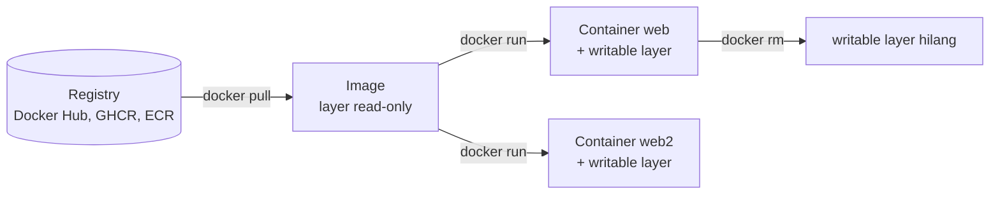
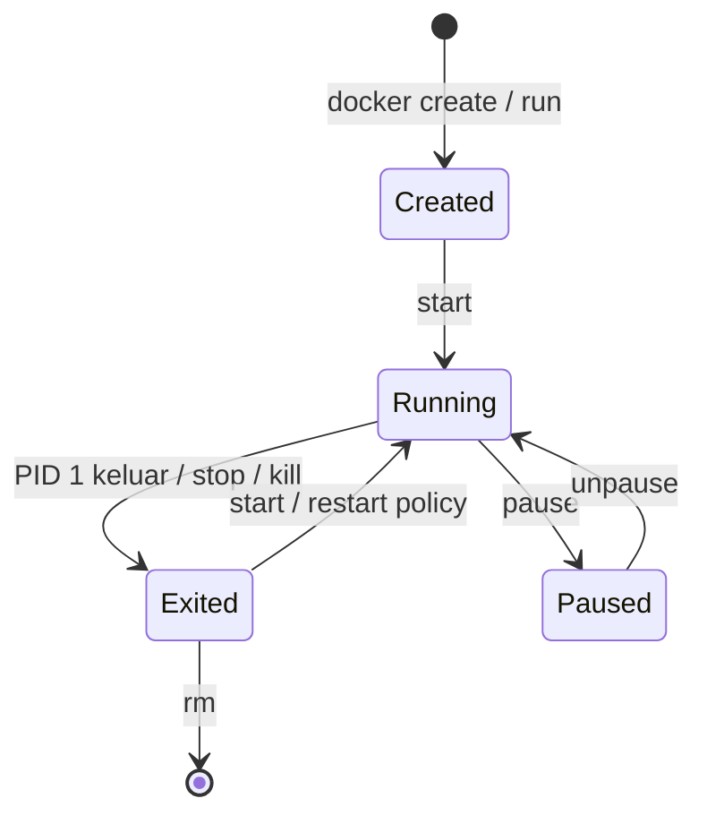

# Container & CLI Dasar

Container adalah cara paling umum mengemas dan menjalankan aplikasi di dunia DevOps. Satu image yang sama berjalan
identik di laptop, CI, dan production. Modul ini membangun pemahaman dasarnya: apa sebenarnya container itu,
bagaimana siklus hidupnya, dan perintah CLI yang dipakai setiap hari untuk menjalankan, mengamati, dan membuang
container, beserta jebakan yang paling sering memakan korban.

> [!NOTE]
> Semua output diuji di Docker Desktop (Windows) dengan Docker Engine & CLI 29.4.1. Di Linux, perilaku
> container sama. Perbedaannya ada di sisi host, mis. path untuk `--env-file`/`docker cp` dan pesan error curl. Modul
> Linux **Process & Signal** (PID 1, exit code) dan **Networking** (bind address, ufw) adalah prasyarat yang berguna.

## 1. Image, container, registry



| | Image | Container |
|---|---|---|
| Apa | Template read-only (filesystem + metadata) | Instance yang berjalan dari image |
| Analogi | Class / file ISO | Object / proses yang sedang jalan |
| Perintah | `pull`, `images`, `rmi`, `build` | `run`, `ps`, `stop`, `rm`, `exec`, `logs` |
| Ukuran (lab) | nginx:1.27-alpine: 52.7MB | writable layer: 81.9kB |

Container **bukan VM**. Ia adalah proses biasa di kernel host, diisolasi dengan namespaces (PID, network, mount)
dan dibatasi cgroups. Di lab, `docker run --rm alpine ps` hanya menampilkan satu proses (`1 root ps`), sedangkan
`docker top` dari host menampilkan PID host yang berbeda (2649).

## 2. Siklus hidup



```bash
docker run -d --name web -p 8080:80 nginx:1.27-alpine
docker ps                       # yang berjalan
docker ps -a                    # semua, termasuk Exited
docker stop web                 # sinyal stop → tunggu → SIGKILL
docker start web
docker restart web
docker rm web                   # harus berhenti dulu (atau -f)
docker run --rm alpine:3.20 cat /etc/alpine-release    # sekali pakai
```

> [!TIP]
> Opsi Docker ditulis **sebelum** nama image. Apa pun setelah nama image adalah perintah dan argumen untuk
> container. `docker run myapp -e X=1` tidak memberi environment, karena `-e X=1` dikirim sebagai argumen ke
> aplikasimu.

## 3. Mengamati container

| Perintah | Untuk |
|---|---|
| `docker logs -f --tail 50 web` | stdout/stderr proses utama |
| `docker exec -it web sh` | Masuk ke container yang berjalan |
| `docker exec -u www-data app ...` | Sebagai user tertentu |
| `docker inspect web` | Semua konfigurasi & state (JSON) |
| `docker inspect -f '{{.State.ExitCode}}' web` | Satu field dengan template Go |
| `docker top web` / `docker stats --no-stream` | Proses / resource |
| `docker diff web` | File yang berubah dibanding image |
| `docker cp web:/path ./` | Salin file keluar/masuk |
| `docker port web` | Pemetaan port |

> [!WARNING]
> **Docker 29 menghapus `.NetworkSettings.IPAddress`.** Di lab, `docker inspect -f '{{.NetworkSettings.IPAddress}}'`
> gagal dengan `map has no entry for key "IPAddress"`. Field itu sudah lama deprecated, dan kini IP hanya ada per network:
> `{{range .NetworkSettings.Networks}}{{.IPAddress}}{{end}}` (lab: `172.17.0.2`). Skrip monitoring lama yang memakai
> field ini akan rusak setelah upgrade.
> Sumber: [Docker Docs — Formatting](https://docs.docker.com/engine/cli/formatting/)

`docker logs` hanya melihat stdout/stderr. Image nginx resmi menautkan `access.log -> /dev/stdout` dan
`error.log -> /dev/stderr` (lab). Itulah konvensi container: log ke stdout, bukan ke file.

## 4. Port publishing

| Opsi | Hasil (lab) |
|---|---|
| `-p 8080:80` | `0.0.0.0:8080->80/tcp, [::]:8080->80/tcp` — semua interface |
| `-p 127.0.0.1:6379:6379` | Hanya localhost host |
| tanpa `-p` | `80/tcp` — tidak bisa diakses dari host (`Could not connect`) |
| `-p 8000:8080` (salah port container) | Port host terbuka, koneksi diputus (`Connection was aborted`) |
| port host sudah dipakai | `Bind for 0.0.0.0:8080 failed: port is already allocated`, container tertinggal `Created` |

`EXPOSE` di Dockerfile **tidak** membuka apa pun ke host. Ia hanya dokumentasi port yang dipakai aplikasi.

## 5. Environment

```bash
docker run -d -e APP_ENV=production myapp
docker run -d --env-file .env myapp
docker inspect -f '{{range .Config.Env}}{{println .}}{{end}}' myapp
```

Catatan dari lab:
- `--env-file` tidak membuang tanda kutip: `QUOTED="with quotes"` → nilainya `"with quotes"`.
- Nilai `-e` terlihat jelas di `docker inspect` (`REDIS_PASSWORD=S3cret`).
- Environment tidak bisa diubah setelah container dibuat, karena `docker update` tidak punya opsi env. Untuk
  mengubahnya, container harus dibuat ulang.

## 6. Restart policy

| Policy | Crash (exit ≠ 0) | Exit 0 | Setelah `docker stop` | Saat daemon/host start ulang |
|---|---|---|---|---|
| `no` (default) | — | — | — | — |
| `on-failure[:N]` | restart (maks N) | tidak | tetap berhenti | restart bila sebelumnya berjalan |
| `always` | restart | restart | tetap berhenti | **restart**, walau sebelumnya di-stop |
| `unless-stopped` | restart | restart | tetap berhenti | restart, kecuali sebelumnya di-stop |

Hasil lab:
- `on-failure:3` + exit 1 → 3 restart (4 kali jalan).
- `on-failure` + exit 0 → 0 restart.
- `always` + exit 0 → 4 restart dalam 6 detik.

`docker update --restart unless-stopped web` mengubah policy container yang sudah ada.

> [!INSIGHT]
> Restart policy menyembunyikan crash. Container `Restarting (1)` dengan `RestartCount` 27 tampak "hidup" di
> dashboard sederhana, padahal tidak pernah melayani satu request pun. Di lab, Docker me-restart container `always`
> empat kali dalam enam detik. Monitor `RestartCount` dan state `restarting`, jangan hanya cek apakah container ada.
> Sumber: [Docker Docs — Start containers automatically](https://docs.docker.com/engine/containers/start-containers-automatically/)

## 7. Writable layer: perubahan yang hilang

Setiap container punya writable layer di atas image. Perubahan lewat `docker exec` hanya hidup selama container itu
ada. Di lab, `new.html` yang dibuat lewat exec → 200. Setelah `rm` dan `run` ulang → 404.

```bash
docker diff web       # C /etc/nginx/conf.d/default.conf, A /run/nginx.pid, ...
```

| Yang ingin bertahan | Tempatnya |
|---|---|
| Kode & config aplikasi | Image (Dockerfile) — modul berikutnya |
| Config per lingkungan | Environment / file yang di-mount `:ro` |
| Data (DB, upload) | Volume — modul Storage |
| Log | stdout/stderr → log driver / agregator |

## 8. Ringkasan kebiasaan aman

| Kebiasaan | Kenapa |
|---|---|
| Pin tag versi (`nginx:1.27-alpine`), bukan `latest` | Reproducible, tidak berubah diam-diam |
| `--rm` untuk perintah sekali pakai | Tidak menumpuk container Exited |
| `-p 127.0.0.1:...` untuk service lokal/internal | `-p` biasa membuka ke semua interface |
| `docker logs` dulu saat container bermasalah | Jawabannya hampir selalu di sana |
| Jangan konfigurasi lewat `docker exec` | Hilang saat container dibuat ulang |
| `docker exec -u <user aplikasi>` | File milik root merusak aplikasi |
| Secret bukan di `-e` (terlihat di inspect) | Modul Keamanan |
| Hapus container lab dengan nama/label spesifik, bukan `prune` global | Prune ikut menghapus container orang lain |
