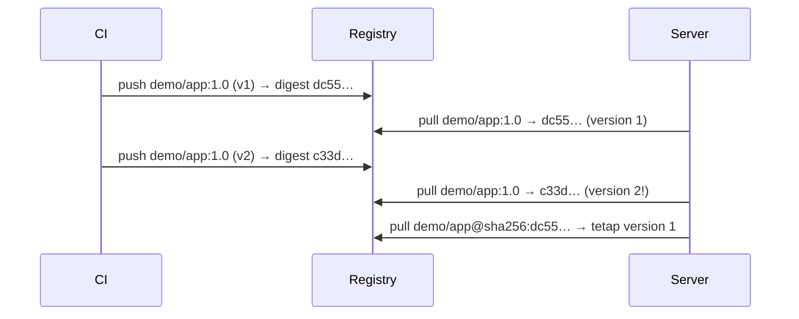
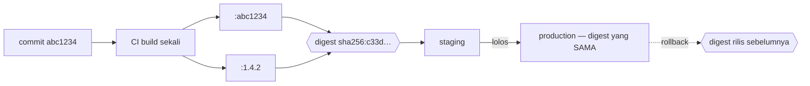

# Image & Registry

Image adalah artefak yang kamu rilis, dan registry adalah gudangnya. Modul ini membahas cara membaca nama image,
mengelola image lokal, bekerja dengan registry (login, push, pull, API), perbedaan tag dan digest yang menentukan
reproducibility, image multi-arsitektur, transfer tanpa registry, serta keamanan supply chain: scanning CVE dan SBOM.

> [!NOTE]
> Lab memakai Docker Engine 29.4.1 dengan **containerd image store** (default di Docker Desktop terbaru), registry lokal
> `registry:2` di `127.0.0.1:5005`, Docker Hub untuk pemeriksaan rate limit, dan Trivy yang dijalankan sebagai container.
> Jumlah CVE berubah setiap hari seiring database diperbarui. Angka di modul ini adalah hasil pemindaian 23 November 2026.

## 1. Anatomi nama image

```text
ghcr.io / acme / api : 1.4.2 @ sha256:c33d0a60c9c7...
└──┬──┘   └─┬─┘  └┬┘   └─┬─┘   └───────┬─────────┘
registry namespace repo  tag          digest (opsional)
```

| Ditulis | Artinya |
|---|---|
| `nginx` | `docker.io/library/nginx:latest` |
| `nginx:1.27-alpine` | `docker.io/library/nginx:1.27-alpine` |
| `bitnami/redis:7.4` | `docker.io/bitnami/redis:7.4` |
| `ghcr.io/acme/api:1.4.2` | GitHub Container Registry |
| `127.0.0.1:5005/demo/app:1.0` | Registry lokal (lab) |
| `alpine:3.20@sha256:d9e8...` | Tag + digest, dan yang dipakai adalah **digest** |

## 2. Image lokal

```bash
docker images --digests                         # tag, digest, ID
docker image inspect -f '{{.Architecture}} {{.Created}}' alpine:3.20
docker tag myapp:1.4.2 ghcr.io/acme/myapp:1.4.2 # alias, ID sama
docker rmi ghcr.io/acme/myapp:1.4.2             # Untagged — data tetap bila ada tag lain
docker history myapp:1.4.2
```

Catatan khusus **containerd image store** (lab):
- Image ID = digest index (`d9e853e87e55` untuk keduanya). Di storage klasik, ID adalah hash config.
- Rebuild dengan tag yang sama tidak meninggalkan image `<none>:<none>` di daftar (storage klasik meninggalkannya
  sebagai *dangling*).
- `docker images --tree` (eksperimental) menampilkan platform di dalam index.

> [!WARNING]
> `docker image prune`, `docker system prune`, dan `docker builder prune` berlaku untuk **seluruh mesin**, termasuk image,
> container, dan cache project lain. Di server bersama, filter dengan label atau umur
> (`--filter label=app=api`, `--filter until=168h`), atau hapus image secara spesifik.

## 3. Registry: login, push, pull

```bash
echo "$GHCR_TOKEN" | docker login ghcr.io -u acme-bot --password-stdin
docker push ghcr.io/acme/api:1.4.2
docker pull ghcr.io/acme/api:1.4.2
docker pull ghcr.io/acme/api@sha256:...
docker logout ghcr.io
```

- Kredensial: Docker Desktop memakai `"credsStore": "desktop"` (lab). Di Linux tanpa helper, kredensial tersimpan
  base64 di `~/.docker/config.json`.
- Docker Hub anonim: `ratelimit-limit: 100;w=3600` (lab: 100 pull per jam per IP). Error `toomanyrequests` saat
  deploy adalah alasan umum untuk login, memakai mirror, atau registry internal.

### API registry (Distribution v2)

```bash
curl -s http://127.0.0.1:5005/v2/                          # {} = API hidup
curl -s http://127.0.0.1:5005/v2/_catalog                  # {"repositories":["demo/app",...]}
curl -s http://127.0.0.1:5005/v2/demo/app/tags/list        # {"name":"demo/app","tags":["1.0"]}
curl -sI -H 'Accept: application/vnd.oci.image.index.v1+json' \
  http://127.0.0.1:5005/v2/demo/app/manifests/1.0          # Docker-Content-Digest: sha256:c33d...
```

`DELETE` manifest pada `registry:2` default → **405** (lab). Penghapusan harus diaktifkan dan disusul garbage collection.

## 4. Tag vs digest



Hasil lab persis seperti diagram di atas. **Tag bisa berpindah, digest tidak.**

| Kebutuhan | Pakai |
|---|---|
| Dibaca manusia, "versi berapa" | Tag semver (`1.4.2`) |
| Melacak ke kode | Tag commit SHA |
| Menjamin isi, rollback pasti | Digest (`@sha256:...`) |
| "Terbaru" untuk dev | `latest` / `main` — jangan di production |

## 5. Multi-arsitektur dan attestation

```text
$ docker buildx imagetools inspect alpine:3.20
MediaType: application/vnd.oci.image.index.v1+json
  Platform: linux/amd64      → sha256:c64c687c...
  Platform: linux/arm/v6     → sha256:37753b29...
  Platform: unknown/unknown  → attestation (SBOM/provenance)
  ...
```

- `docker pull` memilih manifest sesuai CPU mesin. `--platform` memaksa platform lain.
- Salin image beserta semua platform antar registry: `docker buildx imagetools create -t target sumber` (lab: digest
  index sama).

## 6. Transfer tanpa registry

| | `save` → `load` | `export` → `import` |
|---|---|---|
| Sumber | **Image** | **Container** (filesystem) |
| Layer | Tetap (lab: 2) | Diratakan jadi 1 |
| CMD/ENV/label | Utuh | **Hilang** (lab: `Cmd=null`, `no command specified`) |
| Tag | Ikut | Harus diberi saat import |
| Gunanya | Memindahkan image | Mengambil snapshot filesystem |

## 7. Scanning CVE dan SBOM

```bash
docker run --rm -v trivy-cache:/root/.cache aquasec/trivy:latest image --severity HIGH,CRITICAL nginx:1.27-alpine
trivy image --severity CRITICAL --ignore-unfixed --exit-code 1 myapp:1.0     # gerbang CI
trivy image --format cyclonedx -o sbom.json myapp:1.0                         # SBOM
```

| Image (dipindai 23 Nov 2026) | Dibuat | Isi | HIGH/CRITICAL |
|---|---|---|---|
| `nginx:1.25-alpine` | 2024-05-03 | nginx 1.25.5, Alpine 3.19.1 | 20 |
| `nginx:1.27-alpine` | 2025-04-16 | nginx 1.27.5, Alpine 3.21.3 | **70** |
| `nginx:stable-alpine` | 2026-11-18 | nginx 1.30.7, Alpine 3.24.4 | **1** |
| `nginx:mainline-alpine` | 2026-11-18 | nginx 1.31.9, Alpine 3.24.4 | 1 |
| `alpine:3.20` | 2026-04-16 | Alpine 3.20.10 | 2 |

> [!INSIGHT]
> **Pin ke versi yang sudah EOL = membeku dengan semua CVE-nya.** `nginx:1.27-alpine` tidak di-rebuild sejak April 2025,
> karena versi 1.27 sudah tidak dipelihara. Di lab, tag itu mengandung 70 CVE HIGH/CRITICAL, lebih banyak dari image
> 1.25 yang lebih tua, karena database CVE terus bertambah sementara isi image tidak berubah. Contoh `nginx:1.27-alpine`
> di modul 01–03 dimaksudkan sebagai contoh pola *pinning*. Untuk dipakai sungguhan, pilih baris versi yang masih
> dipelihara (saat ini 1.30 stable), dan otomatiskan kenaikannya (Renovate/Dependabot).
> Sumber: [Trivy — container image](https://trivy.dev/latest/docs/target/container_image/)

## 8. Strategi tag dan promosi



1. Build **sekali** per commit, jangan build ulang per lingkungan.
2. Tag dengan commit SHA (dan semver saat rilis).
3. Catat digest. Deploy dan rollback berdasarkan digest.
4. Pindai di CI (gerbang) dan secara terjadwal (CVE baru untuk image lama).
5. Simpan SBOM per rilis.
6. Atur retensi di registry supaya tag lama tidak menumpuk tanpa batas.

## 9. Ringkasan kebiasaan aman

| Kebiasaan | Kenapa |
|---|---|
| `--password-stdin`, credential helper | Token tidak bocor ke history/proses |
| Deploy/rollback dengan digest | Tag bisa dipindah (lab: dc55… → c33d…) |
| Tag SHA + semver, bukan `latest` di production | Bisa dilacak dan reproducible |
| Pin ke versi yang **masih dipelihara** + update otomatis | Tag EOL membeku dengan CVE-nya (70 vs 1) |
| Trivy `--exit-code 1 --ignore-unfixed` di CI | Gerbang yang bisa ditindaklanjuti |
| SBOM per rilis | Pindai ulang tanpa image saat CVE baru muncul |
| Mirror base image / login ke Docker Hub | 100 pull/jam per IP anonim |
| `save`/`load`, bukan `export`/`import`, untuk memindahkan image | Metadata tetap utuh |
| Prune dengan filter, bukan global | Prune ikut menghapus milik project lain |
