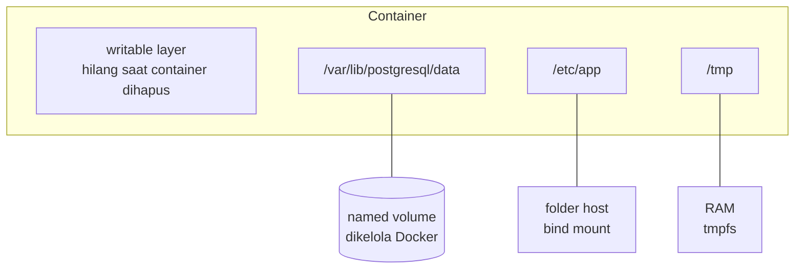

# Storage — Volume, Bind Mount & tmpfs

Container dirancang untuk bisa dibuang: dibuat, dihapus, lalu dibuat ulang dari image. Data yang harus bertahan
(database, upload, state) perlu disimpan **di luar** writable layer container. Modul ini membahas tiga jenis mount,
kapan memakai masing-masing, jebakan permission dan inisialisasi, cara backup/restore, dan hal-hal yang khusus terjadi
di Docker Desktop Windows.

> [!NOTE]
> Diuji di Docker Desktop (Windows) dengan Docker Engine 29.4.1. Di Docker Desktop, volume berada di dalam VM Linux,
> sedangkan bind mount menghubungkan folder Windows ke VM itu. Ini memengaruhi performa dan perilaku path (bagian 7).
> Perilaku volume sama dengan Docker Engine di Linux, kecuali yang ditandai.

## 1. Tiga jenis mount (plus writable layer)



| | Named volume | Bind mount | tmpfs | Writable layer |
|---|---|---|---|---|
| Disimpan di | `/var/lib/docker/volumes/<nama>` | Path host pilihanmu | Memori | Layer container |
| Hidup sampai | `docker volume rm` | Folder host dihapus | Container berhenti | Container dihapus |
| Isi awal | Disalin dari image bila kosong | Isi folder host (menutupi image) | Kosong | Isi image |
| Lab setelah restart | tetap | tetap | **hilang** | tetap |
| Cocok untuk | Database, upload, data aplikasi | Dev (kode), config dari host | Cache, secret sementara | Tidak untuk data penting |

## 2. Sintaks `-v` vs `--mount`

```bash
docker run -v pgdata:/var/lib/postgresql/data postgres:17-alpine                       # named volume
docker run --mount type=volume,src=pgdata,dst=/var/lib/postgresql/data postgres:17-alpine
docker run -v ./config:/etc/app:ro alpine                                              # bind, read-only
docker run --mount type=bind,src="$PWD/config",dst=/etc/app,readonly alpine
docker run --tmpfs /tmp:size=64m alpine
docker run --mount type=tmpfs,dst=/tmp,tmpfs-size=67108864 alpine
docker run --read-only --tmpfs /tmp alpine                                             # rootfs read-only
```

| Sumber di `-v` | Dianggap |
|---|---|
| `pgdata` | **Named volume** — dibuat bila belum ada |
| `./config`, `/srv/config`, `C:\data` | Bind mount |
| (kosong) `-v /data` | **Anonymous volume** |

> [!WARNING]
> Typo pada sumber tidak menghasilkan error. `-v config:/etc/app` (lupa `./`) diam-diam membuat volume kosong bernama
> `config`. Path bind yang salah ketik juga diam-diam membuat folder kosong baru: di lab, Docker Desktop membuat folder
> untuk `-v` **maupun** `--mount`. Hasilnya, aplikasi berjalan dengan config default dan kamu mengira config-mu terpakai.
> Selalu cek dengan `docker inspect -f '{{json .Mounts}}' <container>`.

## 3. Pengisian volume dari image, dan bind mount yang menutupi

- **Volume kosong** di-mount ke path yang berisi file di image → isi image **disalin** ke volume, beserta ownership.
  Lab: `50x.html index.html`.
- **Bind mount** → isi image di path itu **tertutup**. Lab: folder kosong → `0` file.
- Penyalinan hanya terjadi saat volume kosong. Volume yang sudah berisi tidak menerima file baru dari image versi baru.
  Jangan simpan aset aplikasi (mis. `public/build`) di volume, karena deploy versi baru tidak akan memperbaruinya.

## 4. Permission dan UID

```dockerfile
RUN mkdir -p /data && chown 10001:10001 /data
USER 10001
```

| Situasi (lab) | Hasil |
|---|---|
| `-u 1000` + volume baru, image tanpa `/data` | `/data` milik root → `Permission denied` |
| Image menyiapkan `/data` milik 1000 | Volume baru mewarisi `1000:1000` → `write-ok` |
| Volume lama yang **kosong** + image di atas | Ikut terisi ownership 1000 |
| Volume lama yang berisi file milik root | Tidak berubah. Perlu `chown` sekali jalan |
| Bind mount folder Windows (Docker Desktop) | Terlihat `-rwxrwxrwx 0 0`, user 1000 tetap bisa menulis |

Di Linux, bind mount memakai UID/GID **numerik** apa adanya (modul Linux User & sudo). File yang dibuat container sebagai
UID 1000 akan dimiliki "siapa pun UID 1000 di host". Di host SELinux, tambahkan label `:z`/`:Z`.

## 5. Database di container: PostgreSQL

```bash
docker volume create pgdata
docker run -d --name db -e POSTGRES_PASSWORD=... -v pgdata:/var/lib/postgresql/data postgres:17-alpine
docker exec db pg_dump -U postgres appdb > appdb.sql          # backup logis, konsisten
```

Hasil lab:
- Tabel tetap ada setelah container dihapus dan dibuat ulang (`42`), selama volume yang sama dipakai.
- Tanpa `-v`, image membuat **anonymous volume**. `docker rm -f` meninggalkannya (data masih bisa diselamatkan),
  sedangkan `rm -f -v` menghapusnya.
- `POSTGRES_PASSWORD` baru diabaikan pada volume yang sudah berisi: `Skipping initialization`.

> [!DANGER]
> **PostgreSQL 18 mengubah lokasi data.** Di lab, `postgres:18-alpine` punya `VOLUME /var/lib/postgresql` dan
> `PGDATA=/var/lib/postgresql/18/docker`, sedangkan versi 17: `/var/lib/postgresql/data`. Mengganti tag 17 → 18 dengan mount
> lama membuat container berhenti: `Error: in 18+, these Docker images are configured to store database data in a format
> which is compatible with "pg_ctlcluster"... there appears to be PostgreSQL data in: /var/lib/postgresql/data`. Upgrade
> mayor PostgreSQL selalu butuh migrasi (dump/restore atau `pg_upgrade`). Untuk 18+, mount volume ke `/var/lib/postgresql`.
> Sumber: [docker-library/postgres#1259](https://github.com/docker-library/postgres/pull/1259)

## 6. Backup, restore, migrasi

```bash
# backup (container sementara + tar)
docker run --rm -v pgdata:/data:ro -v "$PWD":/backup alpine:3.20 tar czf /backup/pgdata.tgz -C /data .
# restore ke volume baru
docker volume create pgdata-restored
docker run --rm -v pgdata-restored:/data -v "$PWD":/backup:ro alpine:3.20 tar xzf /backup/pgdata.tgz -C /data
```

- Hentikan service yang menulis (atau pakai tool database) supaya salinannya konsisten.
- Volume **bukan** backup: disk atau server yang rusak ikut membawa volumenya. Kirim hasil backup ke luar server,
  dan uji restore secara berkala.
- Jangan menyalin `/var/lib/docker/volumes` langsung. Itu detail internal Docker, dan di Docker Desktop path itu ada di
  dalam VM.

## 7. Performa: bind mount di Docker Desktop Windows

| Lab: 3.000 file kecil (buat, baca, hapus) | Waktu |
|---|---|
| Bind mount dari folder Windows (`C:\...`) | **19.347 ms** |
| Named volume | **639 ms** |

> [!INSIGHT]
> Di Docker Desktop, setiap akses ke bind mount dari folder Windows melewati batas filesystem ke VM Linux. Untuk beban
> yang menyentuh banyak file kecil (`vendor/`, `node_modules/`, cache Laravel), perbedaannya sekitar 30× di lab. Pilihannya:
> - Taruh source di filesystem WSL 2 (`\\wsl$\...`), seperti yang disarankan dokumentasi Docker.
> - Bind mount hanya kode, sedangkan `vendor`/`node_modules` disimpan di named volume.
> - Di production Linux, masalah ini tidak ada, karena bind mount di sana adalah mount biasa.
>
> Sumber: [Docker Desktop — WSL 2 best practices](https://docs.docker.com/desktop/features/wsl/best-practices/)

## 8. Mengelola volume

```bash
docker volume ls --filter dangling=true          # tidak dipakai container mana pun
docker volume inspect pgdata
docker ps -a --filter volume=pgdata              # siapa yang memakai
docker system df -v                              # ukuran per volume
docker volume rm pgdata                          # PERMANEN
```

> [!WARNING]
> `docker volume prune` (dan `docker system prune --volumes`) menghapus **semua** volume yang tidak terpasang ke container,
> termasuk data database yang containernya sedang dihapus untuk di-upgrade, dan anonymous volume yang masih ingin kamu
> selamatkan (studi kasus C1). Di server, beri label pada volume penting dan jangan pernah prune volume tanpa filter.

## 9. Ringkasan kebiasaan aman

| Kebiasaan | Kenapa |
|---|---|
| Named volume untuk data, beri nama yang jelas | Anonymous volume mudah hilang atau terlupa |
| Kode dan aset di image, bukan volume | Volume tidak menerima update dari image baru |
| Config dari host: bind mount `:ro` | Container tidak bisa mengubah config |
| `--read-only` + tmpfs/volume untuk path yang perlu ditulis | Hardening murah |
| Siapkan ownership direktori data di Dockerfile | Volume baru mewarisi ownership, tanpa 777 |
| Cek `.Mounts` setelah deploy | Typo path = folder/volume kosong baru, tanpa error |
| Backup logis (`pg_dump`) + uji restore, simpan di luar server | Volume bukan backup |
| Baca catatan rilis image database sebelum upgrade mayor | PostgreSQL 18 mengubah path data |
| Di Windows: named volume / WSL untuk file kecil yang banyak | 19 s vs 0,6 s di lab |
| Jangan prune volume tanpa filter | Data hilang permanen |
