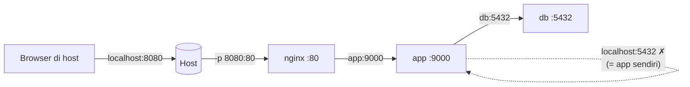
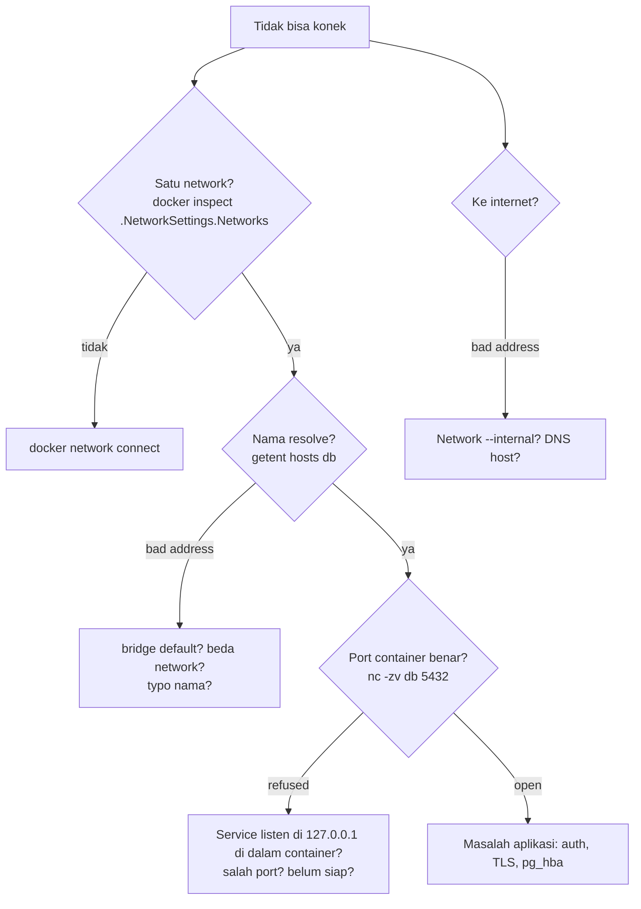

# Networking Container

Setiap container punya network stack sendiri: interface, IP, loopback, dan tabel routing. Docker menghubungkannya
lewat network virtual dan menyediakan DNS supaya container bisa saling memanggil dengan nama. Modul ini membahas jenis
network, DNS bawaan, perbedaan port container vs port host (sumber kebingungan nomor satu), akses ke host,
segmentasi untuk keamanan, dan cara troubleshooting koneksi.

> [!NOTE]
> Diuji di Docker Desktop (Windows), Docker Engine 29.4.1, dengan `alpine:3.20` (busybox `wget`, `nc`, `nslookup`) sebagai
> klien. Docker Desktop menjalankan Docker di VM, sehingga beberapa hal berbeda dari Engine Linux: `host.docker.internal`,
> akses ke loopback host, dan `--network host`. Perbedaan ditandai di setiap bagian.

## 1. Jenis network

| Driver / network | Isolasi | DNS nama container | Kegunaan |
|---|---|---|---|
| `bridge` **default** | Ya | **Tidak** (lab: `bad address`) | Warisan, `docker run` tanpa `--network` |
| User-defined `bridge` | Ya | **Ya** (127.0.0.11) | Default yang disarankan untuk aplikasi |
| `bridge --internal` | Ya, tanpa akses keluar | Ya (antar anggota) | Database, cache |
| `host` | Tidak (berbagi stack host) | — | Performa jaringan ekstrem, tool monitoring |
| `none` | Total (hanya `lo`) | — | Job yang tidak butuh jaringan |
| `overlay` | Antar host | Ya | Swarm |
| `macvlan`/`ipvlan` | IP di LAN fisik | — | Integrasi jaringan lama |

## 2. DNS bawaan

```bash
docker network create appnet
docker run -d --name db  --network appnet redis:7-alpine
docker run -d --name api --network appnet --network-alias backend myorg/api:1.0
docker run --rm --network appnet alpine:3.20 nslookup db         # 172.18.0.x
```

- Nama container dan alias di-resolve oleh `127.0.0.11`, sedangkan nama lain diteruskan ke DNS host.
- `--dns 1.1.1.1` di user-defined network menjadi **upstream**. `resolv.conf` tetap `127.0.0.11` (lab).
- Alias yang sama di beberapa container memberi beberapa IP (lab: 2 alamat), yaitu round-robin DNS sederhana.
- IP berubah saat container dibuat ulang (lab: `.3` → `.5`). Pakai nama, jangan IP.

## 3. Port: container vs host



| Dari | Ke | Alamat yang benar |
|---|---|---|
| Host | Container yang di-publish `-p 15432:5432` | `127.0.0.1:15432` |
| Container | Container lain di network yang sama | `db:5432` (nama + **port container**) |
| Container | Dirinya sendiri | `localhost:<port>` |
| Container | Service di host (Desktop) | `host.docker.internal:<port>` |

Hasil lab:
- `wget localhost:80` dari container alpine → `Connection refused`.
- `wget dj-a:8085` (port host) → refused, `wget dj-a:80` → nginx.

Antar container tidak butuh `-p` sama sekali. Publish hanya untuk yang harus dijangkau dari luar host.

## 4. Akses ke host

```bash
# Docker Desktop: tersedia otomatis
docker run --rm alpine:3.20 wget -qO- http://host.docker.internal:8098/
# Docker Engine Linux: tambahkan sendiri
docker run --rm --add-host=host.docker.internal:host-gateway alpine:3.20 cat /etc/hosts
```

| | Docker Desktop (lab) | Docker Engine Linux (dokumentasi) |
|---|---|---|
| `host.docker.internal` | Otomatis (`192.168.65.254`) | Perlu `--add-host ...:host-gateway` / `extra_hosts` |
| Service host yang listen di `127.0.0.1` | **Terjangkau** | Tidak terjangkau (perlu listen di IP bridge/0.0.0.0) |

> [!WARNING]
> Konfigurasi "jalan di laptop" belum tentu jalan di server. Di Docker Desktop, container bisa menjangkau database Laragon
> yang hanya listen di `127.0.0.1` lewat `host.docker.internal` (lab). Di server Linux, cara yang sama gagal sampai
> service host di-bind ke IP bridge, dan saat itu firewall wajib membatasinya. Lebih baik jalankan dependency di container
> di network yang sama.

## 5. Segmentasi

```bash
docker network create front
docker network create --internal back
docker run -d --name db    --network back  postgres:17-alpine
docker run -d --name app   --network front --network back myorg/app:1.4.2
docker run -d --name nginx --network front -p 80:80 -p 443:443 myorg/nginx:1.4.2
```

| Hasil lab | |
|---|---|
| Container di `front` saja → `db` | `bad address 'dj-db'` |
| `app` (front + back) → `db` | `open`, punya 2 IP |
| Network `--internal` → internet | `bad address 'example.com'` |
| Publish port pada container yang hanya di network internal | Tidak terjangkau dari host (`000`) |

> [!INSIGHT]
> `--internal` memblokir dua arah sekaligus: tidak ada jalan keluar (termasuk DNS untuk nama luar) dan port publishing
> tidak efektif. Kombinasi ini membuat database di network internal tidak bisa tidak sengaja terekspos ke internet,
> walau seseorang menambahkan `-p 5432:5432` (lab: `000`). Hal itu adalah risiko nyata di Linux, karena port yang
> di-publish Docker melewati ufw.
> Sumber: [docker network create — --internal](https://docs.docker.com/reference/cli/docker/network/create/#internal)

## 6. Mengelola network

```bash
docker network ls
docker network inspect -f '{{.Driver}} {{.Internal}} {{range .IPAM.Config}}{{.Subnet}}{{end}}' appnet
docker network connect --alias api appnet web
docker network disconnect appnet web
docker ps -a --filter network=appnet
docker ps --filter publish=8080
docker network rm appnet           # gagal bila masih ada endpoint aktif
```

`docker network prune` menghapus semua network yang tidak dipakai di mesin itu. Hal ini aman untuk network, tetapi tetap
ikut menghapus network milik project lain yang sedang dimatikan.

## 7. Troubleshooting koneksi antar container



| Pesan | Arti |
|---|---|
| `bad address 'db'` / `Could not resolve host` | DNS: beda network, bridge default, network internal, atau typo |
| `Connection refused` ke `127.0.0.1` | Memanggil diri sendiri |
| `Connection refused` ke `db:15432` | Memakai port host, bukan port container |
| `Connection refused` ke `db:5432` | Service belum siap, atau listen di localhost container (mis. Redis `bind 127.0.0.1`) |

## 8. Ringkasan kebiasaan aman

| Kebiasaan | Kenapa |
|---|---|
| Selalu user-defined network | DNS nama container (bridge default tidak punya) |
| Panggil `nama:port-container`, jangan IP/localhost/port host | IP berubah, localhost = diri sendiri |
| Publish hanya yang perlu, bind `127.0.0.1` untuk akses lokal | Database tidak terekspos |
| Segmentasi front/back, data di network `--internal` | Proxy yang dibobol tidak melihat database |
| Jalur egress eksplisit untuk service yang perlu internet | Isolasi tetap terjaga |
| Jangan `--network host` sebagai "perbaikan" | Menghapus isolasi |
| Uji konfigurasi akses-ke-host di Linux, bukan hanya Desktop | `host.docker.internal` berbeda perilaku |
| Migrasikan `--link`/`links:` lama | Legacy |
