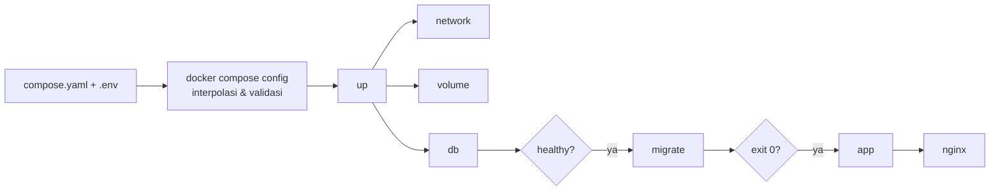

# Compose: Anatomi compose.yaml

Docker Compose mendefinisikan **seluruh aplikasi**: service, network, volume, beserta hubungan di antaranya, dalam satu file
deklaratif yang bisa di-commit, di-review, dan dijalankan ulang secara identik. Modul ini membedah `compose.yaml` bagian
demi bagian, dari struktur top-level sampai setiap key service yang penting, beserta perilaku yang diuji langsung di lab.
Fitur lanjutan (interpolasi `.env` detail, profiles, override & merge, include, secrets/configs, watch, production)
dibahas di modul berikutnya.

> [!NOTE]
> Diuji dengan **Docker Compose v5.1.3** (plugin `docker compose`, bukan `docker-compose` v1 yang sudah tidak dipelihara)
> di Docker Desktop. Setiap tabel "hasil lab" berasal dari project uji `djc`. File dari project devops-dojo dipakai di studi
> kasus C3. Salinannya divalidasi di folder lab, dan file aslinya tidak diubah.

## 1. Struktur file

```yaml
name: dojo                 # nama project (prefix semua resource)
services:                  # WAJIB — container yang dijalankan
  web: { ... }
  db: { ... }
networks:                  # network bernama yang dipakai service
  frontend: {}
  backend: { internal: true }
volumes:                   # volume bernama
  pgdata: {}
configs: { ... }           # file konfigurasi (modul 08)
secrets: { ... }           # secret (modul 08)
x-common: &common          # extension field: blok yang bisa dipakai ulang
  restart: unless-stopped
```

| Hal | Hasil lab |
|---|---|
| `version: "3.8"` | Peringatan `the attribute version is obsolete, it will be ignored` |
| Nama network default | `djc_default` |
| Nama volume `pgdata` | `djc_pgdata` |
| Nama container | `djc-db-1`, `djc-web-1` |
| Nama project | `-p` > `COMPOSE_PROJECT_NAME` > `name:` > nama folder |
| Network/volume dipakai tapi tidak dideklarasikan | `refers to undefined network internal: invalid compose project` |

### Extension field & anchor YAML

```yaml
x-common: &common
  restart: unless-stopped
  logging:
    driver: json-file
    options: { max-size: "10m", max-file: "3" }
services:
  web:
    <<: *common            # gabungkan blok di atas
    image: nginx:1.30-alpine
```

Key berawalan `x-` diabaikan Compose, sehingga aman dipakai sebagai "variabel" YAML. Di lab, `web` mewarisi
`restart=unless-stopped` dan log `{"max-file":"3","max-size":"10m"}`.

## 2. Referensi key service

### Image, build, dan perintah

```yaml
services:
  app:
    image: ghcr.io/acme/app:${TAG:?set TAG}     # nama image (dan tag hasil build bila ada build:)
    build:
      context: .                               # build context
      dockerfile: docker/app.Dockerfile
      target: app                              # stage multi-stage
      args: { PHP_VERSION: "8.3" }             # ARG
    pull_policy: missing                       # always | missing | never | build
    platform: linux/amd64
    command: ["php-fpm"]                       # menimpa CMD image
    entrypoint: ["docker-entrypoint.sh"]       # menimpa ENTRYPOINT image
    working_dir: /var/www/html
    user: "1000:1000"
    init: true
```

Di lab, service `migrate` dengan `build.args.GREETING: "migrated!"` di-build dan mencetak `migrated!`. Bila ada `image:`
**dan** `build:`, hasil build diberi tag sesuai `image:`.

### Environment

```yaml
    environment:            # bentuk map
      APP_ENV: production
      APP_DEBUG: "false"    # kutip nilai yang bukan teks biasa
      FROM_SHELL:           # tanpa nilai = ambil dari shell yang menjalankan compose
    environment:            # bentuk list (setara)
      - APP_ENV=production
    env_file:
      - app.env
      - path: local.env
        required: false     # tidak error bila file tidak ada
```

| Hasil lab | |
|---|---|
| `environment:` vs `env_file` | `environment:` menang (`fromenvironment`) |
| `QUOTED="with quotes"` di env_file | `with quotes`, kutip dibuang (≠ `docker run --env-file`) |
| `COUNT: 08` tanpa kutip | `"8"`, nol hilang |
| `APP_DEBUG: false` | `"false"` |
| `FROM_SHELL:` | Diisi dari shell: `hello-from-shell` |
| `env_file` dengan `required: false` yang hilang | Diabaikan tanpa error |

> [!WARNING]
> Ada dua mekanisme `.env` yang berbeda:
> - **`env_file:`** mengirim variabel **ke dalam container**.
> - **File `.env` di folder project** dipakai Compose untuk **interpolasi** `${VAR}` di file Compose itu sendiri, dan
>   **tidak** otomatis masuk ke container.
>
> Memakai satu `.env` untuk keduanya (seperti compose devops-dojo: `env_file: .env` di semua service) membuat setiap
> service, termasuk database, menerima semua secret aplikasi.

### Ports dan expose

```yaml
    ports:
      - "127.0.0.1:8080:80"        # pendek: [IP:]HOST:CONTAINER[/protokol] — selalu kutip
      - target: 80                 # panjang
        published: "8080"
        host_ip: 127.0.0.1
        protocol: tcp
    expose: ["9000"]               # dokumentasi saja, antar service tidak butuh publish
```

Compose v5 mem-parse `2222:22` tanpa kutip dengan benar (lab: `published: "2222"`, `target: 22`). Parser YAML lama bisa
membacanya sebagai angka basis-60. Tetap kutip demi keamanan dan keterbacaan.

### Volumes, tmpfs, read_only

```yaml
    volumes:
      - pgdata:/var/lib/postgresql/data          # named volume (harus ada di top-level volumes:)
      - ./conf:/etc/nginx/conf.d:ro              # bind mount relatif terhadap file compose
      - type: bind                               # panjang
        source: ./conf
        target: /etc/nginx/conf.d
        read_only: true
    tmpfs: [/tmp]
    read_only: true
```

Di lab: bind `./conf` → nginx memakai config dari host. Service `api` dengan `read_only: true` + `tmpfs: [/tmp]` →
`touch /x` gagal (`Read-only file system`), sedangkan `/tmp` bisa ditulis.

### Networks

```yaml
    networks:
      backend:
        aliases: [api-internal]      # nama DNS tambahan, hanya di network ini
      frontend: {}
networks:
  frontend: {}
  backend: { internal: true }
```

Di lab: `web` (front) me-resolve `api` (front+back), tetapi tidak me-resolve alias `backend` milik network `back`.

### depends_on dan healthcheck

```yaml
    depends_on:
      db:
        condition: service_healthy              # tunggu healthcheck lolos
        restart: true                           # restart service ini bila db di-restart compose
      migrate:
        condition: service_completed_successfully
      cache:
        condition: service_started              # = bentuk pendek [cache]
    healthcheck:
      test: ["CMD-SHELL", "pg_isready -U $${POSTGRES_USER}"]
      interval: 5s
      timeout: 3s
      retries: 10
      start_period: 10s
      start_interval: 1s
```

| Hasil lab | |
|---|---|
| `service_healthy` | `db Waiting` → `db Healthy` → `web Starting` |
| `service_completed_successfully` + exit 0 | `migrate Exited (0)` → `api` start |
| `service_completed_successfully` + exit 1 | `didn't complete successfully: exit 1`, `api` tetap `Created` |
| `["CMD", "test", "-f", "$$TARGET"]` | `unhealthy`, karena variabel tidak diekspansi |
| `["CMD-SHELL", "test -f $$TARGET"]` | `healthy` |
| `up --wait` | Menunggu semua service running/healthy, lalu keluar |

### Restart, resource, logging, keamanan, dan lain-lain

```yaml
    restart: unless-stopped                  # no | always | on-failure[:N] | unless-stopped
    stop_signal: SIGQUIT
    stop_grace_period: 20s                   # lab: Config.StopTimeout=20
    deploy:
      resources:
        limits: { memory: 64m, cpus: "0.5" } # lab: Memory=67108864, NanoCpus=500000000
    mem_limit: 64m                           # bentuk lama, masih didukung
    logging:
      driver: json-file
      options: { max-size: "10m", max-file: "3" }
    cap_drop: [ALL]                          # lab: CapDrop=["ALL"]
    security_opt: ["no-new-privileges:true"]
    extra_hosts: ["host.docker.internal:host-gateway"]
    labels: { com.acme.team: "web" }
    container_name: fixed                    # HINDARI — tidak bisa di-scale, tanpa prefix project
    profiles: [tools]                        # hanya jalan dengan --profile tools (modul 08)
```

> [!TIP]
> Tanpa `logging.options.max-size`, driver `json-file` menyimpan log container **tanpa batas**, dan server yang
> berjalan berbulan-bulan bisa kehabisan disk karena satu container yang cerewet (modul Linux Filesystem: "disk penuh").
> Pasang rotasi log di `x-common` agar semua service mendapatkannya.

## 3. Perintah sehari-hari

| Perintah | Fungsi |
|---|---|
| `docker compose up -d [--wait] [--build]` | Buat/perbarui dan jalankan, hanya recreate yang berubah |
| `docker compose down [-v] [--remove-orphans]` | Hapus container + network (`-v`: volume juga) |
| `docker compose stop` / `start` / `restart` | Tanpa membuat ulang container |
| `docker compose ps [-a]` | Status container project |
| `docker compose logs -f [--tail N] [service]` | Log gabungan |
| `docker compose exec [-T] service cmd` | Masuk ke container yang berjalan |
| `docker compose run --rm service cmd` | Container sekali jalan (tanpa `ports:`) |
| `docker compose config [-q]` | Render/validasi file akhir |
| `docker compose pull` / `build` | Siapkan image |
| `docker compose top` / `port service 80` / `ls` | Proses / port / daftar project |



## 4. Ringkasan kebiasaan aman

| Kebiasaan | Kenapa |
|---|---|
| `compose.yaml` tanpa `version:`, dengan `name:` eksplisit | `version` obsolete. Nama project menentukan nama volume |
| Deklarasikan semua network/volume di top-level | Bila tidak, project invalid |
| `docker compose config -q` di CI | Menangkap error sebelum deploy |
| Healthcheck + `condition: service_healthy`, bukan `sleep` | Urutan start yang pasti |
| Migrasi sebagai service/`run --rm` terpisah | Sekali per deploy, bukan per replica |
| `env_file` per service, kutip nilai environment | Secret tidak bocor ke service lain. `08` tidak menjadi `8` |
| `$$` untuk variabel yang harus diekspansi di container | `$VAR` diinterpolasi Compose dari host |
| `${TAG:?...}` untuk tag deploy | Tidak diam-diam memakai `latest` |
| Publish hanya proxy, bind `127.0.0.1`. Data di network `internal: true` | Permukaan serangan minimal |
| `deploy.resources.limits` + rotasi log | Satu service tidak bisa menghabiskan RAM/disk |
| Hindari `container_name` | Bisa bentrok, tidak bisa di-scale |
| `down -v` hanya bila memang ingin menghapus data | Volume ikut terhapus permanen |
