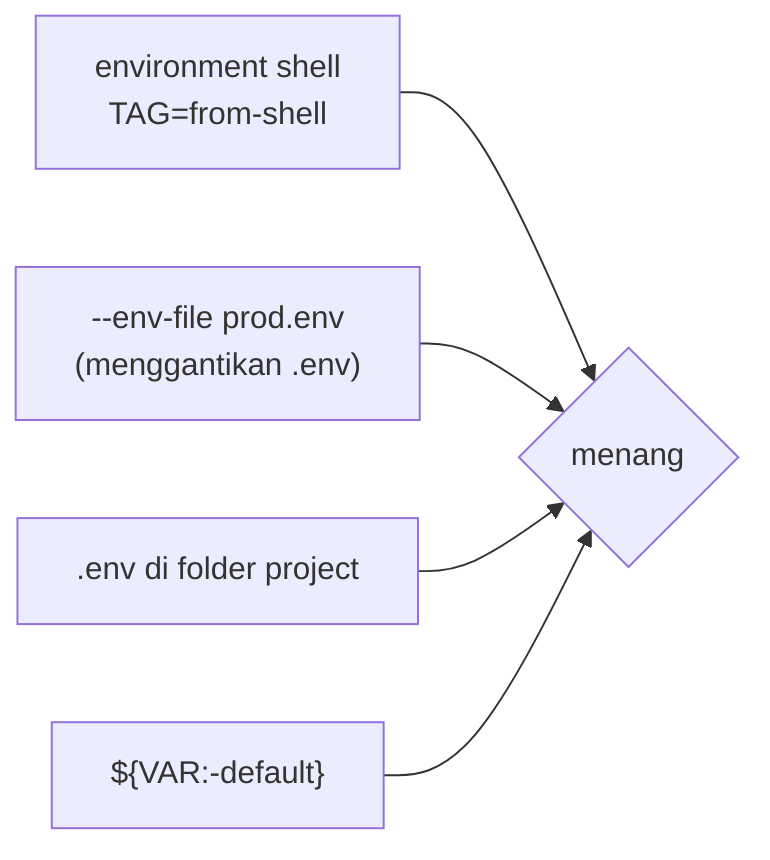
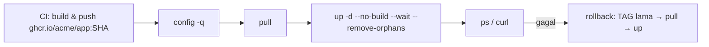

# Compose Lanjutan: Interpolasi, Override, Secrets & Production

Modul sebelumnya membedah isi satu `compose.yaml`. Di dunia nyata, satu aplikasi berjalan di beberapa lingkungan
(laptop, staging, production) dengan perbedaan kecil, dan punya rahasia yang tidak boleh berceceran. Modul ini membahas
cara memisahkan konfigurasi per lingkungan tanpa menyalin file, cara memberi secret dengan benar, dan cara memakai
Compose dengan aman di server.

> [!NOTE]
> Diuji dengan Docker Compose v5.1.3 di Docker Desktop (Windows). Aturan merge dan interpolasi berasal dari Compose
> Specification. Hasil lab ditandai di setiap bagian. Satu perilaku (`include` yang bentrok) berbeda dari dokumentasi
> lama, sehingga ditandai khusus.

## 1. Interpolasi variabel

```yaml
services:
  web:
    image: "nginx:${TAG:?set TAG}"
    ports: ["127.0.0.1:${PORT:-8080}:80"]
    environment:
      GREETING: ${GREETING}         # dari interpolasi, lalu dikirim ke container
      LITERAL: "$${HOME}"           # $$ = $ literal, diekspansi di container
```

| Sintaks | Arti |
|---|---|
| `${VAR}` / `$VAR` | Nilai VAR (kosong + peringatan bila tidak ada) |
| `${VAR:-default}` | Default bila kosong/unset |
| `${VAR-default}` | Default hanya bila unset |
| `${VAR:?pesan}` | **Gagal** bila kosong/unset |
| `${VAR:+alt}` | `alt` bila VAR di-set |
| `$$` | Tanda dolar literal |

### Sumber nilai dan prioritasnya (hasil lab)



| Kasus lab | Hasil |
|---|---|
| `.env` saja | `nginx:from-dotenv` |
| `TAG=from-shell` + `.env` | `nginx:from-shell` |
| `--env-file prod.env` (hanya TAG) | `nginx:from-prodenv`, PORT/GREETING **kosong** |
| `--env-file .env --env-file prod.env` | TAG dari prod.env, PORT dari .env |
| `.env` di dalam container | **Tidak ada** (`TAG_in_container=[]`) |

> [!WARNING]
> **`.env` ≠ `env_file`.** Yang pertama mengisi `${...}` di file Compose (versi image, port), sedangkan yang kedua mengirim
> variabel ke container. Lab membuktikan isi `.env` tidak masuk ke container kecuali disebut di `environment:`. Pisahkan
> keduanya: `.env`/`prod.env` untuk variabel deploy, dan `app.env` (atau secrets) untuk konfigurasi aplikasi.

## 2. Profiles

```yaml
services:
  app: { image: ghcr.io/acme/app:1.4.2 }
  mailpit:
    image: axllent/mailpit
    profiles: [dev]
  backup:
    image: alpine:3.20
    profiles: [tools]
    command: ["sh", "-c", "tar czf /backup/uploads.tgz -C /data ."]
```

```bash
docker compose up -d                     # hanya app
docker compose --profile dev up -d       # app + mailpit
COMPOSE_PROFILES=dev,tools docker compose up -d
docker compose run --rm backup           # profile otomatis aktif (lab: "tool ran")
```

## 3. Menggabungkan file: override & aturan merge

```bash
docker compose up -d                                         # compose.yaml + compose.override.yaml (otomatis)
docker compose -f compose.yaml -f compose.prod.yaml up -d    # eksplisit, override TIDAK dibaca
COMPOSE_FILE="compose.yaml;compose.prod.yaml"                # Windows: pemisah ;   (Linux/macOS: :)
```

| Jenis key | Aturan merge | Hasil lab |
|---|---|---|
| Skalar (`image`, `command`, `restart`) | **Diganti** | `command` → `nginx-debug` |
| Mapping (`environment`, `labels`) | Digabung per key | `EXTRA` ditambah, `GREETING` tetap |
| List unik (`ports`, `expose`, `volumes`, `dns`) | **Digabung** | 8201 **dan** 8202 aktif |
| `!override` | Mengganti nilai | `ports: !override [...]` → hanya 8300 |
| `!reset` | Menghapus nilai | `GREETING: !reset null` → hilang |

> [!INSIGHT]
> Kesalahan merge yang paling umum: menambahkan port di file override dengan harapan port dasar "tertimpa". Di lab,
> kedua port tetap terbuka (`8201` + `8202`), karena untuk `ports` Compose **menggabung** list, bukan mengganti. Untuk
> production, port debug di dasar yang dianggap sudah diganti ternyata tetap ter-publish. Selalu jalankan
> `docker compose -f ... config` dan baca hasil akhirnya, atau pakai `!override`.
> Sumber: [Compose — Merge](https://docs.docker.com/reference/compose-file/merge/)

## 4. Pakai ulang: extends dan include

```yaml
# common.yaml
services:
  base-php:
    image: ghcr.io/acme/app:${TAG:?}
    environment: { APP_ENV: production, TZ: Asia/Jakarta }
    restart: unless-stopped

# compose.yaml
include:
  - infra/compose.yaml             # redis, mailpit, dll. dipelihara terpisah
services:
  app:
    extends: { file: common.yaml, service: base-php }
  worker:
    extends: { file: common.yaml, service: base-php }
    command: ["php", "artisan", "queue:work"]
    environment: { QUEUE: emails }
```

- `extends`: satu service mewarisi service lain, dengan aturan merge yang sama. Lab: worker punya `APP_ENV`, `TZ`, `QUEUE`.
- `include`: satu file utuh (service + network + volume). Lab: `redis` dan `app` dalam satu project.
- Konflik nama di `include`: di Compose v5 (lab) definisi file utama menang tanpa error (`redis:8-alpine`). Jangan
  mengandalkan perilaku ini, dan hindari nama yang sama.

## 5. Secrets dan configs

```yaml
services:
  db:
    image: postgres:17-alpine
    environment:
      POSTGRES_PASSWORD_FILE: /run/secrets/db_password
    secrets: [db_password]
  app:
    secrets:
      - db_password
      - source: api_key
        target: api_key
    configs:
      - source: app_ini
        target: /etc/app/app.ini
secrets:
  db_password:
    file: ./secrets/db_password.txt
  api_key:
    environment: HOST_API_KEY       # diambil dari env host saat up
configs:
  app_ini:
    content: |
      [app]
      env=${APP_ENV:-production}
```

| Hasil lab | |
|---|---|
| `/run/secrets` | `api_key`, `db_password` |
| `env \| grep -c API_KEY` di container | `0`, tidak ada di environment |
| `docker inspect` db | Hanya `POSTGRES_PASSWORD_FILE=/run/secrets/db_password` |
| Login PostgreSQL dengan password dari secret | `login-with-secret-ok` |
| Mekanisme secret `file:` | Bind mount read-only. Permission mengikuti host (Windows: `rwxrwxrwx`) |
| `configs.content` | Diinterpolasi: `env=production` |

Secret di Compose biasa **tidak dienkripsi**, jadi lindungi file sumbernya (`chmod 600`, di luar git). Manfaat utamanya
adalah nilai rahasia tidak terlihat di `docker inspect`, `/proc/*/environ`, log, atau halaman error yang mencetak environment.

## 6. Replicas dan banyak lingkungan dari satu file

```yaml
services:
  worker:
    image: ghcr.io/acme/app:${TAG:?}
    command: ["php", "artisan", "queue:work"]
    deploy: { replicas: 3 }          # lab: djc2r-w-1..3
```

```bash
docker compose up -d --scale worker=1
docker compose -p dojo-staging --env-file staging.env up -d
docker compose -p dojo-prod    --env-file prod.env    up -d
docker compose ls                   # lab: djc2prd running(1), djc2stg running(1)
```

## 7. Development loop: `compose watch`

```yaml
services:
  app:
    build: .
    develop:
      watch:
        - action: sync               # salin file yang berubah ke container
          path: ./resources
          target: /var/www/html/resources
        - action: sync+restart       # salin lalu restart (config)
          path: ./config
          target: /var/www/html/config
        - action: rebuild            # build ulang image
          path: composer.lock
```

Di lab: `Watch enabled` → ubah `index.html` → `Syncing service "web" after 1 changes` → halaman berubah menjadi `v2`. Yang
disinkronkan hanya file yang **berubah**, sedangkan kondisi awal tetap dari image. Di Windows, ini jauh lebih cepat daripada
bind mount folder Windows (modul Storage: 19 s vs 0,6 s).

## 8. Compose di production



| Praktik | Kenapa |
|---|---|
| Build di CI, server hanya `pull` (`--no-build`) | Yang berjalan = yang diuji |
| `config -q` sebelum perubahan | File invalid ditolak sebelum stack lama disentuh |
| `--wait` | Deploy gagal bila healthcheck tidak lolos |
| `--remove-orphans` | Service lama tidak tertinggal (lab: peringatan orphan) |
| `restart: unless-stopped`, `deploy.resources`, rotasi log | Pulih otomatis, tidak menghabiskan RAM/disk |
| Tag SHA + catat digest | Rollback pasti |
| Jangan `down -v` / `prune` dalam skrip deploy | Data hilang permanen |
| Sadari batasnya | Tidak ada rolling update atau multi-host. Untuk itu: Swarm/Kubernetes |

## 9. Ringkasan kebiasaan aman

| Kebiasaan | Kenapa |
|---|---|
| `.env` untuk interpolasi, `env_file`/secrets untuk container | Mekanisme berbeda (lab: `.env` tidak masuk container) |
| File env prod lengkap | `--env-file` mengganti `.env`, tidak menambah |
| Deploy prod selalu dengan `-f` eksplisit | Override dev otomatis tidak ikut |
| Baca `config` setelah merge, pakai `!override` / `!reset` | `ports` digabung, bukan diganti |
| Pemisah `COMPOSE_FILE` sesuai OS (`;` Windows, `:` Linux) | Skrip lintas OS rusak |
| Profiles untuk tool/dev, `run --rm` untuk tugas sekali jalan | `up` biasa tetap bersih |
| Secrets + `*_FILE`, bukan password di `environment:` | Tidak terlihat di inspect/env |
| `watch` untuk dev di Windows | Cepat tanpa bind mount |
| Runbook: config → pull → up --wait --remove-orphans → verifikasi | Deploy yang bisa diulang dan di-rollback |
