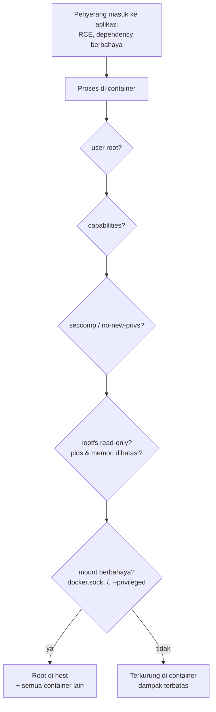

# Keamanan Container

Container memberi isolasi yang nyata, tetapi bukan isolasi sekuat VM. Semua container berbagi **satu kernel** dengan host,
dan sebagian besar keamanannya berasal dari lapisan yang bisa dikurangi atau dimatikan lewat satu opsi: user, capabilities,
seccomp, namespace, dan batas resource. Modul ini membahas setiap lapisan itu, apa yang terjadi bila dilepas (dengan
bukti lab), dan cara menerapkan hardening di `docker run` maupun Compose.

> [!NOTE]
> Diuji di Docker Desktop (Windows) dengan Docker Engine 29.4.1. Di Docker Desktop, container berjalan di VM Linux, sehingga
> "host" di hasil lab adalah VM itu (mis. `/etc/shadow` milik VM). Di server Linux, host-nya adalah server itu sendiri,
> dan dampaknya jauh lebih besar. Satu percobaan (eskalasi setuid) tidak bisa direproduksi di lingkungan ini, dan ditandai.

## 1. Model ancaman



Hardening tidak bertujuan membuat container mustahil dibobol. Tujuannya membuat penyerang yang sudah masuk **tidak
bisa berbuat banyak**.

## 2. User non-root

```dockerfile
RUN addgroup -S -g 10001 app && adduser -S -u 10001 -G app app
USER 10001:10001
```

```bash
docker run --user 10001:10001 myapp
```

- Default tanpa `USER`: `uid=0(root)` (lab).
- Image yang dirancang untuk root sering gagal saat dipaksa non-root. Di lab, `nginx:1.27-alpine` → `test failed`,
  sedangkan `nginxinc/nginx-unprivileged` → `test is successful` (listen 8080).
- Non-root bisa bind port 80 di container (lab: `ip_unprivileged_port_start=0`), jadi itu bukan alasan memakai root.

## 3. Capabilities

| Container | `CapEff` (lab) | Artinya |
|---|---|---|
| Default | `00000000a80425fb` | 14 capability (CHOWN, SETUID, SETGID, NET_RAW, KILL, ...) |
| `--cap-drop ALL` | `0000000000000000` | Tidak ada. Root pun tidak bisa `chown` |
| `--cap-drop ALL --cap-add NET_BIND_SERVICE` | `0000000000000400` | Hanya bind port rendah |
| `--privileged` | `000001ffffffffff` | **Semua**, plus 157 device, plus `mount` |

```bash
docker run --cap-drop ALL --cap-add NET_BIND_SERVICE myapp
docker exec web grep -E 'CapEff|NoNewPrivs|Seccomp' /proc/1/status
```

> [!WARNING]
> Jangan menguji capability dengan "apakah ping masih jalan". Di lab, `--cap-drop NET_RAW` **tidak** menghentikan ping
> busybox, karena ia memakai ICMP datagram socket yang diizinkan `ping_group_range`. Verifikasi dengan `CapEff`, bukan
> dengan perilaku satu program.

## 4. `--privileged`, grup docker, dan docker.sock

| Akses | Hasil lab | Setara |
|---|---|---|
| `--privileged` | 157 device, `mount` berhasil, semua capability | Root host (mount disk host) |
| `-v /:/host` | `/host/etc/shadow` terbaca | Root host |
| `-v /var/run/docker.sock:...` | Menjalankan container privileged baru, `exec` ke container lain | Root host + semua container |
| `-v ...docker.sock:...:ro` | **Tetap** bisa `docker run` | Sama, karena `:ro` tidak melindungi API |
| Anggota grup `docker` | Bisa melakukan semua di atas | **root** |

> [!DANGER]
> **docker.sock adalah kunci root.** Pola umum seperti Traefik, Portainer, Watchtower, runner CI, atau "agent monitoring"
> me-mount socket ke container. Di lab, dari container seperti itu kita menjalankan container `--privileged` baru dan
> masuk ke container lain, bahkan saat socket di-mount `:ro`. Bila tool itu atau image-nya dibobol, host ikut jatuh.
> Pakai hanya untuk tool tepercaya, di host yang tidak menjalankan workload sensitif, atau lewat proxy socket yang
> membatasi endpoint API.
> Sumber: [Docker daemon attack surface](https://docs.docker.com/engine/security/#docker-daemon-attack-surface)

## 5. Seccomp dan no-new-privileges

```bash
docker run --security-opt no-new-privileges:true myapp     # NoNewPrivs: 1 (lab)
docker run --security-opt seccomp=/path/profile.json myapp # profil khusus
# JANGAN: --security-opt seccomp=unconfined / apparmor=unconfined
```

- Seccomp default (`Seccomp: 2`) memblokir syscall berisiko. Di lab, `unshare -U -r` → `Operation not permitted`, tetapi
  dengan `seccomp=unconfined` berhasil.
- `no-new-privileges` mencegah eskalasi lewat binary setuid/setgid. Di lab, flag-nya terbukti aktif (`NoNewPrivs: 1`),
  tetapi eskalasi setuid itu sendiri tidak bisa direproduksi di Docker Desktop.

## 6. Batas resource dan filesystem

```bash
docker run --read-only --tmpfs /tmp --pids-limit 100 --memory 256m --cpus 0.5 myapp
```

| Opsi | Melindungi dari | Lab |
|---|---|---|
| `--read-only` + tmpfs/volume | Binary ditanam, file aplikasi diubah | `Read-only file system` |
| `--pids-limit` | Fork bomb | `can't fork: Resource temporarily unavailable` |
| `--memory` | Kebocoran memori → host OOM | Modul Process: OOMKilled, exit 137 |
| `--cpus` | Satu service memonopoli CPU | — |

## 7. Hardening di Compose

```yaml
x-hardened: &hardened
  read_only: true
  cap_drop: [ALL]
  security_opt: ["no-new-privileges:true"]
  pids_limit: 200
  tmpfs: [/tmp]

services:
  app:
    <<: *hardened
    user: "www-data"
    volumes: [storage:/var/www/html/storage]
    deploy: { resources: { limits: { memory: 384m } } }
  nginx:
    <<: *hardened
    image: nginxinc/nginx-unprivileged:1.30-alpine
    ports: ["127.0.0.1:8080:8080"]
```

## 8. Audit cepat container yang berjalan

```bash
docker ps -q | xargs docker inspect -f \
  '{{.Name}} priv={{.HostConfig.Privileged}} user={{.Config.User}} capadd={{.HostConfig.CapAdd}} ro={{.HostConfig.ReadonlyRootfs}}'
docker ps -q | xargs docker inspect -f '{{.Name}} {{range .Mounts}}{{.Source}}->{{.Destination}} {{end}}' | grep docker.sock
docker ps --format '{{.Names}} {{.Ports}}' | grep 0.0.0.0
```

Gabungkan dengan scanning image (Trivy, modul 04) dan CIS Docker Benchmark (docker-bench-security) untuk pemeriksaan
konfigurasi daemon dan host.

## 9. Ringkasan kebiasaan aman

| Kebiasaan | Kenapa (bukti lab) |
|---|---|
| `USER` non-root di image, UID tinggi | Default = `uid=0(root)` |
| `cap_drop: [ALL]`, tambah seperlunya | Root tanpa capability tidak bisa `chown` |
| Jangan `--privileged` untuk aplikasi | 157 device + `mount` = breakout |
| Jangan mount `docker.sock`, dan `:ro` tidak membantu | Bisa menjalankan container privileged |
| Perlakukan grup docker = root | `-v /:/host` membaca `/etc/shadow` |
| `no-new-privileges:true`, jangan `seccomp=unconfined` | Seccomp memblokir `unshare` |
| `read_only` + tmpfs/volume | Penyerang tidak bisa menulis ke rootfs |
| `pids_limit` + limit memori/CPU | Fork bomb berhenti di `can't fork` |
| Pilih image yang dirancang non-root (nginx-unprivileged) | Image resmi sering butuh root |
| Audit rutin: Privileged, User, CapAdd, Mounts, Ports + scan CVE | Konfigurasi berbahaya bisa terdeteksi sebelum dimanfaatkan |
