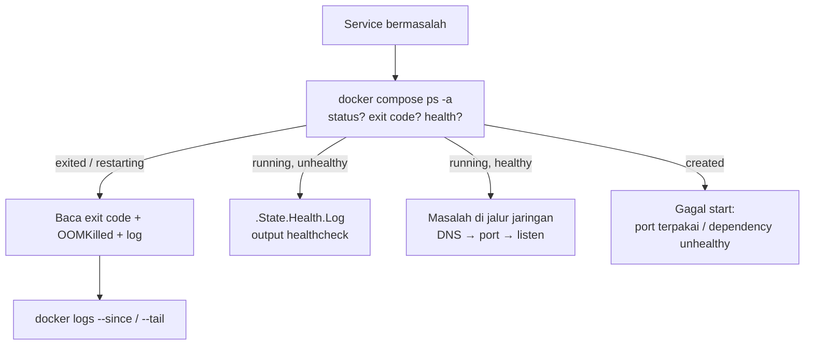

# Troubleshooting & Operasional

Sebagian besar insiden Docker bisa diselesaikan dengan membaca sinyal yang sudah tersedia: exit code, state, log,
healthcheck, dan event. Modul ini membahas cara membaca setiap sinyal itu, memetakan pesan error yang umum ke
penyebabnya, dan menjaga server tetap sehat (log dan disk). Semua contoh error di bawah adalah keluaran asli dari lab.

> [!NOTE]
> Diuji di Docker Desktop (Windows), Docker Engine 29.4.1, Compose v5.1.3. Path `/var/lib/docker/...` dan `daemon.json`
> berlaku untuk server Linux. Di Docker Desktop, keduanya ada di dalam VM dan diatur lewat Settings → Docker Engine.

## 1. Alur diagnosis



## 2. Exit code

| Exit | Arti | Contoh lab |
|---|---|---|
| 0 | Selesai normal | nginx di-stop (punya handler SIGTERM) → 0 |
| 1–124 | Error dari aplikasi | `exit 3` → 3 |
| **125** | `docker run` sendiri gagal | flag tidak dikenal |
| **126** | Tidak bisa dieksekusi | `exec: "/etc/passwd": permission denied` |
| **127** | Tidak ditemukan | `exec: "nosuchcmd": executable file not found in $PATH` |
| **137** | SIGKILL (128+9) | OOM (`OOMKilled=true`) atau stop timeout |
| **139** | SIGSEGV (128+11) | `Segmentation fault (core dumped)` |
| **143** | SIGTERM (128+15) | `--init` + `sleep` di-stop → 143 dalam 1 detik |

```bash
docker inspect -f 'exit={{.State.ExitCode}} oom={{.State.OOMKilled}} restarts={{.RestartCount}} err={{.State.Error}}' app
```

> [!WARNING]
> **PID 1 mengabaikan SIGTERM** bila tidak memasang handler. Di lab, `sleep` sebagai PID 1 → `docker stop -t 3` butuh
> 4 detik dan exit **137**. Dengan `--init` → 1 detik, exit **143**. Bila setiap deploy terasa "menggantung 10 detik",
> inilah penyebabnya. Perbaiki dengan `init: true`, `exec "$@"` di entrypoint, atau handler SIGTERM di aplikasi.

## 3. Restart policy dan restart loop

| Policy | Perilaku (lab) |
|---|---|
| `no` (default) | Tidak di-restart |
| `on-failure:3` | Dijalankan 4×, lalu `exited`, `RestartCount=3` |
| `always` / `unless-stopped` | Terus mencoba: `Restarting (1) 1 second ago` |

Restart policy membuat service "hidup lagi", tetapi tidak memperbaiki apa pun. Untuk menemukan crash yang tertutup
restart:

```bash
docker events --since 1h --until 0s --filter event=die --format '{{.Time}} {{.Actor.Attributes.name}} exit={{.Actor.Attributes.exitCode}}'
```

## 4. Log

```bash
docker logs --since 15m -t web            # rentang waktu + timestamp
docker logs web 2>&1 >/dev/null           # hanya stderr
docker compose logs --tail 50 app worker  # beberapa service
docker inspect -f '{{.LogPath}}' web      # file log di host
```

| Driver | `docker logs` | Rotasi |
|---|---|---|
| `json-file` (default) | Ya | **Tidak**, kecuali `max-size`/`max-file` (lab: `cfg=map[]`) |
| `local` | Ya | Otomatis |
| `none` | Error: `does not support reading` | — |

```json
// /etc/docker/daemon.json — default untuk container BARU
{ "log-driver": "json-file", "log-opts": { "max-size": "10m", "max-file": "3" } }
```

```yaml
# per service di Compose
logging:
  driver: json-file
  options: { max-size: "10m", max-file: "3" }
```

## 5. Healthcheck dan dependency

```bash
docker inspect -f '{{.State.Health.Status}} streak={{.State.Health.FailingStreak}}' db
docker inspect -f '{{json .State.Health.Log}}' db     # exit code + output setiap percobaan
```

Di lab, healthcheck `wget http://127.0.0.1:81` → `unhealthy`, dengan log
`wget: can't connect to remote host (127.0.0.1): Connection refused`. Karena itu Compose menghentikan `up` dengan
`dependency failed to start: container djc10-db-1 is unhealthy`, dan `app` tertahan di status **created**.

## 6. Debug container

| Situasi | Teknik |
|---|---|
| Container jalan, ada shell | `docker exec -it web sh` |
| Container jalan, **tanpa** shell (distroless/busybox tanpa bash) | Sidecar: `docker run --rm -it --pid container:web --network container:web nicolaka/netshoot` |
| Melihat file container tanpa shell | Dari sidecar: `/proc/1/root/...`, atau `docker cp web:/path -` |
| Entrypoint langsung crash | `docker run --rm -it --entrypoint sh myapp` |
| Container sudah berhenti | `docker logs`, `docker diff`, `docker cp` (masih bisa); `exec` → `is not running` |
| Apa yang diubah di container? | `docker diff web` (A/C/D) |
| Proses & resource | `docker top web`, `docker stats --no-stream` |

## 7. Pesan error jaringan

| Pesan (lab) | Artinya | Cek |
|---|---|---|
| `bad address 'db'` / `NXDOMAIN` | DNS: nama tidak dikenal | Satu network? nama service benar? |
| `Connection refused` | Nama ter-resolve, port tidak ada yang listen | Aplikasi jalan? listen `0.0.0.0`? port benar? |
| `download timed out` | Tidak ada jawaban | Jalur jaringan, firewall, IP salah |
| `port is already allocated` | Port host dipakai container lain | `docker ps --filter publish=PORT`; container baru tertinggal `created` |
| `exec format error` | Arsitektur image ≠ host | Build multi-platform |

## 8. Disk

```bash
docker system df                       # baca dulu (lab: build cache 5.6 GB)
docker builder prune --filter until=168h
docker image prune                     # hanya dangling
```

> [!DANGER]
> Perintah yang menghapus **data**: `docker system prune --volumes`, `docker volume prune`, `docker compose down -v`,
> `rm -rf /var/lib/docker`. Saat disk penuh dan panik, jangan jalankan salah satunya tanpa tahu isi volumenya. Untuk
> log yang membengkak, `truncate -s 0` file-nya (jangan `rm`, karena daemon masih memegangnya), lalu pasang rotasi.

## 9. Ringkasan

| Gejala | Perintah pertama |
|---|---|
| Container hilang dari `ps` | `docker compose ps -a`, lalu exit code |
| Exit 137 | `.State.OOMKilled` |
| Stop lambat | PID 1 + SIGTERM → `init: true` / `exec` |
| Naik-turun | `RestartCount`, `docker events --filter event=die` |
| Unhealthy | `.State.Health.Log` |
| 502 / tidak bisa konek | DNS → refused vs timeout → listen address |
| Disk penuh | `docker system df`, ukuran `*-json.log`, rotasi log |
