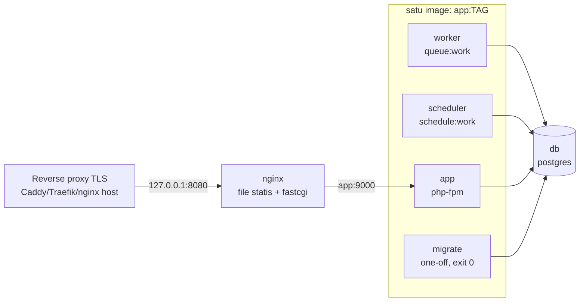

# Deploy Laravel dengan Docker Compose

Modul penutup ini menyatukan semua yang sudah dipelajari menjadi deployment Laravel yang bisa dipakai di server
sungguhan: satu image untuk semua peran PHP, migrasi yang aman, worker yang berhenti dengan benar, update dan
rollback berbasis tag, serta backup yang sudah diuji restore-nya. Semua angka di bawah berasal dari lab yang
menjalankan aplikasi devops-dojo ini sendiri.

> [!NOTE]
> Lab: image `app`/`nginx` di-build dari salinan project ini (Dockerfile versi perbaikan dari modul 03, 229 MB), stack
> lengkap dijalankan dengan Compose v5.1.3 di Docker Desktop. File project aslimu tidak diubah. Path secret dan
> perintah server (`systemctl`, `/etc/docker`) berlaku untuk server Linux.

## 1. Topologi



| Service | Command | Catatan lab |
|---|---|---|
| `db` | (default) | Healthcheck `pg_isready`, volume `pgdata` |
| `migrate` | `php artisan migrate --force` | `restart: "no"`, `exited 0`, gerbang untuk service lain |
| `app` | `php-fpm` | Healthcheck ping fpm, `/up` → 200 |
| `worker` | `queue:work --tries=3 --max-time=3600` | Butuh `pcntl` + `stop_grace_period` |
| `scheduler` | `schedule:work` | **Satu** replica |
| `nginx` | (default) | `root .../public`, `/.env` → 403 |

`up -d --wait` sampai semua healthy: **12 detik**.

## 2. Konfigurasi production

```dotenv
APP_ENV=production
APP_DEBUG=false
APP_KEY=base64:...            # php artisan key:generate --show, simpan sebagai secret
LOG_CHANNEL=stderr            # ke docker logs, bukan storage/logs
SESSION_DRIVER=database
CACHE_STORE=database
QUEUE_CONNECTION=database
DB_HOST=db
```

Secret DB lewat file, dengan entrypoint yang mengubahnya menjadi env sebelum cache dibuat:

```sh
#!/bin/sh
set -eu
if [ -n "${DB_PASSWORD_FILE:-}" ] && [ -f "$DB_PASSWORD_FILE" ]; then
  DB_PASSWORD="$(cat "$DB_PASSWORD_FILE")"; export DB_PASSWORD
fi
[ -n "${APP_KEY:-}" ] || { echo "APP_KEY belum diset" >&2; exit 1; }
php artisan config:cache && php artisan route:cache && php artisan view:cache
exec "$@"
```

> [!WARNING]
> `config:cache` menulis semua nilai konfigurasi, **termasuk password**, ke `bootstrap/cache/config.php` (lab: 4
> kemunculan password, plaintext). Jalankan di entrypoint saat start, **jangan** di `docker build`, karena secret akan
> tertanam di layer image dan ikut terunggah ke registry.

## 3. Migrasi

- Satu service `migrate` one-off, dengan app/worker/scheduler menunggu `service_completed_successfully`. Bila migrasi
  gagal, versi baru tidak start.
- Hindari `migrate` di entrypoint setiap replica. Bila terpaksa, pakai `--isolated` dengan cache store bersama.
- Migrasi harus **backward-compatible**. Rollback image tidak mengembalikan skema (lab: rollback 9 detik, skema
  tetap).

## 4. Worker dan scheduler

| Kondisi worker (lab) | `docker compose stop -t 15` | Hasil |
|---|---|---|
| PHP **tanpa** `pcntl`, PID 1 | 16 s, exit **137** | Job terputus di tengah |
| Tanpa `pcntl` + `init: true` | 1 s, exit **131** (SIGQUIT) | Cepat, tetapi job tetap terputus |
| **Dengan** `pcntl` | 0 s, exit **0** | Job selesai dulu, lalu keluar |

> [!WARNING]
> Image `php:*-fpm` menetapkan `STOPSIGNAL SIGQUIT`, dan worker/scheduler dari image yang sama ikut mewarisinya. Pasang
> `pcntl` di Dockerfile (`docker-php-ext-install pcntl`), set `stop_grace_period` lebih besar dari `--timeout` job
> terlama, dan buat job penting idempotent.

Scheduler: satu replica saja (atau `->onOneServer()`). Worker: boleh diskalakan, dan wajib dibuat ulang setiap deploy
karena kode lama ada di memori. Compose melakukannya otomatis bila tag image berubah.

## 5. Log

- `LOG_CHANNEL=stderr`: log request dari worker php-fpm masuk ke `docker compose logs app` (lab: `dojo-fpm-stderr`).
- Artisan via `docker compose exec` adalah proses terpisah, sehingga lognya **tidak** masuk `docker logs` (lab: 0).
- Pasang rotasi log (modul 10): `logging.options.max-size`.

## 6. Update dan rollback

```bash
export TAG=v1.4.0
docker compose config -q && docker compose pull
docker compose exec -T db pg_dump -U dojo -d dojo -Fc > backups/pre-$TAG.dump
docker compose up -d --wait --remove-orphans
curl -fsS -o /dev/null -w '%{http_code}\n' https://dojo.example.com/up
# rollback:
TAG=v1.3.2 docker compose up -d --wait
```

- Lab update: 10 detik. Dari 150 request: **147× 200, 3× gagal**, jadi tidak benar-benar zero-downtime dengan satu
  replica.
- Lab rollback: 9 detik.

## 7. Jebakan DNS nginx → php-fpm

nginx me-resolve `fastcgi_pass app:9000` **sekali saat start**. Di lab, setelah app dibuat ulang dengan IP baru
(`.5` → `.7`), hasilnya `502` terus-menerus (`connect() failed (111: Connection refused)`), termasuk setelah rollback.

| Perbaikan | Hasil lab |
|---|---|
| `resolver 127.0.0.11 valid=10s ipv6=off;` + `set $php_upstream app:9000; fastcgi_pass $php_upstream;` | 200 setelah IP berubah |
| `depends_on: { app: { condition: service_healthy, restart: true } }` | nginx di-restart otomatis → 200 |
| Darurat: `docker compose exec nginx nginx -s reload` | 502 → 200 |

## 8. Backup dan restore

```bash
docker compose exec -T db pg_dump -U dojo -d dojo -Fc > dojo.dump        # lab: 35 KB, header PGDMP
docker compose exec -T db pg_restore -U dojo -d dojo --clean --if-exists < dojo.dump
```

Di lab:
- Restore ke database kosong → rc=0, `users=1 migrations=8`.
- Restore ulang ke database berisi tanpa `--clean` → `errors ignored on restore: 63`.

Uji restore secara berkala ke container terpisah. Backup yang belum pernah di-restore belum terbukti bisa dipakai.

## 9. Hardening

```yaml
app:
  read_only: true
  tmpfs:
    - /tmp
    - /var/www/html/bootstrap/cache:uid=82,gid=82
    - /var/www/html/storage/framework/views:uid=82,gid=82
  cap_drop: [ALL]
  security_opt: ["no-new-privileges:true"]
```

Di lab, hanya `/tmp` → `Read-only file system`. Ditambah `bootstrap/cache` → view cache masih gagal. Ditambah
`storage/framework/views` → sukses. User `www-data` (UID 82) sudah diset di image.

## 10. Checklist production

| Item | Kenapa (lab) |
|---|---|
| Tag image wajib (`${TAG:?}`) | Tidak pernah deploy `latest` tanpa sengaja |
| `APP_DEBUG=false`, `LOG_CHANNEL=stderr` | Stack trace tidak bocor, log ada di Docker |
| Secret DB via file + entrypoint | Tidak di env Compose. `config:cache` hanya saat start |
| Service `migrate` + `service_completed_successfully` | Migrasi tepat sekali, gagal = deploy berhenti |
| `pcntl` + `stop_grace_period` | Worker exit 0, bukan 137 |
| Scheduler 1 replica | Task tidak dobel |
| `resolver` atau `depends_on.restart` di nginx | Tidak ada 502 setelah IP app berubah |
| Backup sebelum migrasi + uji restore | Rollback image tidak mengembalikan skema |
| `read_only` + tmpfs `bootstrap/cache`, `storage/framework/views` | Rootfs tidak bisa ditulis penyerang |
| nginx `root .../public`, port `127.0.0.1` | `/.env` → 403, nginx hanya lewat reverse proxy TLS |
