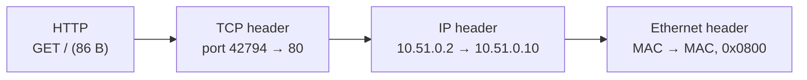

# Model TCP/IP & Pengalamatan IP

Semua perintah di board Linux dan Docker (`ip`, `ss`, `curl`, network Docker) berdiri di atas beberapa konsep dasar:
bagaimana data dibungkus berlapis, dan bagaimana alamat IP serta prefix menentukan siapa yang bisa dihubungi
langsung dan siapa yang harus lewat router. Modul ini membahas konsep itu dengan paket dan network nyata dari lab.

> [!NOTE]
> Diuji di Docker Desktop (Windows) dengan container `alpine:3.20` (busybox `ipcalc`, `iproute2`, `tcpdump`). Semua
> hitungan subnet diverifikasi dua kali, dengan `ipcalc` dan modul Python `ipaddress`.

## 1. Lapisan TCP/IP

| Lapisan TCP/IP | OSI | Contoh | Alamat/identitas |
|---|---|---|---|
| Application | 5–7 | HTTP, DNS, SSH, TLS | URL, nama host |
| Transport | 4 | TCP, UDP | **Port** |
| Internet | 3 | IP, ICMP | **Alamat IP** |
| Link | 1–2 | Ethernet, Wi-Fi, ARP | **Alamat MAC** |

Satu request HTTP di lab (`tcpdump -e -nn`):

```text
fe:e8:af:fb:f5:4c > 42:c9:33:05:d9:98, ethertype IPv4 (0x0800), length 152:      ← Link (14 byte)
  10.51.0.2.42794 > 10.51.0.10.80:                                                ← Internet (20) + Transport (32)
  Flags [P.], ... length 86: HTTP: GET / HTTP/1.1                                 ← Application (86)
```

14 + 20 + 32 + 86 = **152** byte. Setiap lapisan membungkus lapisan di atasnya dan punya field yang menunjuk isi
berikutnya: EtherType `0x0800` → IPv4, protocol 6 → TCP, port 80 → HTTP.



## 2. IPv4 dan CIDR

Alamat IPv4 terdiri dari 32 bit. Prefix `/n` = n bit pertama adalah bagian **network**, sisanya bagian **host**.

| Prefix | Netmask | Ukuran blok | Host terpakai |
|---|---|---|---|
| /8 | 255.0.0.0 | 16.777.216 | 16.777.214 |
| /16 | 255.255.0.0 | 65.536 | 65.534 |
| /20 | 255.255.240.0 | 4.096 | 4.094 |
| /24 | 255.255.255.0 | 256 | 254 |
| /26 | 255.255.255.192 | 64 | 62 |
| /29 | 255.255.255.248 | 8 | 6 |
| /30 | 255.255.255.252 | 4 | 2 |
| /31 | 255.255.255.254 | 2 | 2 (point-to-point, RFC 3021) |
| /32 | 255.255.255.255 | 1 | 1 (host route) |

### Cara cepat menghitung

1. Ukuran blok = 2^(32 − prefix), dihitung di oktet tempat prefix "berhenti".
2. Network = kelipatan ukuran blok terdekat di bawah alamat.
3. Broadcast = network + ukuran blok − 1.
4. Host = network + 1 sampai broadcast − 1.

Contoh `192.168.10.77/26`: blok 64, maka network `.64`, broadcast `.127`, host `.65`–`.126` (62).

```bash
docker run --rm alpine:3.20 ipcalc -nbmp 192.168.10.77/26
python -c "import ipaddress as i; n=i.ip_interface('192.168.10.77/26').network; print(n, n.broadcast_address, n.num_addresses-2)"
```

## 3. Prefix menentukan siapa "tetangga"

```text
inet 10.50.0.2/29 brd 10.50.0.7 scope global eth0
default via 10.50.0.1 dev eth0
10.50.0.0/29 dev eth0 scope link  src 10.50.0.2     ← connected route, dibuat otomatis dari prefix
```

Alamat yang tercakup connected route dikirim langsung, sedangkan sisanya dikirim ke default gateway. Di lab:

| Prefix di container | `ip route` | `ping 10.51.0.10` |
|---|---|---|
| `/24` | connected + default | berhasil |
| `/32` | **kosong** | `Network unreachable` |
| `/28` | `10.51.0.0/28` | berhasil (kebetulan .10 masih di dalam .0–.15) |

Salah prefix bisa "kebetulan bekerja" sampai ada host di luar rentang yang salah itu, sehingga sulit dilacak.

## 4. Rentang alamat khusus

| Rentang | Kegunaan | Catatan lab |
|---|---|---|
| `10.0.0.0/8`, `172.16.0.0/12`, `192.168.0.0/16` | Private (RFC 1918) | `172.32.0.1` → **bukan** private |
| `127.0.0.0/8` | Loopback | `127.0.0.53` (systemd-resolved), `127.0.0.11` (DNS Docker) |
| `169.254.0.0/16` | Link-local (DHCP gagal) | `169.254.169.254` = metadata cloud |
| `100.64.0.0/10` | CGNAT / shared | bukan private, bukan global |
| `192.0.2.0/24`, `198.51.100.0/24`, `203.0.113.0/24` | Dokumentasi | pakai untuk contoh |
| `224.0.0.0/4` | Multicast | — |

## 5. Merencanakan subnet

- Beri cadangan. Di lab, Docker `/29` hanya muat **5** container (6 host − gateway). Container ke-6 →
  `no available IPv4 addresses`.
- Jangan overlap. Docker menolak overlap antar network-nya sendiri (`Pool overlaps ...`), tetapi tidak tahu
  apa-apa tentang LAN kantor, VPN, atau VPC lain.
- Default Docker: bridge `172.17.0.0/16`, lalu network berikutnya dari 172.18+. Rentang ini berada di dalam
  `172.16.0.0/12` yang sering dipakai kantor.

```json
// /etc/docker/daemon.json
{ "default-address-pools": [ { "base": "10.250.0.0/16", "size": 24 } ] }
```

Verifikasi rencana dengan Python:

```python
import ipaddress as i
i.ip_network("192.168.1.0/24").overlaps(i.ip_network("192.168.1.128/25"))   # True
list(i.ip_network("10.10.0.0/22").subnets(new_prefix=24))                   # 4 subnet /24
```

## 6. IPv6 singkat

| Hal | Nilai |
|---|---|
| Panjang | 128 bit, 8 grup heksadesimal |
| Ringkas | `2001:0db8:0000:0000:0000:ff00:0042:8329` → `2001:db8::ff00:42:8329` |
| Subnet LAN | **/64** (2^64 alamat) |
| Link-local | `fe80::/10`, otomatis di setiap interface |
| Loopback | `::1` |
| ULA (setara private) | `fd00::/8` |
| Dokumentasi | `2001:db8::/32` |

Di lab, container di network `--ipv6 --subnet fd00:50::/64` mendapat `fd00:50::2/64` (global) dan `fe80::.../64`
(link), dengan `default via fd00:50::1`.

## 7. Ringkasan

| Pertanyaan | Jawaban cepat |
|---|---|
| IP ini di subnet mana? | Blok 2^(32−prefix), kelipatan terdekat di bawahnya |
| Berapa host? | 2^(32−prefix) − 2, dikurangi gateway/cadangan provider |
| Kenapa "Network unreachable"? | Tidak ada route. Cek prefix dan `ip route` |
| Alamat ini private? | Hanya 10/8, 172.16/12, 192.168/16 |
| Kenapa VPN putus saat Docker jalan? | Subnet Docker overlap, dan route yang lebih spesifik menang |
