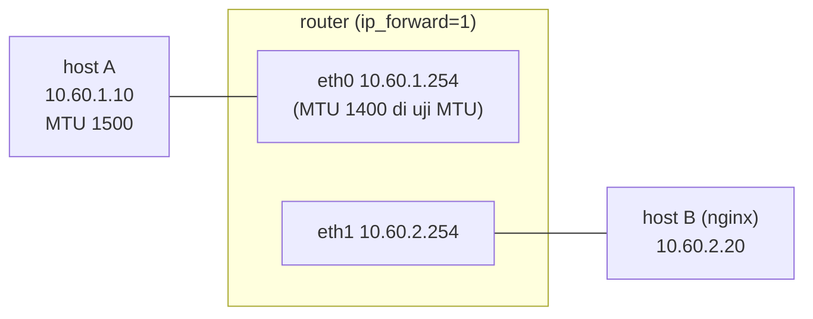
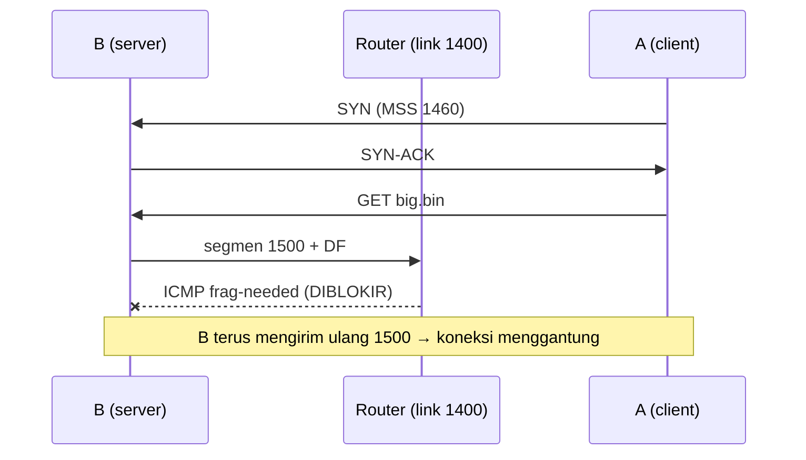

# Routing, ARP & MTU

Modul 01 menjelaskan bagaimana prefix menentukan siapa "tetangga langsung". Modul ini membahas bagaimana paket
mencapai yang **bukan** tetangga: kernel memilih route, router meneruskan, ARP mencari MAC next hop, dan setiap link
membatasi ukuran paket. Semua dibuktikan di topologi tiga container:



> [!NOTE]
> Lab: Docker Desktop, container alpine dengan `NET_ADMIN`/`NET_RAW`, ditambah `iproute2`, `iputils`, `tcpdump`,
> `iptables`. Perilaku kernel (routing, ARP, PMTU, TCPMSS) sama dengan server Linux biasa.

## 1. Tabel routing dan longest prefix match

```text
default via 10.60.1.1 dev eth0
10.60.0.0/16 via 10.60.1.1 dev eth0
10.60.1.0/24 dev eth0 proto kernel scope link src 10.60.1.10     ← connected (modul 01)
10.60.2.0/24 via 10.60.1.254 dev eth0                            ← static
unreachable 198.51.100.0/24
blackhole 203.0.113.0/24
```

| Tujuan | Cocok dengan | Menang | Lab `ip route get` |
|---|---|---|---|
| 10.60.2.20 | /0, /16, /24 | **/24** | `via 10.60.1.254` |
| 10.60.9.9 | /0, /16 | **/16** | `via 10.60.1.1` |
| 198.51.100.5 | unreachable /24 | — | `Host is unreachable` |
| 203.0.113.5 | blackhole /24 | — | `Invalid argument` |

```bash
ip route add 10.60.2.0/24 via 10.60.1.254
ip route del 10.60.2.0/24
ip route get 10.60.2.20
```

## 2. Linux sebagai router

```bash
sysctl -w net.ipv4.ip_forward=1                                   # host biasa
echo 'net.ipv4.ip_forward = 1' > /etc/sysctl.d/90-router.conf     # permanen
docker run --sysctl net.ipv4.ip_forward=1 ...                     # container: hanya saat create
```

| Kondisi (lab) | Hasil ping A → B |
|---|---|
| Tanpa route statis (lewat gateway Docker) | 100% loss (isolasi antar network Docker) |
| Route di A, router `ip_forward=0` | 100% loss, traceroute penuh `*` |
| Router `ip_forward=1`, B tanpa route balik | Berhasil, tetapi balasan lewat `10.60.2.1` (**asimetris**) |
| Route di kedua sisi | Berhasil, `ttl=63`, dua hop |

> [!WARNING]
> **Selalu pasang route balik.** Jalur asimetris bisa terlihat bekerja (di lab tetap 0% loss), tetapi firewall
> stateful, NAT, dan filter `rp_filter` di jalur nyata hanya melihat setengah percakapan, lalu membuang sisanya.

## 3. TTL dan traceroute

```text
traceroute -n 10.60.2.20
 1  10.60.1.254  0.007 ms
 2  10.60.2.20   0.002 ms
ping -t1 10.60.2.20  →  From 10.60.1.254 icmp_seq=1 Time to live exceeded
```

Setiap router mengurangi TTL satu (lab: 64 → 63). Saat TTL mencapai 0, router membalas dengan ICMP Time Exceeded,
dan traceroute memanfaatkan itu untuk memetakan jalur. Baris `*` berarti hop tidak membalas, entah karena
forwarding mati atau karena router sengaja diam.

## 4. ARP

```text
be:c0:d8:b0:23:67 > ff:ff:ff:ff:ff:ff, ARP, Request who-has 10.60.1.254 tell 10.60.1.10
76:77:32:80:18:05 > be:c0:d8:b0:23:67, ARP, Reply 10.60.1.254 is-at 76:77:32:80:18:05
```

- Request dikirim broadcast, reply dikirim unicast. ARP hanya bekerja dalam satu segmen L2.
- Untuk tujuan di subnet lain, MAC yang dicari adalah MAC **next hop**. Di lab, `ip neigh` A hanya berisi router,
  tidak pernah B.
- Host yang tidak ada → `INCOMPLETE`, lalu `FAILED`. Tidak ada paket IP yang pernah terkirim.

## 5. MTU dan Path MTU Discovery

| Lapisan | Rumus | MTU 1500 | MTU 1400 |
|---|---|---|---|
| `ping -s` maksimum | MTU − 20 − 8 | 1472 | 1372 |
| MSS TCP | MTU − 20 − 20 | 1460 | 1360 |

```text
ping -M do -s 1472 10.60.1.10  →  From 10.60.2.254: Frag needed and DF set (mtu = 1400)
ip route get 10.60.1.10        →  cache expires 599sec mtu 1400                 ← PMTUD bekerja
```

### PMTU blackhole



| Lab | `small.txt` | `big.bin` (3 MB) |
|---|---|---|
| ICMP type 3 code 4 diblokir di router | OK | **FAILED/HANG** |
| \+ `TCPMSS --clamp-mss-to-pmtu` | OK | OK |
| \+ `TCPMSS --set-mss 1360` | OK | OK |

```bash
iptables -t mangle -A FORWARD -p tcp --tcp-flags SYN,RST SYN -j TCPMSS --clamp-mss-to-pmtu
```

Perbaikan terbaik: jangan blokir ICMP type 3 dan 11. MSS clamping di gateway VPN/tunnel adalah jaring pengaman
yang wajib, karena kamu tidak mengontrol firewall di tengah internet.

## 6. Ringkasan

| Gejala | Kemungkinan | Cek |
|---|---|---|
| `Network/Host is unreachable` seketika | Tidak ada route / route unreachable | `ip route get` |
| Timeout, `ip neigh` gateway INCOMPLETE | Masalah L2 ke gateway | kabel/VLAN/bridge |
| traceroute berhenti di router | Forwarding/firewall router | `ip_forward`, chain FORWARD |
| Request sampai, balasan tidak | Route balik / asimetris | `ip route get` di tujuan, tcpdump |
| Kecil lancar, besar macet | PMTU blackhole | `ping -M do -s`, MSS clamping |
