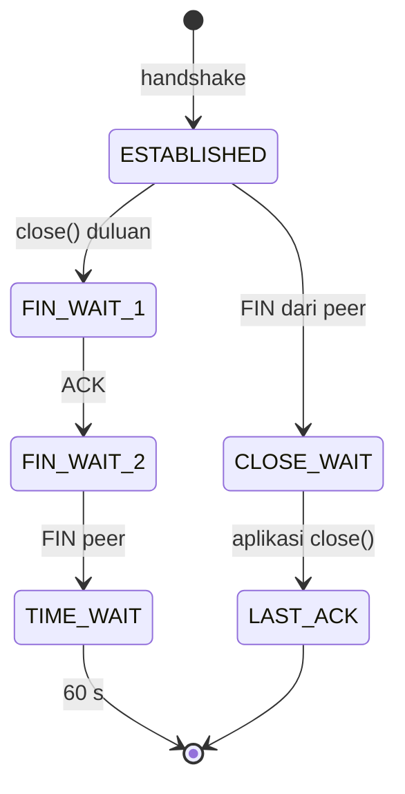

# TCP & UDP

Hampir semua error jaringan yang dilihat aplikasi (refused, timeout, reset, "address not available") adalah TCP yang
sedang bercerita tentang apa yang terjadi. Modul ini membedah TCP dan UDP di paket nyata dan memetakan setiap
perilaku ke error yang muncul di aplikasi.

> [!NOTE]
> Lab: dua container `python:3.12-alpine` (server dan klien) di satu network Docker. Python dipakai agar perilaku
> socket bisa dikendalikan persis: tidak accept, tidak close, backlog kecil. Paket ditangkap tcpdump, kondisi
> jaringan disimulasikan `tc netem`, dan firewall memakai iptables. Kernel: 6.18 (WSL2).

## 1. Siklus hidup koneksi TCP

```text
cli.46730 > srv.8000: Flags [S]        ← SYN
srv.8000 > cli.46730: Flags [S.]       ← SYN+ACK
cli.46730 > srv.8000: Flags [.]        ← ACK          (handshake selesai: 1 RTT)
cli.46730 > srv.8000: Flags [P.] 1:5   ← data "ping"
srv.8000 > cli.46730: Flags [P.] 1:5   ← data "pong"
srv.8000 > cli.46730: Flags [F.]       ← server menutup lebih dulu
cli.46730 > srv.8000: Flags [F.]
srv.8000 > cli.46730: Flags [.]        → server masuk TIME_WAIT (60 s)
```



| State | Artinya | Lab | Normal? |
|---|---|---|---|
| TIME_WAIT | Penutup pertama menunggu 60 s | Ada di server, karena server yang close duluan | Ya, kecuali menghabiskan port |
| CLOSE_WAIT | Peer sudah tutup, **aplikasi lokal belum close()** | 5 dari 5 koneksi | **Tidak**: bug aplikasi |
| FIN-WAIT-2 | Menunggu FIN peer | 5 di klien (pasangan CLOSE_WAIT) | Sementara |

## 2. Refused, timeout, reset, unreachable

| Error klien (lab) | Penyebab di jaringan | Arti |
|---|---|---|
| `Connection refused` (111) | RST, atau REJECT `tcp-reset`/`icmp-port-unreachable` | Host hidup, port tertutup/ditolak |
| `timed out` | DROP. SYN diulang di +1, +2, +3, +4, +5, +7 s | Paket dibuang di jalan |
| `Host is unreachable` (113) | REJECT `icmp-host-prohibited`, atau tidak ada route | Routing **atau** firewall |
| `Connection reset by peer` (104) | RST di tengah koneksi (close dengan data belum dibaca) | Peer membatalkan |
| `Address not available` (99) | Port ephemeral habis | Masalah di sisi **klien** |

> [!TIP]
> Retransmisi SYN di kernel lab bukan 1, 2, 4, 8 detik seperti di buku. Empat percobaan pertama berjarak ~1 detik
> (`tcp_syn_linear_timeouts=4`), baru setelah itu berlipat. Selalu set **connect timeout** di aplikasi, karena
> default kernel (`tcp_syn_retries=6`) bisa menahan `connect()` lebih dari satu menit.

## 3. Backlog listen

```text
server: listen(2), tidak pernah accept()
klien : 8 koneksi → 3 berhasil, 5 TimeoutError
ss -ltn : LISTEN  Recv-Q 3  Send-Q 2  0.0.0.0:8020
nstat   : TcpExtListenOverflows 10
```

Antrean penuh menghasilkan SYN yang **dibuang**, bukan ditolak, sehingga klien melihat timeout. Recv-Q yang
mendekati Send-Q di socket LISTEN berarti aplikasi kewalahan.

## 4. Port ephemeral

- Rentang default `32768–60999` (~28 ribu).
- Kehabisan terjadi **per tujuan**. Di lab, rentang 10 port → 9 koneksi ke `:8010`, lalu `[Errno 99]`. Port yang
  sama masih bisa dipakai ke `:8000`.
- Dengan koneksi pendek, setiap port tertahan 60 s di TIME_WAIT, sehingga batasnya sekitar 470 koneksi baru per
  detik ke satu IP:port.

Perbaikan terbaik adalah memakai ulang koneksi (keep-alive/pool). `tcp_tw_reuse=1` dan rentang port yang lebih lebar
hanya membantu.

## 5. Keepalive

| Sysctl | Default (lab) | Per socket |
|---|---|---|
| `tcp_keepalive_time` | 7200 s | `TCP_KEEPIDLE` |
| `tcp_keepalive_intvl` | 75 s | `TCP_KEEPINTVL` |
| `tcp_keepalive_probes` | 9 | `TCP_KEEPCNT` |

Keepalive tidak aktif kecuali aplikasi menyalakan `SO_KEEPALIVE`. Di lab, dengan 5/2/3 → probe ACK kosong setiap 5
detik, dan peer yang di-DROP terdeteksi kurang dari 14 detik. Dengan default, butuh ~2 jam 11 menit, jauh lebih lama
dari timeout idle NAT/firewall/load balancer.

## 6. Packet loss dan latency

| Kondisi (`tc netem` di server) | Unduh 20 MB |
|---|---|
| Normal | 0.04 s |
| loss 2% | 0.04 s (243 segmen di-retransmit) |
| **loss 10%** | **8.26 s** |
| delay 50 ms | 0.78 s |

TCP menganggap kehilangan sebagai kemacetan dan memperlambat diri. Sedikit loss tertutupi, tetapi banyak loss
membuat throughput runtuh. Saat transfer lambat tanpa error, cek retransmisi (`nstat TcpRetransSegs`,
`ss -ti` → `retrans:`).

## 7. UDP

| Uji (lab) | Hasil |
|---|---|
| Kirim ke port terbuka | Dua paket saja, tanpa handshake |
| Kirim ke port tertutup | ICMP `port unreachable` |
| Socket **connected** ke port tertutup | `ConnectionRefusedError` |
| Socket **unconnected** ke port tertutup | Hanya timeout (error ICMP tidak dilaporkan) |
| Port di-DROP | Timeout |
| `nc -zuv` ke port di-DROP | **`open`** (rc=0), positif palsu |

Uji UDP dengan protokol aslinya (`dig`, klien WireGuard, dst.) atau lihat tcpdump di server. Jangan mengandalkan
`nc -zu`.

## 8. Ringkasan

| Gejala | Cek pertama |
|---|---|
| Refused | `ss -ltn` di server: listen? di alamat mana? |
| Timeout | tcpdump di server: SYN sampai? lalu firewall/SG |
| No route to host | `ip route get`, lalu firewall `icmp-host-prohibited` |
| Reset by peer | Log upstream: crash, timeout, menolak? |
| CLOSE_WAIT menumpuk | Kode aplikasi: close/pool/timeout |
| Address not available | TIME_WAIT di klien → keep-alive/pool |
| Lambat tanpa error | Retransmisi, loss, RTT |
