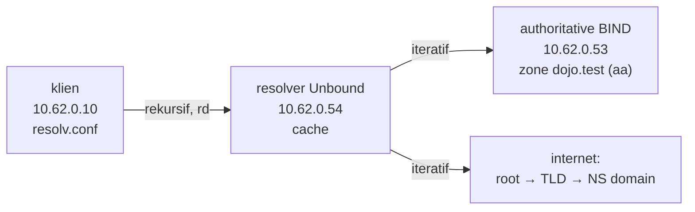

# DNS Mendalam

Modul Linux 08 mengajarkan *cara memakai* `dig`. Modul ini membahas *apa yang sebenarnya terjadi* di balik setiap
jawaban: siapa yang menjawab, kenapa jawabannya bisa basi, dan apa arti setiap status. Semua dibuktikan di ekosistem
DNS kecil yang dibangun di container.



> [!NOTE]
> Lab: BIND sebagai authoritative `dojo.test` (TTL 30, negative TTL 20), Unbound sebagai resolver rekursif
> (stub-zone ke BIND, internet lewat root hints), klien `dig` + tcpdump. `.test` adalah TLD khusus (RFC 6761), jadi
> aman dipakai untuk lab.

## 1. Resolusi: authoritative vs resolver

| | Authoritative | Resolver rekursif |
|---|---|---|
| Tugas | Pemilik jawaban untuk zone-nya | Mencari jawaban untuk klien, lalu menyimpannya di cache |
| Flag (lab) | `qr aa rd` | `qr rd ra` |
| TTL | Selalu penuh (30) | Sisa cache (29 → 22) |
| Contoh | BIND, NSD, PowerDNS, Route 53, Cloudflare | Unbound, systemd-resolved, 1.1.1.1, 8.8.8.8, CoreDNS |

`dig +trace example.com` (lab, internet):

```text
.            NS  j.root-servers.net.        ← dari resolver (daftar root)
com.         NS  i.gtld-servers.net.        ← dari b.root-servers.net
example.com. NS  hera.ns.cloudflare.com.    ← dari k.gtld-servers.net
example.com. A   172.66.147.243             ← dari elliott.ns.cloudflare.com
```

## 2. Jenis record

| Tipe | Lab (`dojo.test`) | Catatan |
|---|---|---|
| A / AAAA | `10.62.0.100` | IPv4 / IPv6 |
| CNAME | `www → dojo.test.` | Tidak boleh berdampingan dengan record lain, dan tidak di apex |
| MX | `10 mail.dojo.test.` | Target berupa nama, bukan IP |
| TXT | `"v=spf1 mx -all"` | SPF, DKIM, DMARC, verifikasi |
| NS / SOA | `ns1.dojo.test.` / `1 3600 600 86400 20` | Delegasi / metadata zone |
| SRV | `10 60 5060 sip.dojo.test.` | prioritas bobot port target |
| CAA | `0 issue "letsencrypt.org"` | CA yang boleh menerbitkan sertifikat |
| PTR | `101 → api.dojo.test.` | Reverse (`dig -x`) |
| Wildcard | `*.apps → 10.62.0.199` | Cocok untuk `x.apps` **dan** `foo.bar.apps` |

## 3. TTL, cache, dan "propagasi"

```text
resolver: api.dojo.test. 29 IN A 10.62.0.101
(7 detik)  api.dojo.test. 22 IN A 10.62.0.101
auth diubah → 10.62.0.111
auth: 10.62.0.111   resolver: 21 10.62.0.101      ← basi sampai TTL habis
unbound-control flush api.dojo.test → 10.62.0.111
```

> [!WARNING]
> "Propagasi DNS" sebenarnya adalah cache yang kedaluwarsa. Turunkan TTL **sebelum** perubahan (minimal satu TTL
> lama sebelumnya), karena menurunkan TTL saat perubahan tidak mempercepat apa pun.

### Negative caching

```text
dig new.dojo.test           → NXDOMAIN (SOA minimum 20 → di-cache 20 s)
record new dibuat di auth   → auth: 10.62.0.120
resolver                    → masih NXDOMAIN (sisa 18 s)
setelah 21 s                → 10.62.0.120
```

## 4. Status jawaban

| Hasil (lab) | Arti | Langkah berikutnya |
|---|---|---|
| `NXDOMAIN` + SOA | Nama tidak ada (pasti) | Typo? record belum dibuat? negative cache? |
| `NOERROR`, `ANSWER: 0` | **NODATA**: nama ada, tipe tidak ada | Mis. tidak ada AAAA |
| `SERVFAIL` | Resolver gagal mendapat jawaban | Lame delegation (lab: REFUSED → SERVFAIL), DNSSEC, NS mati |
| Timeout | Tidak ada balasan | Lab: auth mati → resolver diam 90 s |
| `REFUSED` | Server menolak (bukan authoritative / tidak melayani rekursi) | Salah server |

## 5. Resolver klien: search dan ndots

```text
search dojo.test svc.cluster.local
options ndots:5
getent hosts example.com  →  A? example.com.dojo.test.
                             A? example.com.svc.cluster.local.
                             A? example.com.                    (3 query)
options ndots:1           →  A? example.com.                    (1 query)
getent hosts api          →  api.dojo.test                      (search tetap dipakai)
```

Nama dengan titik di akhir (`example.com.`) adalah nama absolut dan tidak pernah memakai search.

## 6. UDP, TCP, dan truncation

```text
dig TXT big.dojo.test +notcp +ignore  → flags: qr aa tc rd, MSG SIZE 70
dig TXT big.dojo.test                 → ;; Truncated, retrying in TCP mode.  MSG SIZE 1493
EDNS: udp: 1232
```

Firewall **wajib** membuka TCP 53 juga. Tanpa itu, jawaban besar gagal sementara jawaban kecil lancar.

## 7. Aturan zone yang sering dilanggar

- `CNAME and other data`: CNAME di apex, atau CNAME dan A di nama yang sama (lab: `named-checkzone` menolak).
- Naikkan **serial** SOA di setiap perubahan, karena secondary memakai serial untuk tahu ada versi baru.
- Minimal 2 NS di jaringan berbeda. Dengan satu NS mati, resolver diam saja (lab).
- Pakai TLD khusus untuk internal: `.test`, `.example`, `.invalid`, `home.arpa`. Unbound bahkan memblokir `.test`
  secara default (`test. static`).

## 8. Split-horizon

```text
authoritative:      app.dojo.test → NXDOMAIN
resolver internal:  app.dojo.test → 10.62.0.250   (local-data)
```

Selalu sebutkan **resolver mana** yang ditanya saat debugging (`dig @...`), karena jawaban bisa berbeda sesuai
penanyanya.

## 9. Ringkasan diagnosis

```bash
dig name                    # lewat resolver: status, ANSWER, sisa TTL
dig AAAA name               # NODATA?
dig @ns-authoritative name  # aa, TTL penuh = kebenaran
dig +trace name             # delegasi di setiap level
```
