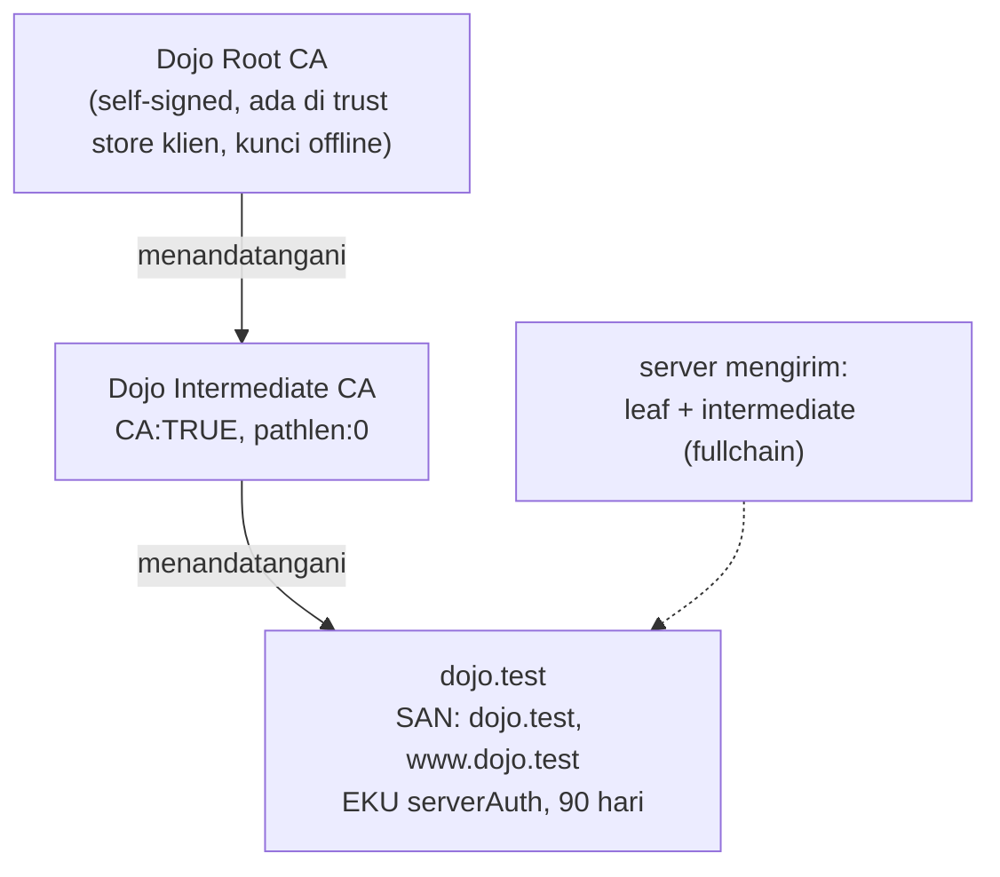

# TLS & Sertifikat

TLS menjawab dua pertanyaan: apakah percakapan ini rahasia, dan apakah aku benar-benar bicara dengan server yang
kumaksud. Jawaban kedua bergantung pada sertifikat dan rantai kepercayaan, yang juga merupakan sumber hampir semua
error HTTPS. Modul ini membangun PKI kecil sendiri, lalu sengaja memancing setiap error yang umum.

> [!NOTE]
> Lab: OpenSSL 3.3.7 membuat Root CA → Intermediate CA → sertifikat leaf ECDSA P-256 (normal, wildcard,
> kedaluwarsa, self-signed, klien). Satu nginx 1.27.5 melayani semuanya di 443 dengan SNI (plus 8443 leaf-only dan
> 9443 mTLS). Diuji dengan curl dan `openssl s_client`.

## 1. Rantai kepercayaan



```text
$ echo | openssl s_client -connect 10.64.0.43:443 -servername dojo.test -CAfile root.pem
 0 s:CN=dojo.test
   i:CN=Dojo Intermediate CA
 1 s:CN=Dojo Intermediate CA
   i:CN=Dojo Root CA
New, TLSv1.3, Cipher is TLS_AES_256_GCM_SHA384
Verify return code: 0 (ok)
```

Klien memverifikasi bahwa setiap sertifikat ditandatangani yang di atasnya, sampai ke root yang ia percaya.
Kemudian ia memeriksa nama (SAN), tanggal, dan kegunaan (EKU).

## 2. Membuat CA dan sertifikat (ringkas)

```bash
# root
openssl req -x509 -newkey ec -pkeyopt ec_paramgen_curve:P-256 -nodes -keyout root.key -out root.pem -days 3650 \
  -subj "/CN=Dojo Root CA" -addext "basicConstraints=critical,CA:TRUE" -addext "keyUsage=critical,keyCertSign,cRLSign"
# leaf: CSR lalu tanda tangani dengan intermediate + extension
openssl req -newkey ec -pkeyopt ec_paramgen_curve:P-256 -nodes -keyout site.key -out site.csr -subj "/CN=dojo.test"
printf "basicConstraints=CA:FALSE\nkeyUsage=critical,digitalSignature\nextendedKeyUsage=serverAuth\nsubjectAltName=DNS:dojo.test,DNS:www.dojo.test\n" > site.ext
openssl x509 -req -in site.csr -CA int.pem -CAkey int.key -CAcreateserial -out site.pem -days 90 -extfile site.ext
cat site.pem int.pem > site.full.pem
```

## 3. Error yang umum, dengan pesan aslinya

| Kasus (lab) | curl | `openssl s_client` | Perbaikan |
|---|---|---|---|
| Leaf tanpa intermediate | `(60) unable to get local issuer certificate` | `21 (unable to verify the first certificate)` | Pasang fullchain |
| CA privat tidak dipercaya | `(60) unable to get local issuer certificate` | `20` | `--cacert` / pasang root ke store |
| Nama tidak ada di SAN | `(60) no alternative certificate subject name matches target hostname` | `62 (hostname mismatch)` | Terbitkan ulang dengan SAN benar |
| Akses lewat IP | `... matches target ipv4 address '10.64.0.43'` | — | SAN `IP:` atau pakai nama |
| Kedaluwarsa | `(60) certificate has expired` | `10` | Perpanjang. Cek jam sistem |
| Self-signed | `(60) self-signed certificate` | `18` | CA internal |
| Key tidak cocok / urutan salah | — | — | `nginx -t`: `key values mismatch` |
| TLS terlalu lama | `(35) no protocols available` | — | Klien ≥ TLS 1.2 |

> [!WARNING]
> **Browser bukan alat uji.** Di lab, leaf-only gagal di curl, tetapi berhasil begitu klien kebetulan memegang
> intermediate, persis seperti browser desktop yang menyimpan intermediate di cache atau mengunduhnya lewat AIA. Uji
> dengan `openssl s_client` dan curl.

## 4. Nama: SAN dan wildcard

| Sertifikat | `x.apps.dojo.test` | `foo.bar.apps.dojo.test` | `apps.dojo.test` |
|---|---|---|---|
| `*.apps.dojo.test` | ✅ | ❌ | ❌ |

Wildcard TLS = tepat satu label. Untuk apex, tambahkan SAN kedua. Bandingkan dengan wildcard DNS (modul 04), yang
mencocokkan banyak label.

## 5. Handshake: SNI, ALPN, versi

```text
* ALPN: curl offers h2,http/1.1
* SSL connection using TLSv1.3 / TLS_AES_256_GCM_SHA384 / x25519 / id-ecPublicKey
* ALPN: server accepted h2
*  subjectAltName: host "dojo.test" matched cert's "dojo.test"
connect=0.000217  appconnect=0.005481   ← biaya handshake TLS
```

- SNI memilih sertifikat. Tanpa SNI → sertifikat `default_server` (lab: `CN=other.test`).
- ALPN memilih protokol aplikasi (`h2`).
- `ssl_protocols TLSv1.2 TLSv1.3;`. Lab: TLS 1.3 default, TLS 1.2 dengan ECDHE (forward secrecy).

## 6. Operasional di nginx

```nginx
server {
    listen 443 ssl;
    http2 on;
    server_name dojo.test www.dojo.test;
    ssl_certificate     /etc/nginx/tls/fullchain.pem;   # leaf → intermediate
    ssl_certificate_key /etc/nginx/tls/privkey.pem;     # chmod 600
    ssl_protocols TLSv1.2 TLSv1.3;
    add_header Strict-Transport-Security "max-age=31536000; includeSubDomains" always;
}
```

```bash
openssl x509 -in cert.pem -noout -pubkey | sha256sum ; openssl pkey -in privkey.pem -pubout | sha256sum   # harus sama
nginx -t && nginx -s reload
openssl x509 -in cert.pem -noout -checkend 2592000 || echo "habis < 30 hari"
```

## 7. mTLS dan HSTS

| mTLS (lab) | Hasil |
|---|---|
| Tanpa sertifikat klien | `400 No required SSL certificate was sent` |
| Sertifikat dari CA lain | `400 The SSL certificate error` |
| `client1` (EKU clientAuth, CA lab) | `mtls ok: CN=client1` |

HSTS: setelah dilihat browser, domain hanya bisa diakses lewat HTTPS selama `max-age`. `includeSubDomains` berlaku ke
semua subdomain. Naikkan bertahap.

## 8. Ringkasan

| Pertanyaan | Alat |
|---|---|
| Sertifikat apa yang dikirim server? | `openssl s_client -connect host:443 -servername host -showcerts` |
| Rantai valid? | `Verify return code: 0`, `openssl verify -untrusted` |
| Nama dan tanggal? | `openssl x509 -noout -ext subjectAltName -dates` |
| Key cocok? | Bandingkan hash public key |
| Akan habis? | `openssl x509 -checkend` |
| Biaya handshake? | `curl -w '%{time_appconnect}'` |
