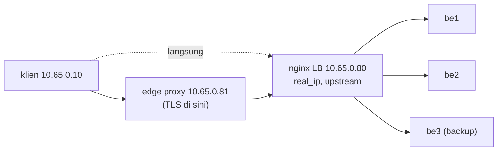

# Reverse Proxy & Load Balancing

Begitu ada proxy di depan aplikasi (nginx, load balancer cloud, Cloudflare), aplikasi tidak lagi melihat klien
secara langsung. IP, Host, dan skema yang ia lihat adalah milik proxy, kecuali proxy meneruskannya lewat header,
dan aplikasi tahu header mana yang boleh dipercaya. Modul ini membahas masalah itu, lalu cara membagi beban ke
banyak backend dan apa yang terjadi saat salah satunya mati.



> [!NOTE]
> Lab: nginx 1.27.5 sebagai load balancer (14 worker), nginx kedua sebagai edge proxy, dan tiga backend Python yang
> membalas JSON berisi nama dirinya, IP peer, Host, X-Forwarded-For/Real-IP/Proto, dan header Upgrade yang diterima.

## 1. Apa yang dilihat backend

| Konfigurasi proxy (lab) | `peer` | `host` | `xff` | `xri` | `xfp` |
|---|---|---|---|---|---|
| `proxy_pass` saja | 10.65.0.80 | `rr` | — | — | — |
| \+ header standar | 10.65.0.80 | 10.65.0.80 | 10.65.0.10 | 10.65.0.10 | http |
| Klien mengirim XFF/X-Real-IP palsu `1.2.3.4` | 10.65.0.80 | — | **1.2.3.4**, 10.65.0.10 | 10.65.0.10 | http |

```nginx
proxy_set_header Host              $host;
proxy_set_header X-Real-IP         $remote_addr;                 # ditimpa → tidak bisa dipalsukan
proxy_set_header X-Forwarded-For   $proxy_add_x_forwarded_for;   # ditambah → kiri bisa palsu
proxy_set_header X-Forwarded-Proto $scheme;                      # hanya di proxy TERDEPAN
```

## 2. Mempercayai header dengan benar

| `set_real_ip_from` (lab) | Request | `$remote_addr` di log |
|---|---|---|
| `10.65.0.0/24` (terlalu luas, termasuk klien) | Klien langsung + XFF `6.6.6.6` | **6.6.6.6** (palsu diterima) |
| `10.65.0.81` (edge saja) | Lewat edge | 10.65.0.10 (klien asli) |
| `10.65.0.81` (edge saja) | Klien langsung + XFF `6.6.6.6` | 10.65.0.10 (palsu diabaikan) |

> [!WARNING]
> - Baca XFF dari **kanan**, dan lewati hanya IP proxy milikmu.
> - Percayai proxy berdasarkan IP **spesifik**, bukan "seluruh jaringan internal".
> - Di lab, proxy dalam yang memakai `$scheme` menimpa `https` dari edge menjadi `http`. Proxy di belakang proxy
>   harus **meneruskan** `X-Forwarded-Proto`, bukan menimpanya.

Di Laravel 11+:

```php
->withMiddleware(function (Middleware $middleware) {
    $middleware->trustProxies(at: ['10.65.0.80']);   // IP proxy, bukan '*' bila app bisa diakses langsung
})
```

## 3. Algoritma load balancing

| Algoritma | Lab | Cocok untuk |
|---|---|---|
| Round robin (default) **tanpa `zone`** | 30 req → 17/7/6 (state per worker) | — |
| Round robin **dengan `zone`** | 30 req → **10/10/10** | Request seragam |
| `weight=3` | 50 req → 31/10/9 | Server tidak setara, canary |
| `least_conn` | Server sibuk dihindari → 3 be2 / 3 be3 | Durasi bervariasi |
| `ip_hash` | 20 req → 20 be1 | Session lokal (lebih baik dihindari) |

```nginx
upstream app {
    zone app 64k;
    least_conn;
    server app1:8000 max_fails=2 fail_timeout=30s;
    server app2:8000 max_fails=2 fail_timeout=30s;
    server app3:8000 backup;
}
```

## 4. Failover, retry, dan timeout

| Kejadian (lab) | Hasil |
|---|---|
| be1 dihentikan (IP hilang) | Satu request: `ust=504, 200 rt=60.060`, menunggu `proxy_connect_timeout` default **60 s**, lalu retry |
| Request berikutnya | Langsung ke server lain (`max_fails=1`, `fail_timeout=10s`) |
| Backend membalas 500 | **Tidak** di-retry: `500 500 500` |
| be1 mati, be3 `backup` | Semua ke be2. be3 baru dipakai saat be2 ikut mati |

```nginx
proxy_connect_timeout 3s;          # bukan 60s
proxy_next_upstream error timeout; # default; hati-hati menambah http_500 untuk POST
```

## 5. WebSocket dan streaming

```nginx
location /ws/ {
    proxy_pass http://app;
    proxy_http_version 1.1;
    proxy_set_header Upgrade $http_upgrade;
    proxy_set_header Connection "upgrade";
    proxy_read_timeout 1h;
}
```

- Tanpa ini (lab `/ws-bad/`), backend menerima `"upgrade": null, "conn": "close"`, karena header hop-by-hop
  dibuang.
- `proxy_buffering`: di lab, stream chunked tetap tiba per detik dengan buffering on maupun off. Fungsi utamanya
  adalah membebaskan backend dari klien yang lambat. Untuk SSE/long polling, dokumentasi menyarankan
  `proxy_buffering off` atau `X-Accel-Buffering: no`.

## 6. Log yang membantu

```nginx
log_format lb '$remote_addr real=$realip_remote_addr st=$status up=$upstream_addr ust=$upstream_status rt=$request_time "$request"';
```

| Baris log (lab) | Artinya |
|---|---|
| `st=200 up=A, B ust=504, 200 rt=60.060` | A timeout, retry ke B yang berhasil, klien menunggu 60 s |
| `st=499 ust=- rt=1.001` | Klien menyerah setelah 1 s, sebelum upstream menjawab |
| `6.6.6.6 real=10.65.0.10` | real_ip mempercayai sumber yang salah |

## 7. Ringkasan

| Gejala | Penyebab | Perbaikan |
|---|---|---|
| Semua IP = IP proxy | Header tidak diteruskan/dipercaya | `proxy_set_header` + real_ip/trustProxies |
| IP bisa dipalsukan | Trust terlalu luas / baca XFF dari kiri | Trust IP proxy spesifik |
| URL `http://` / redirect loop | `X-Forwarded-Proto` hilang atau tertimpa | Teruskan dari proxy terdepan |
| Beban tidak rata | Tanpa `zone`, `ip_hash` di belakang NAT | `zone`, `least_conn`, session bersama |
| Hang 60 s saat server mati | `proxy_connect_timeout` default | 2–5 s, `max_fails`, keluarkan server |
| WebSocket gagal | Header Upgrade dibuang | HTTP/1.1 + Upgrade/Connection |
| Banyak 499 | Timeout klien/LB depan | Kerja panjang ke queue |
