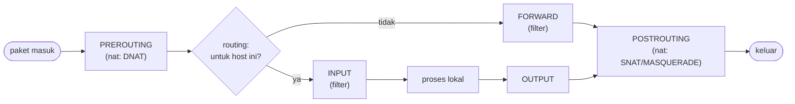

# Firewall & NAT

Firewall Linux (iptables, nftables, ufw, firewalld, dan rule Docker) semuanya berdiri di atas **netfilter** di kernel.
Memahami jalur paket di netfilter menjelaskan banyak hal yang membingungkan: kenapa port Docker lolos dari ufw, kenapa
satu rule "tidak berefek", kenapa koneksi lama tetap hidup setelah diblokir, dan kenapa NAT merusak jalur balik.

> [!NOTE]
> Lab: container firewall (alpine, `iptables v1.8.10 (nf_tables)`, `ip_forward=1`) di antara klien `10.66.1.10` dan
> server nginx `10.66.2.20`. Rule Docker dibaca **read-only** dari VM Docker Desktop. Satu temuan lab (DNAT yang
> terganggu NAT di host Docker) dijelaskan apa adanya di bagian 5.

## 1. Jalur paket



| Tujuan paket | Chain filter | Contoh |
|---|---|---|
| Host ini (SSH ke server) | INPUT | ufw bekerja di sini |
| Melewati host (router, **container Docker**) | FORWARD | port forwarding, publish Docker |
| Dibuat host ini | OUTPUT | curl dari server |

## 2. Rule, urutan, dan policy

```text
Chain FORWARD (policy DROP 7 packets, 420 bytes)
num  pkts bytes target  prot  source          destination
1      11  1507 ACCEPT  0     0.0.0.0/0       0.0.0.0/0     ctstate RELATED,ESTABLISHED
2       4   240 ACCEPT  6     10.66.1.0/24    10.66.2.20    tcp dpt:80
```

| Langkah lab | Hasil |
|---|---|
| `-P FORWARD DROP` | Ke server `000`. Ping ke firewall sendiri tetap OK (INPUT) |
| \+ ACCEPT NEW tcp/80 saja | `000`: balasan SYN-ACK terbuang |
| \+ `ESTABLISHED,RELATED` di atas | `200` |
| `-I FORWARD 2 ... --dport 80 -j DROP` | `000`: rule pertama yang cocok menang |

## 3. Conntrack: firewall yang ingat

```text
tcp 6 111 TIME_WAIT src=10.66.1.10 dst=10.66.2.20 sport=45970 dport=80
                    src=10.66.2.20 dst=10.66.1.10 sport=80 dport=45970 [ASSURED]
nf_conntrack_max=262144
```

- Rule DROP NEW yang ditambahkan saat koneksi sedang berjalan → koneksi lama **tetap** `200 OK`, koneksi baru
  `000` (lab). Ini menyelamatkan SSH-mu, tetapi juga tidak memutus penyerang yang sudah terhubung
  (`conntrack -D`).
- Tabel penuh → `nf_conntrack: table full, dropping packet`.

## 4. NAT

| Jenis | Chain | Lab | Efek |
|---|---|---|---|
| MASQUERADE / SNAT | POSTROUTING | Log server: klien = `10.66.2.254` | Klien tersembunyi di balik firewall |
| DNAT (port forwarding) | PREROUTING | `10.66.1.254:8080 → 10.66.2.20:80`, counter INPUT 8080 = 0 | Lewat FORWARD, bukan INPUT |

```bash
iptables -t nat -A PREROUTING  -d 10.66.1.254 -p tcp --dport 8080 -j DNAT --to-destination 10.66.2.20:80
iptables -A FORWARD -d 10.66.2.20 -p tcp --dport 80 -j ACCEPT        # alamat SETELAH DNAT
iptables -t nat -A POSTROUTING -s 10.66.1.0/24 -o eth1 -j MASQUERADE
```

## 5. Temuan lab: NAT tersembunyi di jalur

Uji DNAT pertama gagal (`000`):

```text
firewall eth1 Out: 10.66.1.10.48410 > 10.66.2.20.80: [S]        ← DNAT di firewall benar
server   eth0 In : 10.66.2.1.43338  > 10.66.2.20.80: [S]        ← sumber berubah jadi gateway Docker!
                   10.66.2.20.80 > 10.66.2.1.43338: [S.]   →   10.66.2.1 ... [R]
conntrack firewall: SYN_SENT ... [UNREPLIED]
```

Netfilter di host Docker Desktop men-NAT ulang paket itu, sehingga balasan server tidak kembali lewat firewall.
Lalu lintas routed biasa (tanpa DNAT) tidak terkena (server melihat `10.66.1.10`), dan DNAT + MASQUERADE di firewall
langsung berhasil (`200`). Pelajarannya berlaku di mana pun: **tcpdump di setiap hop**, karena NAT tambahan dari
cloud, ISP, atau perangkat lain sering tidak terlihat dari satu titik.

## 6. Docker dan firewall host

Dibaca langsung dari VM Docker Desktop:

```text
-A DOCKER -d 127.0.0.1/32 -p tcp -m tcp --dport 18777 -j DNAT --to-destination 172.17.0.2:80   ← -p 127.0.0.1:18777:80
-A DOCKER -p tcp -m tcp --dport 18778 -j DNAT --to-destination 172.17.0.2:80                   ← -p 18778:80 (semua alamat)
-A FORWARD -j DOCKER-USER                                                                       ← rule-mu, dievaluasi dulu
-A FORWARD -j DOCKER-FORWARD
```

> [!DANGER]
> `ports: ["5432:5432"]` membuka port itu ke **semua** alamat. Lalu lintasnya di-DNAT dan lewat FORWARD, sehingga
> ufw (INPUT) tidak pernah melihatnya. Untuk layanan internal: jangan publish (pakai network Compose), atau bind ke
> `127.0.0.1`, atau batasi di `DOCKER-USER`.

## 7. Alat

| Tugas | iptables | nftables |
|---|---|---|
| Lihat semua | `iptables -S`, `iptables -t nat -S` | `nft list ruleset` |
| Lihat counter | `iptables -L FORWARD -v -n --line-numbers` | `nft list chain ip filter FORWARD` |
| Simpan permanen | `iptables-save > /etc/iptables/rules.v4` | `/etc/nftables.conf` |
| Lihat koneksi | `conntrack -L` | `conntrack -L` |

`iptables (nf_tables)` = sintaks iptables, backend nftables (lab: rule iptables muncul di `nft list`).

## 8. Ringkasan

| Gejala | Penyebab | Cek |
|---|---|---|
| Rule "tidak berefek" | Rule lain cocok lebih dulu / chain salah | Urutan + counter |
| Satu arah saja yang lewat | Tidak ada `ESTABLISHED,RELATED` | Rule state di atas |
| Port Docker lolos ufw | DNAT → FORWARD | `iptables -t nat -S DOCKER`, `DOCKER-USER` |
| Port forwarding gagal | Rule FORWARD / jalur balik | `conntrack -L` (UNREPLIED), tcpdump di kedua sisi |
| Server melihat IP gateway | SNAT/MASQUERADE | Hindari SNAT bila IP klien penting |
| Blokir tidak memutus koneksi | Conntrack ESTABLISHED | `conntrack -D` |
