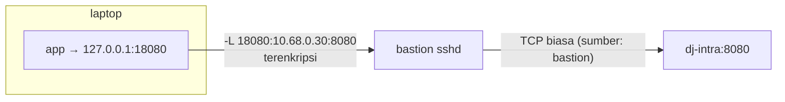

# Tunneling & VPN

Banyak server penting sengaja tidak bisa dijangkau dari internet: database, panel admin, jaringan privat VPC. Tunnel
adalah cara aman untuk sampai ke sana. SSH cocok untuk akses ad-hoc satu orang ke satu layanan, sedangkan WireGuard
untuk koneksi jaringan ke jaringan yang permanen. Modul ini membangun keduanya di lab dan memperlihatkan perilaku
yang sering membingungkan.

> [!NOTE]
> Lab SSH: laptop (`10.67.0.10`) → bastion (`10.67.0.22` / `10.68.0.22`) → host privat `dj-intra` (`10.68.0.30`,
> network `--internal`). Lab WireGuard: peer A (`10.70.0.10`) ↔ peer B (`10.70.0.20`, juga di LAN `10.71.0.0/24`
> dengan server nginx `10.71.0.50`), tunnel `10.99.0.0/24`.

## 1. SSH port forwarding



| Mode | Perintah (lab) | Port dibuka di | Hasil |
|---|---|---|---|
| Local | `ssh -f -N -L 15432:127.0.0.1:5432 dev@bastion` | laptop `127.0.0.1` | Service localhost-only di bastion terjangkau |
| Local ke host lain | `-L 18080:10.68.0.30:8080` | laptop | `intra-web`, dengan intra melihat sumber **10.68.0.22** |
| Dynamic (SOCKS) | `-D 1080` + `curl --socks5-hostname` | laptop | Tujuan apa pun di jaringan bastion |
| Remote | `-R 13000:127.0.0.1:3000` | **server** `127.0.0.1` | Bastion melihat `laptop-dev-server` |
| Jump | `ssh -J dev@bastion dev@10.68.0.30` | — | `dj-intra`, end-to-end |

Default bind-nya `127.0.0.1` di kedua arah (lab: `-L` → `127.0.0.1:18080`, `-R` → `127.0.0.1:13000` dengan
`GatewayPorts no`). Membuka ke `0.0.0.0` harus dilakukan secara sengaja.

## 2. Mengatur sshd

```text
AllowTcpForwarding no  →  channel 2: open failed: administratively prohibited: open failed
GatewayPorts yes (ditambah di AKHIR file)  →  sshd -T: gatewayports no   ← baris 91 "GatewayPorts no" menang
GatewayPorts yes (mengganti baris 91)      →  0.0.0.0:13003 LISTEN
```

> [!WARNING]
> Di `sshd_config`, **nilai pertama yang ditemukan yang berlaku**, termasuk dari `Include
> /etc/ssh/sshd_config.d/*.conf` di bagian atas. Menambah baris di akhir file sering tidak berefek. Selalu
> verifikasi dengan `sshd -T`, dan cek sintaks dengan `sshd -t` sebelum reload.

Pembatasan yang lebih halus: `Match User dev` + `AllowTcpForwarding local` + `PermitOpen 127.0.0.1:5432`.

## 3. WireGuard dari nol

```bash
umask 077; wg genkey | tee privatekey | wg pubkey > publickey
ip link add wg0 type wireguard
wg set wg0 private-key ./privatekey listen-port 51820 \
   peer <PUB_B> endpoint 10.70.0.20:51820 allowed-ips 10.99.0.2/32 persistent-keepalive 25
ip addr add 10.99.0.1/24 dev wg0 && ip link set wg0 up
wg show
```

Yang terlihat di jaringan (tcpdump underlay, lab):

```text
10.70.0.10.51820 > 10.70.0.20.51820: UDP, length 148    ← handshake initiation
10.70.0.20.51820 > 10.70.0.10.51820: UDP, length 92     ← handshake response
10.70.0.10.51820 > 10.70.0.20.51820: UDP, length 32     ← keepalive/data
```

Alamat `10.99.0.x` dan isi paket tidak terlihat, tetapi siapa bicara dengan siapa, kapan, dan seberapa banyak tetap
terlihat.

## 4. AllowedIPs = cryptokey routing

| Arah | Fungsi AllowedIPs | Lab |
|---|---|---|
| Keluar | Tujuan → peer mana | `10.71.0.0/24` tidak ada → `ping: sendmsg: Required key not available` |
| Masuk | Filter sumber dari peer itu | Sumber palsu `10.99.0.77` → dibuang diam-diam (`0 received`), sumber sah → `2 received` |

| Pola | AllowedIPs klien | Efek |
|---|---|---|
| Split tunnel | `10.99.0.0/24, 10.71.0.0/24` | Hanya subnet itu lewat VPN |
| Full tunnel | `0.0.0.0/0` | Semua trafik lewat VPN |

Site-to-site (lab): AllowedIPs A ditambah `10.71.0.0/24`, B `ip_forward=1` + MASQUERADE, lalu ping `ttl=63`, web
LAN `200`, dan server LAN melihat **10.71.0.2**. Tanpa NAT, LAN butuh route `10.99.0.0/24 via B`.

## 5. MTU dan keepalive

| | Nilai | Lab |
|---|---|---|
| MTU wg0 | 1420 (overhead 80 = IPv6 40 + UDP 8 + WG 32) | `ip link`: `mtu 1420` |
| `ping -M do -s` maksimum | 1392 | 1392 OK, 1393 → `message too long, mtu=1420` |
| MSS TCP lewat tunnel | 1380 | — |
| PersistentKeepalive | 25 s untuk peer di belakang NAT | `every 25 seconds` |

## 6. Ringkasan troubleshooting

| Gejala | Cek | Kemungkinan |
|---|---|---|
| SSH tunnel tersambung, tapi koneksi gagal | Output `-v`: `administratively prohibited` | `AllowTcpForwarding`/`PermitOpen` |
| Host lain tidak bisa memakai port tunnel | `netstat -ltn`: `127.0.0.1` | Bind default / `GatewayPorts` |
| Opsi sshd tidak berefek | `sshd -T` | Nilai pertama menang |
| VPN tidak tersambung | `wg show`: tidak ada handshake | UDP diblokir, endpoint, atau kunci |
| `Required key not available` | AllowedIPs | Tujuan tidak dipetakan ke peer |
| Gateway bisa, LAN tidak | Forwarding, jalur balik, AllowedIPs server | NAT/route |
| Kecil lancar, besar macet | `ping -M do -s` | MTU/MSS |
