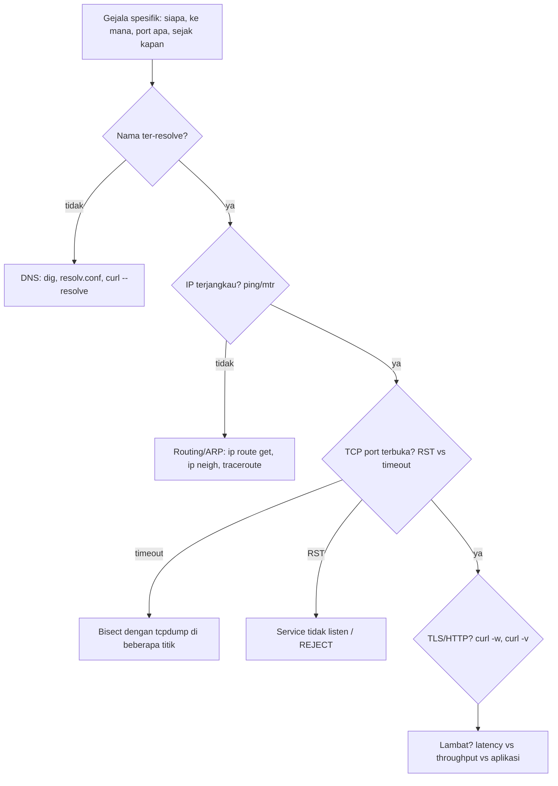

# Troubleshooting Jaringan Metodologis

Masalah jaringan jarang berupa "jaringannya mati". Biasanya yang terjadi hanya satu port, satu arah, satu jenis paket,
atau hanya saat data besar. Menebak-nebak (restart, ganti DNS, matikan firewall) membuang waktu dan sering
menimbulkan masalah baru. Modul penutup ini menyatukan alat dari modul 01–09 menjadi **metode**: membuat hipotesis,
mengukur, lalu memotong kemungkinan menjadi separuh.

> [!NOTE]
> Lab: client `dj-c10` (`10.80.1.10`) → router `dj-r10` (eth0 `10.80.1.254`, eth1 `10.80.2.254`) → server `dj-s10`
> (`10.80.2.20`, HTTP `:8080`, iperf3 `:5201`). Gangguan dibuat dengan iptables, route yang salah, dan `tc netem`.

## 1. Metodenya



Prinsipnya:
1. **Spesifikkan gejala.** "Timeout dari pod A ke 10.80.2.20:8080 sejak pukul 14.00" lebih berguna daripada
   "jaringan lemot".
2. **Lapis demi lapis.** Setiap tes yang lolos menghapus satu lapisan dari daftar tersangka.
3. **Bisect.** Ukur di tengah jalur, lalu lanjut ke separuh yang bermasalah.
4. **Ubah satu hal, ukur ulang, catat.** Tanpa langkah ini, kamu tidak tahu perubahan mana yang sebenarnya menolong.

## 2. Jalur: traceroute, tracepath, mtr

| Alat | Probe default | Kegunaan | Lab |
|---|---|---|---|
| `traceroute -n` | UDP 33434+ | Hop demi hop | Server DROP UDP → `2 *`, `3 *` … |
| `traceroute -I` | ICMP Echo | Bila UDP diblok | → `2  10.80.2.20` |
| `tracepath -n` | UDP + DF | Jalur + PMTU, tanpa root | `Resume: pmtu 1500 hops 2 back 2` |
| `mtr -n -r -c 100` | ICMP | Loss/jitter per hop dari waktu ke waktu | `Loss% Snt Avg Best Wrst StDev` |
| `mtr -T -P 443` | TCP SYN | Meniru trafik aplikasi | Tetap jalan saat UDP diblok |

Membaca hasilnya:

```text
Router membuang ICMP Time Exceeded keluar:     1  *  *  *            ← hop "hilang"
                                               2  10.80.2.20 0.008 ms ← tujuan sehat
mtr -i 0.1, router TANPA firewall:             1.|-- 10.80.1.254  80.0%   ← icmp_ratelimit 1000 ms
                                               2.|-- 10.80.2.20    0.0%   ← tidak ada loss nyata
netem loss 1% di jalur:                        2.|-- 10.80.2.20    1.0%   ← loss nyata muncul di AKHIR
```

> [!TIP]
> Aturan praktis: **loss yang nyata selalu berlanjut sampai hop terakhir.** Loss atau `* * *` yang hanya muncul di
> hop tengah adalah kebijakan router (rate limit, ICMP diblok), bukan paket yang hilang.

## 3. tcpdump di beberapa titik

```bash
tcpdump -nn -i eth0 -w /tmp/c.pcap host 10.80.2.20            # simpan mentah
tcpdump -nn -r /tmp/c.pcap port 8080                          # baca ulang dengan filter lain
tcpdump -nn -r /tmp/c.pcap 'tcp[tcpflags] & tcp-rst != 0'     # hanya RST
tcpdump -nn -r /tmp/c.pcap 'tcp[tcpflags] & (tcp-syn|tcp-ack) == tcp-syn'   # hanya SYN awal
tcpdump -nn -i any tcp port 8080                              # router: lihat In & Out
tcpdump -e -nn -r /tmp/s.pcap                                 # tampilkan MAC
```

| Yang terlihat | Arti | Lab |
|---|---|---|
| SYN → `[R.]` seketika | Host hidup, port tertutup/REJECT | port 7777, `after 0 ms` |
| SYN diulang (~1 s, lalu 2 s) | Paket dibuang di jalur (DROP) | port 9999, `curl: (28)` |
| Router `eth0 In` tanpa `eth1 Out` | Dibuang di router | `FORWARD ... DROP tcp dpt:8080` |
| Server: SYN masuk, `[S.]` berulang, `SYN-RECV` | Jalur **balik** rusak | route `via 10.80.2.30`, MAC tujuan salah |

## 4. Socket dan counter

```text
ss -tin dst 10.80.2.20
  cubic rtt:52.405/3.503 mss:1448 cwnd:12 ssthresh:11 bytes_retrans:30408 retrans:0/21 notsent:482184
nstat -az TcpRetransSegs TcpOutSegs
  TcpOutSegs 8320491     TcpRetransSegs 2859
tc -s qdisc show dev eth1
  Sent 18522 bytes 189 pkt (dropped 11, ...)
```

`cwnd` kecil disertai `retrans` naik berarti TCP sedang mengerem karena loss. Jika `Send-Q`/`notsent` besar,
data menumpuk di pengirim karena jalurnya tidak sanggup mengalirkan.

## 5. Latency vs throughput

| Kondisi lab (iperf3, 1 stream) | Hasil |
|---|---|
| RTT ~0, `-w 64K` | `18047 Mbits/sec` |
| RTT 100 ms, window default | `263 Mbits/sec` |
| RTT 100 ms, `-w 64K` | `6.29 Mbits/sec` (≈ window / RTT) |
| RTT 100 ms, `-w 64K -P 4` | `27.7 Mbits/sec` (≈ 4×) |
| RTT 50 ms, 0% loss | `603 Mbits/sec` |
| RTT 50 ms, **1% loss** | `5.50 Mbits/sec`, `Retr 30` |

- **Latency** (RTT) adalah waktu bolak-balik satu paket. Ukur dengan ping, mtr, atau `curl time_connect`.
- **Throughput** adalah jumlah data per detik. Ukur dengan iperf3 dan transfer nyata.
- Throughput satu koneksi TCP ≤ **window / RTT**, dan bisa jatuh drastis karena loss.
- BDP = bandwidth × RTT, yaitu ukuran window yang dibutuhkan agar pipa penuh.

```bash
tc qdisc add dev eth1 root netem delay 50ms             # tiru WAN
tc qdisc change dev eth1 root netem delay 25ms loss 1%  # change menggantikan SEMUA parameter
tc qdisc del dev eth1 root
```

## 6. Memecah waktu request dengan curl

```bash
curl -s -o /dev/null -w 'dns=%{time_namelookup} connect=%{time_connect} tls=%{time_appconnect} ttfb=%{time_starttransfer} total=%{time_total}\n' URL
```

| Hasil lab | Kesimpulan |
|---|---|
| `dns=1.503 connect=1.5037 ttfb=1.5059` | DNS lambat, lalu buktikan dengan `--resolve` → `total=0.0023` |
| `connect=0.101 ttfb=0.203` (RTT 100 ms) | Murni jaringan: connect 1 RTT, request 1 RTT |
| `connect=0.001 ttfb=2.8` | Server/aplikasi lambat, bukan jaringan |

## 7. Ringkasan gejala → langkah

| Gejala | Langkah pertama | Modul |
|---|---|---|
| `Could not resolve host` | `dig`, `curl --resolve` | 04 |
| Timeout, ping OK | tcpdump di beberapa titik, counter firewall | 08 |
| RST seketika | `ss -ltn` di server, aturan REJECT | 03, 08 |
| Server `SYN-RECV` | `ip route get <client>`, tcpdump `-e` | 02 |
| Kecil lancar, besar macet | `tracepath`, `ping -M do -s` | 02 |
| Lambat, connect cepat | `curl -w` (TTFB), log aplikasi | 05 |
| Throughput rendah | iperf3 (`-P`, `-R`), `ss -ti`, loss di hop terakhir | 10 |
| `* * *` / loss di hop tengah | Abaikan bila hop akhir sehat | 10 |
