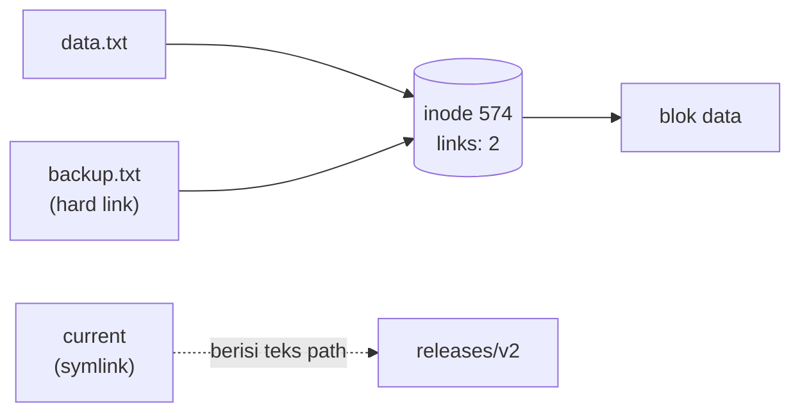

# Filesystem & Navigasi

Semua pekerjaan DevOps berujung di filesystem: membaca config di `/etc`, mengejar log di `/var/log`, mengganti
release lewat symlink, dan — cukup sering — memadamkan alarm "disk penuh". Modul ini membahas peta direktori
Linux, cara bergerak di dalamnya, operasi file yang aman, inode & link, `find`, dan troubleshooting ruang disk.

> [!NOTE]
> Semua contoh output dan klaim perilaku di modul ini dijalankan ulang di Ubuntu 24.04 (GNU coreutils 9.4,
> findutils 4.9.0) di dalam container Docker. Alpine (BusyBox) dan macOS (BSD) punya opsi yang berbeda di
> beberapa tempat, misalnya `du --inodes` dan `find -xtype` tidak ada di semua implementasi.

## 1. Peta filesystem (FHS)

Linux hanya punya **satu pohon** yang berawal di `/`. Disk lain, partisi, `tmpfs`, atau volume network
"ditempelkan" (di-*mount*) ke salah satu direktori di pohon itu.

| Direktori | Isi | Contoh yang sering kamu sentuh |
|---|---|---|
| `/etc` | Konfigurasi host | `nginx/`, `ssh/sshd_config`, `fstab`, `hosts` |
| `/var` | Data yang berubah-ubah | `log/`, `lib/docker/`, `lib/postgresql/`, `cache/` |
| `/usr` | Program & library (read-only secara konsep) | `bin/`, `lib/`, `share/` |
| `/home`, `/root` | Home user biasa dan root | `~/.ssh/`, `~/.bashrc` |
| `/tmp` | File sementara, bisa dibersihkan saat boot | socket, file upload sementara |
| `/opt` | Paket pihak ketiga yang berdiri sendiri | `/opt/vendor-app/` |
| `/srv` | Data yang dilayani server | `/srv/app`, `/srv/www` |
| `/proc`, `/sys` | Filesystem virtual dari kernel | `/proc/cpuinfo`, `/proc/PID/fd` |
| `/dev` | Device node | `/dev/sda`, `/dev/null` |
| `/run` | State runtime sejak boot (tmpfs) | PID file, socket `php-fpm.sock` |

> [!TIP]
> Di Ubuntu 24.04, `/bin`, `/sbin`, dan `/lib` hanyalah symlink ke `/usr/bin`, `/usr/sbin`, `/usr/lib`
> ("usrmerge"). Di lab: `lrwxrwxrwx 1 root root 7 Apr 22 2024 /bin -> usr/bin`. Jadi `/bin/bash` dan
> `/usr/bin/bash` adalah file yang sama.

## 2. Path dan cara bergerak

| Bentuk | Arti |
|---|---|
| `/etc/nginx` | Path **absolut** — selalu dari `/` |
| `nginx/sites-enabled` | Path **relatif** — dari direktori saat ini |
| `.` / `..` | Direktori ini / parent |
| `~` | Home user saat ini (diekspansi oleh shell, bukan oleh kernel) |
| `cd -` | Kembali ke direktori sebelumnya (`$OLDPWD`) |

```bash
cd /etc; cd /tmp; cd -     # mencetak /etc
pwd                        # path logis, bisa mengandung symlink
pwd -P                     # path fisik, symlink di-resolve
```

Di lab, setelah `cd /lab/link` (symlink ke `real`): `pwd` → `/lab/link`, `pwd -P` → `/lab/real`.

> [!WARNING]
> Di skrip dan cron, **selalu pakai path absolut** atau `cd` ke direktori yang pasti terlebih dulu. Cron
> menjalankan job dari home user dengan `PATH` minimal, jadi path relatif yang jalan di terminal sering
> gagal di sana.

## 3. `ls` yang benar-benar berguna

| Opsi | Fungsi |
|---|---|
| `-l` | Format panjang (permission, link count, owner, ukuran, waktu) |
| `-a` / `-A` | Termasuk dotfile (`-A` tanpa `.` dan `..`) |
| `-h` | Ukuran K/M/G |
| `-t` / `-r` | Urut berdasarkan waktu / balik urutan (`ls -ltr`: terbaru di bawah) |
| `-d` | Tampilkan direktori itu sendiri, bukan isinya |
| `-i` | Nomor inode |
| `-S` | Urut berdasarkan ukuran |

```bash
ls -lah /srv/app          # semua isi, termasuk .env
ls -ld /srv/app           # permission direktorinya
ls -ltr /var/log | tail   # log yang paling baru berubah
```

## 4. Membuat, menyalin, memindah, menghapus

```bash
mkdir -p /srv/app/releases/v1      # buat beserta parent, tidak error bila sudah ada
touch app.log                      # buat file kosong / perbarui mtime
cp -a config /backup/config        # salinan "arsip": owner, mode, timestamp, symlink
mv config.yml config.yml.bak       # rename (menimpa tanpa bertanya!)
rm -r build/                       # hapus direktori beserta isinya
```

Perilaku yang terbukti di lab dan sering mengejutkan:

- `cp -a config /backup/config` dua kali → percobaan kedua menghasilkan `/backup/config/config`, karena
  tujuan yang sudah ada dianggap direktori **tempat** menyalin.
- `mv` di filesystem yang sama hanya mengganti nama (cepat, tidak menyalin data). Lintas filesystem, `mv`
  menyalin lalu menghapus.
- `mv -n` di coreutils 9.4 menolak dengan `mv: not replacing 'config.yml.bak'` dan **exit 1**;
  `mv --update=none` diam dan exit 0. Penting kalau skripmu memakai `set -e`.

## 5. Inode, hard link, dan symbolic link

Nama file hanyalah entri di direktori yang menunjuk ke sebuah **inode**. Inode menyimpan metadata (mode,
owner, ukuran, timestamp, lokasi blok), tetapi **tidak menyimpan nama**.



| | Hard link | Symbolic link |
|---|---|---|
| Isinya | Nama lain untuk inode yang sama | File kecil berisi **teks path** target |
| Lintas filesystem | Tidak bisa | Bisa |
| Ke direktori | Tidak diizinkan | Bisa |
| Target dihapus | Data tetap ada (link count turun) | Link jadi rusak (dangling) |
| Dibuat dengan | `ln target nama` | `ln -s target nama` |

```bash
ln data.txt backup.txt
ls -li data.txt backup.txt
# 574 -rw-r--r-- 2 root root 5 ... backup.txt
# 574 -rw-r--r-- 2 root root 5 ... data.txt
rm data.txt; cat backup.txt      # masih "data", link count jadi 1
```

### Mengganti symlink release dengan benar

Pola deploy "release per direktori + symlink `current`" dipakai banyak tool deploy. Jebakannya ada di `ln`:

```bash
ln -s releases/v1 current
ln -sf releases/v2 current      # SALAH: current masih → v1, muncul link releases/v1/v2
ln -sfn releases/v2 current     # benar: -n = jangan ikuti current
ln -s releases/v2 current.tmp && mv -T current.tmp current   # benar dan atomik
```

`mv -T` memakai `rename(2)`, yang mengganti nama secara atomik. Tidak ada jeda ketika `current` tidak ada,
sedangkan `ln -sfn` di baliknya melakukan unlink lalu symlink.

> [!DANGER]
> **Jangan pernah** `rm -r` sebuah symlink ke direktori dengan garis miring di akhir. Di lab,
> `rm -r releases/20261119/20261120/` mengikuti link dan **menghapus isi direktori target**
> (`index.php` di release baru hilang), baru setelah itu gagal dengan `Not a directory`. Garis miring di akhir
> memaksa kernel me-resolve link sebagai direktori. Hapus link dengan `rm nama-link` atau `unlink nama-link`.
> Sumber: [path_resolution(7)](https://man7.org/linux/man-pages/man7/path_resolution.7.html)

## 6. Membaca metadata: `stat`, `file`, `readlink`

```text
$ stat /etc/hostname
  File: /etc/hostname
  Size: 13          Blocks: 8          IO Block: 4096   regular file
Device: 8,48  Inode: 525         Links: 1
Access: (0644/-rw-r--r--)  Uid: (    0/    root)   Gid: (    0/    root)
Access: 2026-11-20 06:56:49.394250929 +0000
Modify: 2026-11-20 06:56:49.394250929 +0000
Change: 2026-11-20 06:56:49.396590318 +0000
 Birth: 2026-11-20 06:56:49.394250929 +0000
```

| Timestamp | Berubah saat | Opsi `find` |
|---|---|---|
| Access (atime) | Isi dibaca (sering dibatasi oleh opsi mount `relatime`) | `-atime`, `-amin` |
| Modify (mtime) | **Isi** berubah | `-mtime`, `-mmin` |
| Change (ctime) | **Metadata** berubah: chmod, chown, rename, link — juga saat isi berubah | `-ctime`, `-cmin` |
| Birth | File dibuat (tidak semua filesystem mendukung) | `-newerBt` |

```bash
file /usr/bin/ls /bin           # ELF 64-bit ... / symbolic link to usr/bin
readlink /usr/bin/awk           # /etc/alternatives/awk  (satu langkah)
readlink -f /usr/bin/awk        # /usr/bin/mawk          (sampai ujung)
```

## 7. `find`: cari berdasarkan nama, tipe, waktu, ukuran

```bash
find /var/log -type f -name '*.log'          # kutip pola!
find /var/log -type f -size +100M            # > 100 MiB
find /srv/app -mmin -60                       # berubah < 60 menit lalu
find /etc -xtype l                            # symlink rusak
find / -xdev -type f -size +1G 2>/dev/null    # jangan menyeberang ke filesystem lain
find /var/log/app -type f -name '*.log' -mtime +7 -delete
find /srv -type f -name '*.tmp' -print0 | xargs -0 rm   # aman untuk nama berspasi
```

| Bagian | Catatan |
|---|---|
| `-mtime +7` | Umur ≥ 8×24 jam — pecahan hari dibuang. `-mtime 7` = umur 7–8 hari, `-mtime -7` < 7 hari |
| `-size` | Satuan `c` (byte), `k`, `M`, `G`, **dibulatkan ke atas**. `-size -1M` hanya cocok untuk file 0 byte |
| `-exec cmd {} +` | Banyak path per eksekusi (cepat). `{} \;` = satu proses per file |
| `-xdev` | Jangan turun ke mount lain (`/proc`, volume network) |
| `-print0 \| xargs -0` | Di lab, `find ... \| xargs rm` gagal untuk `a b.log`; dengan `-print0`/`-0` berhasil |

> [!DANGER]
> `find` mengevaluasi ekspresi dari kiri ke kanan, dan `-delete` adalah **aksi**, bukan filter. Di lab,
> `find del -delete -name '*.log' -mtime +7` menghapus seluruh isi `del` **beserta direktori `del` itu sendiri**.
> Manual find memperingatkan hal ini secara eksplisit. Biasakan menjalankan perintahnya tanpa `-delete`
> lebih dulu, cek daftarnya, baru tambahkan `-delete` di **akhir**.
> Sumber: [find(1) — -delete](https://man7.org/linux/man-pages/man1/find.1.html)

## 8. Ruang disk dan inode: `df` vs `du`

```bash
df -h                 # ruang per filesystem
df -i                 # inode per filesystem (IUse%)
du -sh /var/log       # total satu direktori
du -sh /var/* 2>/dev/null | sort -rh | head -5    # 5 terbesar di /var
du --inodes -x -d 3 /srv | sort -n | tail         # direktori dengan file terbanyak
findmnt -T /var/lib/docker                         # path ini ada di filesystem mana?
```

`df` bertanya ke filesystem berapa blok yang terpakai. `du` berjalan menyusuri **nama-nama** file dan
menjumlahkan ukurannya. Kalau angkanya jauh berbeda, ada ruang yang terpakai oleh sesuatu yang tidak punya
nama yang bisa dijangkau `du`.

> [!TIP]
> Selalu `sort -h`, bukan `sort -n` atau `sort -r` saja. Di lab, `sort -r` dan `sort -rn` sama-sama
> mengurutkan `900M`, `15M`, `1.2G`, sedangkan `sort -rh` yang benar: `1.2G`, `900M`, `15M`.

## 9. Globbing, quoting, dan batas argumen

| Pola | Cocok dengan |
|---|---|
| `*` | String apa pun, **kecuali** nama berawalan titik |
| `?` | Tepat satu karakter |
| `[abc]`, `[0-9]` | Satu karakter dari himpunan |

Ekspansi dilakukan **shell** sebelum program dijalankan. Akibatnya:

- `echo g/*` di lab menampilkan `g/app.php` tetapi **tidak** `g/.env`.
- Nama berspasi dipecah jadi beberapa argumen kecuali dikutip: `cp laporan akhir.pdf /tmp/` gagal dengan
  `cannot stat 'laporan'` dan `cannot stat 'akhir.pdf'`. Di skrip, selalu tulis `"$file"`.
- Glob yang menghasilkan terlalu banyak nama melebihi batas `execve`. Di lab, `rm many/*` dengan 200.000 file
  gagal: `/usr/bin/rm: Argument list too long`. `find many -type f -delete` berhasil.

## 10. Menghapus dengan aman

```bash
rm -- -rf               # file yang namanya diawali "-"
rm ./-rf                # alternatif
rm -i *.bak             # konfirmasi satu per satu
rm -rf "${BUILD_DIR:?}"/*    # berhenti bila variabel kosong/tidak ada
```

GNU `rm` punya `--preserve-root` sebagai default. Di lab, `rm -rf /` ditolak dengan
`it is dangerous to operate recursively on '/'`. Tapi proteksi itu **hanya untuk `/` persis**. Jadi
`rm -rf "$DIR"/*` dengan `DIR` kosong menjadi `rm -rf /*` dan tidak ditolak.

> [!INSIGHT]
> Skrip Steam for Linux pernah memuat `rm -rf "$STEAMROOT/"*`. Ketika `$STEAMROOT` kosong (setelah
> direktori Steam dipindah), perintah itu menjadi `rm -rf /*` dan menghapus seluruh file milik user, termasuk
> drive backup yang ter-mount. Pertahanannya murah: `set -u`, `${VAR:?}`, dan validasi path sebelum menghapus.
> Di lab, `rm -rf "${DIR:?}"/*` dengan `DIR=""` berhenti: `DIR: parameter null or not set`.
> Sumber: [valvesoftware/steam-for-linux#3671](https://github.com/valvesoftware/steam-for-linux/issues/3671)

## 11. Troubleshooting "No space left on device"

```mermaid
flowchart TD
    E[No space left on device] --> H{df -h<br/>Use% 100%?}
    H -- tidak --> I{df -i<br/>IUse% 100%?}
    I -- ya --> IN[Inode habis: du --inodes / find,<br/>hapus file kecil lama dengan find -delete]
    I -- tidak --> Q[Cek quota, filesystem read-only,<br/>atau path di filesystem lain: findmnt -T]
    H -- ya --> D{du -xsh / ≈ df?}
    D -- ya --> B[Cari file besar:<br/>du -sh ... sort -rh, find -size +1G]
    D -- tidak, du jauh lebih kecil --> L{lsof +L1<br/>ada '(deleted)'?}
    L -- ya --> R[Restart service pemegang file,<br/>atau truncate /proc/PID/fd/N]
    L -- tidak --> M[File tersembunyi di bawah mount point:<br/>bind mount / ke direktori lain lalu du]
```

> [!INSIGHT]
> `rm` pada log yang sedang ditulis **tidak** membebaskan ruang. Nama hilang, tetapi inode tetap ada selama
> proses masih membuka file itu. Di lab, setelah `rm /var/log/app/app.log`, `lsof +L1` menampilkan
> `sleep 404 root 3w REG ... 50000000 0 ... /var/log/app/app.log (deleted)`. Setelah
> `truncate -s 0 /proc/404/fd/3`, ukurannya 0 tanpa menghentikan proses.
> Sumber: [unlink(2)](https://man7.org/linux/man-pages/man2/unlink.2.html),
> [proc(5)](https://man7.org/linux/man-pages/man5/proc.5.html)

> [!INSIGHT]
> Mount menyembunyikan isi lama direktori mount point. Kalau aplikasi menulis ke `/data` **sebelum** disk
> data ter-mount (misalnya saat boot gagal), file itu tetap memakan ruang di root filesystem tetapi tidak terlihat
> oleh `du`. Di lab: file 29M di `/data`, lalu `mount -t tmpfs tmpfs /data` → `du -sh /data` = 0. Lewat
> `mount --bind / /mnt/root`, file itu terlihat lagi di `/mnt/root/data`.
> Sumber: [mount(8)](https://man7.org/linux/man-pages/man8/mount.8.html) — "The previous contents (if any) and
> owner and mode of dir become invisible"

## 12. Ringkasan kebiasaan aman

| Kebiasaan | Kenapa |
|---|---|
| Kutip pola `find` dan variabel (`'*.log'`, `"$f"`) | Shell tidak mengekspansi/memecah sebelum waktunya |
| Jalankan `find` tanpa `-delete` dulu, lalu taruh `-delete` di akhir | `-delete` di depan menghapus semuanya |
| `ln -sfn` atau `ln -s` + `mv -T` untuk symlink release | `ln -sf` mengikuti link direktori |
| Hapus symlink tanpa `/` di akhir | `rm -r link/` menghapus isi target |
| `set -u` dan `${VAR:?}` di skrip yang menghapus | Variabel kosong → `rm -rf /*` |
| `df -h`, lalu `df -i`, lalu `lsof +L1` | Tiga penyebab "disk penuh" yang berbeda |
| Rotasi log dengan `logrotate`, bukan `rm` | Proses yang membuka file tetap memegang ruang |
