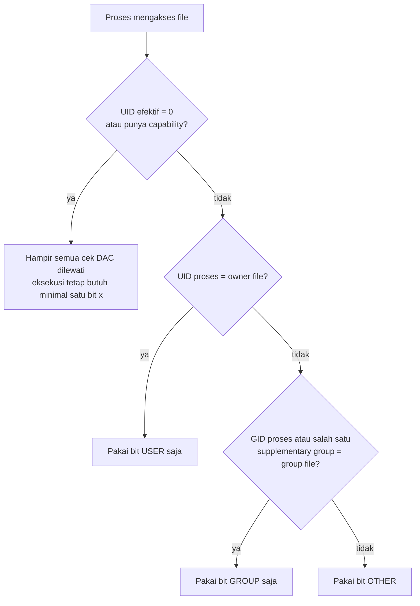
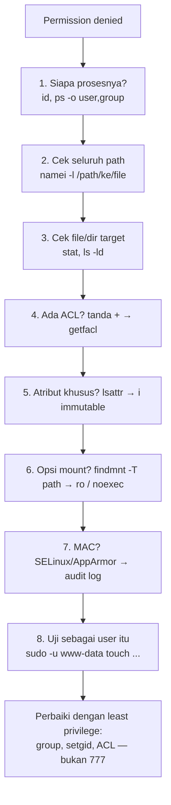

# Permission & Ownership

Hampir setiap insiden "aplikasi tidak bisa menulis log", "deploy gagal", atau "SSH key ditolak" berujung pada
satu hal: **siapa** prosesnya, **milik siapa** file-nya, dan **izin apa** yang berlaku di setiap direktori
sepanjang path. Modul ini membahas model permission klasik Linux (DAC), ACL, bit khusus, dan cara
troubleshoot yang benar — bukan `chmod 777`.

> [!NOTE]
> Semua contoh output dan klaim perilaku di modul ini dijalankan ulang di Ubuntu 24.04 (GNU coreutils 9.4,
> OpenSSH 9.6p1) dan Docker Engine 29. Distro lain (Alpine/BusyBox, RHEL) bisa berbeda di detail kecil.

## 1. Membaca output `ls -l`

```text
-rwxr-x--- 1 deploy www-data 1234 Nov 19 10:00 deploy.sh
drwxr-xr-x 2 root   root     4096 Nov 19 10:00 public
```

| Bagian | Contoh | Arti |
|---|---|---|
| Karakter ke-1 | `-` / `d` / `l` | Tipe: file biasa, direktori, symlink (juga `c`, `b`, `s`, `p`) |
| Karakter 2–4 | `rwx` | Izin **user** (owner) |
| Karakter 5–7 | `r-x` | Izin **group** |
| Karakter 8–10 | `---` | Izin **other** (semua yang lain) |
| Penanda ekstra | `+` / `.` | Ada ACL (`+`) atau konteks SELinux (`.`) |
| Kolom 3 & 4 | `deploy www-data` | Owner dan group |

Konversi ke oktal: `r`=4, `w`=2, `x`=1, dijumlahkan per kelas. `rwxr-x---` → 7 5 0 → **750**.

```bash
stat -c '%a %A %U:%G %n' deploy.sh
# 750 -rwxr-x--- deploy:www-data deploy.sh
```

### Bagaimana kernel memutuskan



> [!INSIGHT]
> Hanya **satu** kelas yang dipakai, dan owner dicek pertama. File `-r--rwx---` milik `alice:devs`:
> anggota `devs` lain bisa menulis, tetapi `alice` sendiri **tidak** — bit group tidak "ditambahkan" ke owner.
> Kami reproduksi di lab: owner mendapat `Permission denied`, anggota group berhasil.
> Sumber: [path_resolution(7)](https://man7.org/linux/man-pages/man7/path_resolution.7.html)

## 2. `r`, `w`, `x` pada file vs direktori

| Bit | Pada file | Pada direktori |
|---|---|---|
| `r` | Membaca isi | Melihat **daftar nama** entri (`ls`) |
| `w` | Mengubah isi | Membuat, menghapus, rename entri di dalamnya |
| `x` | Menjalankan | **Masuk/melewati** (`cd`, akses entri yang namanya diketahui) |

Konsekuensi yang sering mengejutkan (semuanya terbukti di lab):

- Direktori `r` tanpa `x`: `ls` bisa menampilkan nama, tetapi `ls -l` menampilkan `-????????? ? ? ?` dan
  file tidak bisa dibuka.
- Direktori `x` tanpa `r`: `ls` gagal, tetapi `cat dir/file` **berhasil** kalau kamu tahu namanya.
- Menghapus file tergantung `w`+`x` pada **direktori**, bukan pada file. File 444 milik orang lain bisa
  terhapus — kecuali direktorinya ber-sticky bit.

## 3. `chmod` mode simbolik

Format: `[siapa][operator][izin]` — siapa: `u` `g` `o` `a`; operator: `+` `-` `=`.

```bash
chmod u+x deploy.sh               # tambah x untuk owner
chmod g-w,o-rwx secrets.env       # beberapa klausa, pisahkan dengan koma
chmod u=rw,g=r,o= config.ini      # set persis (o= berarti kosong)
chmod -R u=rwX,go=rX /srv/app     # X besar: x hanya untuk direktori / yang sudah executable
```

> [!INSIGHT]
> Tanpa huruf "siapa", chmod menghormati umask. Dengan `umask 022`, `chmod +w` pada file 444 menghasilkan
> **644** (hanya owner), sedangkan `chmod a+w` menghasilkan 666. `chmod +x` pada file 600 menjadi 711.
> Sumber: [GNU Coreutils — Symbolic Modes](https://www.gnu.org/software/coreutils/manual/html_node/Symbolic-Modes.html)

## 4. `chmod` mode oktal

| Oktal | Simbolik | Pemakaian umum |
|---|---|---|
| `755` | `rwxr-xr-x` | Direktori publik, binary/script |
| `644` | `rw-r--r--` | File biasa, public key |
| `750` / `640` | `rwxr-x---` / `rw-r-----` | Aplikasi/config yang dibaca service lewat group |
| `700` / `600` | `rwx------` / `rw-------` | `~/.ssh`, private key, file secret |
| `2775` | `rwxrwsr-x` | Direktori kolaborasi tim (setgid) |
| `1777` | `rwxrwxrwt` | `/tmp` (sticky) |

Digit keempat di depan adalah bit khusus: 4 = setuid, 2 = setgid, 1 = sticky.

## 5. Ownership: `chown` dan `chgrp`

```bash
chown deploy file                  # ganti owner
chown deploy:www-data file         # owner dan group
chown :www-data file               # hanya group (sama dengan chgrp www-data file)
chown -R deploy:www-data /srv/app  # rekursif
ls -ln file                        # tampilkan UID/GID angka
```

- Hanya root (CAP_CHOWN) yang bisa mengganti owner. Owner file boleh `chgrp` ke group yang ia anggotai.
- `chown` **menghapus bit setuid/setgid** pada file executable — di lab, file 4755 menjadi 755 setelah
  di-chown oleh root. Set ulang bit khusus *setelah* chown.
- Pemisah titik (`user.group`) sudah deprecated; coreutils 9.4 mencetak peringatan.

> [!INSIGHT]
> Kernel hanya mengenal **angka**. Di container, `app` (UID 1000) dan user `ubuntu` (UID 1000) di image lain
> adalah "orang yang sama" bagi filesystem. Selalu bandingkan dengan `id` dan `ls -n` saat debugging volume.
> Sumber: [credentials(7)](https://man7.org/linux/man-pages/man7/credentials.7.html)

## 6. `umask` — permission default

File baru dibuat dengan dasar `666`, direktori `777`, lalu bit yang ada di umask **dimatikan** (AND NOT,
bukan pengurangan).

| umask | File baru | Direktori baru |
|---|---|---|
| `022` | 644 | 755 |
| `027` | 640 | 750 |
| `077` | 600 | 700 |
| `002` | 664 | 775 |
| `023` | 644 (bukan 643!) | 754 |

```bash
umask        # 0022
umask -S     # u=rwx,g=rx,o=rx
```

> [!TIP]
> Untuk service systemd, set umask di unit (`UMask=0027`), bukan di `.bashrc` — service tidak membaca
> profil shell. Sumber: [systemd.exec(5)](https://www.freedesktop.org/software/systemd/man/latest/systemd.exec.html)

## 7. Bit khusus: setuid, setgid, sticky

| Bit | Pada file | Pada direktori | Tampilan |
|---|---|---|---|
| setuid (4000) | Program berjalan sebagai **owner** file (contoh `/usr/bin/passwd`) | — | `rws` (`rwS` bila tanpa x) |
| setgid (2000) | Berjalan sebagai group file | File baru **mewarisi group** direktori | `rws` di kolom group |
| sticky (1000) | — | Hanya owner file/direktori/root yang boleh hapus | `t` di akhir |

> [!INSIGHT]
> Linux **mengabaikan** setuid pada script (`#!/bin/sh`). Di lab, script 4755 milik root tetap mencetak UID
> pemanggil. Setuid hanya bermakna untuk binary.
> Sumber: [execve(2)](https://man7.org/linux/man-pages/man2/execve.2.html)

> [!INSIGHT]
> GNU chmod **tidak menghapus** setgid direktori lewat mode oktal biasa: `chmod 755 dir` pada direktori 2775
> menghasilkan **2755**. Untuk benar-benar mencabut, pakai `chmod g-s dir` atau `chmod 00755 dir`.
> Sumber: [GNU Coreutils — Directories and the Set-User-ID and Set-Group-ID Bits](https://www.gnu.org/software/coreutils/manual/html_node/Directory-Setuid-and-Setgid.html)

## 8. Mengubah permission secara rekursif dengan aman

```bash
# Direktori 755, file 644 — dua langkah eksplisit
find /srv/app -type d -exec chmod 755 {} +
find /srv/app -type f -exec chmod 644 {} +

# Atau satu langkah dengan X besar
chmod -R u=rwX,go=rX /srv/app
```

> [!WARNING]
> `chmod -R 777` membuat **semua** file bisa ditulis siapa pun (injeksi kode) dan semua file jadi executable.
> Pada `/`, perintah ini ikut merusak setuid/setgid sistem sehingga `sudo`/`su` tidak berfungsi — diskusi
> klasiknya ada di [Server Fault #364677](https://serverfault.com/questions/364677/why-is-chmod-r-777-destructive).
> Pemulihan yang realistis: restore dari backup.

> [!INSIGHT]
> Untuk Laravel, dokumentasi resminya hanya meminta `storage` dan `bootstrap/cache` writable oleh proses
> web server — bukan seluruh project. Pola yang kami uji: kode milik `deploy`, dua direktori itu
> `deploy:www-data` + `ug+rwX` + setgid.
> Sumber: [Laravel 13 — Deployment](https://laravel.com/docs/13.x/deployment)

## 9. ACL — saat owner/group/other tidak cukup

```bash
setfacl -m u:alice:rwx /srv/data        # tambah entri user
setfacl -d -m g:devs:rwX /srv/share     # default ACL: diwariskan ke item baru
getfacl /srv/data                       # lihat semua entri
setfacl -x u:alice /srv/data            # hapus satu entri
setfacl -b /srv/data                    # hapus semua ACL
```

Output `getfacl` di lab:

```text
# file: srv/data
# owner: root
# group: root
user::rwx
user:alice:rwx
group::r-x
mask::rwx
other::r-x
```

> [!INSIGHT]
> Entri `mask::` adalah batas atas izin semua named user/group. Di lab, file baru di direktori ber-default-ACL
> mendapat `group:devs:rwx #effective:rw-` karena mask-nya `rw-`. Kalau ACL "tidak berpengaruh", cek mask dulu.
> Sumber: [acl(5)](https://man7.org/linux/man-pages/man5/acl.5.html)

## 10. Troubleshooting "Permission denied" — sistematis



```bash
id www-data
namei -l /srv/app/storage/logs/laravel.log
getfacl /srv/app/storage
lsattr /etc/app/config.yml
findmnt -T /tmp
sudo -u www-data touch /srv/app/storage/.probe
```

Contoh `namei -l` di lab — langsung terlihat `storage` adalah penghalangnya:

```text
f: /srv/app/storage/logs/laravel.log
drwxr-xr-x root root /
drwxr-xr-x root root srv
drwxr-xr-x root root app
drwx------ root root storage
drwxr-xr-x root root logs
-rw-r--r-- root root laravel.log
```

> [!INSIGHT]
> Setelah `usermod -aG docker user`, sesi yang sudah terbuka **tidak** langsung mendapat group baru —
> daftar group ditetapkan saat login. Di lab, `id -nG` pada proses lama tetap tanpa group baru, sedangkan sesi
> baru langsung punya. Dokumentasi Docker meminta logout/login atau `newgrp docker`.
> Sumber: [Docker Docs — Linux post-installation steps](https://docs.docker.com/engine/install/linux-postinstall/)

> [!INSIGHT]
> `chattr +i` membuat file kebal bahkan untuk root: `chmod`, `rm`, dan menulis semuanya gagal dengan
> `Operation not permitted`, padahal `ls -l` terlihat normal. Biasanya dipasang tim security atau
> tool hardening — cek `lsattr` sebelum menyimpulkan "permission rusak".
> Sumber: [chattr(1)](https://man7.org/linux/man-pages/man1/chattr.1.html)

## 11. Checklist keamanan (DevSecOps)

| Target | Permission | Kenapa |
|---|---|---|
| `~/.ssh` | 700 | sshd StrictModes & mencegah orang lain menaruh key |
| Private key | 600 | Klien ssh **mengabaikan** key yang terbuka bagi orang lain |
| `authorized_keys` | 600 (644 masih diterima) | Tidak boleh writable oleh group/other |
| `.env` / file secret | 600 atau 640 `app:app` | Tidak terbaca user lain di server |
| `/etc/shadow` | 640 `root:shadow` (Ubuntu) | Hash password |
| Kode aplikasi | milik user deploy, read-only bagi web server | Kompromi aplikasi tidak bisa menulis ulang kode |
| Container | `USER` non-root + `COPY --chown` | Membatasi dampak kompromi |

```bash
find / -xdev -type f -perm -4000 2>/dev/null   # audit binary SUID
find /srv -type f -perm -0002                  # file world-writable
```

> [!INSIGHT]
> Debian/Ubuntu menambal OpenSSH (`user-group-modes.patch`) sehingga home/`~/.ssh`/`authorized_keys` yang
> group-writable **tetap diterima** jika group itu hanya berisi user tersebut. Di lab, `chmod 775 /home/dev`
> tetap bisa login; begitu group-nya punya anggota lain, sshd menolak dengan
> `Authentication refused: bad ownership or modes`. Distro lain tanpa patch ini akan langsung menolak.
> Sumber: [Debian openssh — user-group-modes.patch](https://sources.debian.org/src/openssh/1%3A10.2p1-3/debian/patches/user-group-modes.patch)

> [!INSIGHT]
> Named volume Docker yang **baru dan kosong** diisi dari isi image di path tersebut, termasuk ownership-nya.
> Jadi `RUN mkdir /data && chown app:app /data` sebelum `USER app` membuat volume baru langsung writable.
> Volume lama yang sudah milik root tidak ikut berubah — perlu `chown` sekali jalan.
> Sumber: [Docker Docs — Populate a volume using a container](https://docs.docker.com/engine/storage/volumes/#populate-a-volume-using-a-container)
> (diverifikasi di lab Docker 29)
