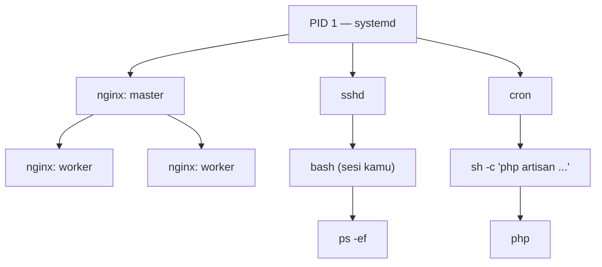
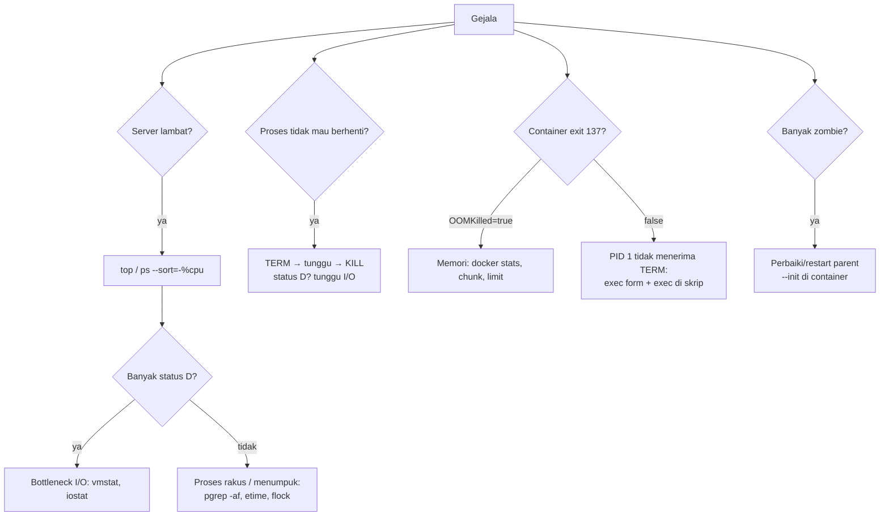

# Process & Signal

Setiap perintah yang kamu jalankan, setiap worker, web server, dan container adalah **proses**. Banyak insiden
production sebenarnya soal proses: job yang menumpuk, worker yang tidak mau berhenti, container yang selalu
keluar dengan 137, atau zombie yang memenuhi tabel proses. Modul ini membahas cara melihat proses, berbicara
dengannya lewat **sinyal**, dan perilaku khususnya di dalam container.

> [!NOTE]
> Semua contoh output dan klaim perilaku dijalankan ulang di Ubuntu 24.04 (procps-ng 4.0.4, bash 5.2, dash 0.5.12)
> dan Docker Engine 29.4. Image `ubuntu:24.04` tidak membawa `ps` — pasang `procps` (dan `psmisc` untuk `pstree`,
> `killall`, `fuser`). Image minimal lain (distroless, scratch) bahkan tidak punya shell.

## 1. Model proses

- Setiap proses punya **PID** dan **PPID** (PID parent-nya).
- Proses baru lahir lewat `fork()`, yang menggandakan parent, lalu biasanya `exec()`, yang mengganti isinya dengan
  program lain. Shell menjalankan `ls` persis seperti itu.
- **PID 1** (systemd di host, perintah utama di container) adalah akar pohon proses dan mengadopsi proses yatim.



> [!TIP]
> `exec` di shell **tidak** membuat proses baru: program menggantikan shell dengan PID yang sama. Ini kunci
> agar aplikasi menjadi PID 1 di container (bagian 8).

## 2. Melihat proses

```bash
ps aux                                    # BSD: USER %CPU %MEM RSS STAT COMMAND
ps -ef                                    # UNIX: UID PID PPID STIME CMD
ps -eo pid,ppid,user,%mem,etime,cmd --sort=-%mem | head
ps -fp 4321                               # satu proses
pgrep -a nginx                            # PID + command line, tanpa dirinya sendiri
pstree -p                                 # pohon proses dengan PID
top                                       # interaktif: P (CPU), M (memori), k (kill), 1 (per core)
```

| Kolom | Arti |
|---|---|
| `RSS` | Memori fisik yang sedang dipakai (KiB) |
| `VSZ` | Ukuran virtual (termasuk yang belum disentuh) — jarang berguna untuk kapasitas |
| `STAT` | Status (bagian 3) |
| `etime` | Lama berjalan — bagus untuk menemukan job yang "nyangkut" |
| `%CPU` di `ps` | Rata-rata sepanjang umur proses, **bukan** saat ini; pakai `top` untuk nilai sesaat |

> [!WARNING]
> `ps aux | grep nginx` selalu ikut menampilkan proses `grep nginx` itu sendiri (terlihat di lab), dan skrip
> yang menghitung baris jadi salah. Pakai `pgrep`. Ingat juga bahwa pgrep/pkill tanpa `-f` hanya mencocokkan
> **nama** proses yang maksimal 15 karakter. Di lab, pola 21 karakter memicu peringatan
> `will result in zero matches`.

### `/proc/PID` — semua info mentah

```bash
cat /proc/4321/status | grep -E 'State|PPid|VmRSS|Threads'
tr '\0' ' ' < /proc/4321/cmdline; echo
tr '\0' '\n' < /proc/4321/environ     # hanya pemilik/root (mode 0400)
ls -l /proc/4321/fd                    # file & socket yang dibuka
ls -l /proc/4321/cwd /proc/4321/exe    # direktori kerja dan binary
cat /proc/4321/limits                  # ulimit efektif (mis. Max open files)
```

## 3. Status proses dan load average

| STAT | Arti | Catatan |
|---|---|---|
| `R` | Running / runnable | Memakai atau menunggu CPU |
| `S` | Sleeping (interruptible) | Menunggu event; mayoritas proses |
| `D` | Uninterruptible sleep | Menunggu I/O (disk, NFS); tidak bisa dibunuh sampai I/O kembali |
| `T` | Stopped | Kena SIGSTOP/SIGTSTP (Ctrl+Z) |
| `Z` | Zombie | Sudah mati, menunggu `wait()` dari parent |

Di lab, `kill -STOP` mengubah status `sleep` menjadi `T`, lalu `kill -CONT` mengembalikannya ke `S`.

> [!INSIGHT]
> Load average Linux bukan "pemakaian CPU". Ia menghitung proses `R` **ditambah** proses `D`. Itu sebabnya server
> dengan disk atau NFS yang macet bisa punya load 30 dengan CPU hampir idle. Brendan Gregg menelusuri patch kernel
> tahun 1993 yang menambahkan `D` ke perhitungan dan menunjukkan cara membedakannya.
> Sumber: [Linux Load Averages: Solving the Mystery](https://www.brendangregg.com/blog/2017-08-08/linux-load-averages.html)

## 4. Sinyal

| Sinyal | No. | Default | Dipakai untuk |
|---|---|---|---|
| `SIGHUP` | 1 | Terminate | Terminal ditutup. Banyak daemon memakainya untuk reload config |
| `SIGINT` | 2 | Terminate | Ctrl+C |
| `SIGQUIT` | 3 | Core dump | Ctrl+\\ |
| `SIGKILL` | 9 | Terminate | **Tidak bisa ditangkap.** Pilihan terakhir |
| `SIGUSR1` | 10 | Terminate | Ditentukan aplikasi (mis. reopen log) |
| `SIGTERM` | 15 | Terminate | Permintaan berhenti yang sopan — default `kill`, `docker stop`, systemd |
| `SIGCONT` | 18 | Continue | Melanjutkan proses yang di-stop |
| `SIGSTOP` | 19 | Stop | **Tidak bisa ditangkap** |
| `SIGTSTP` | 20 | Stop | Ctrl+Z |

```bash
kill 4321                 # SIGTERM
kill -9 4321              # SIGKILL — setelah TERM gagal
kill -HUP 4321            # reload (bila aplikasi mendukung)
kill -0 4321              # cek: masih hidup?
pkill -f queue:work       # berdasarkan command line
kill -TERM -- -2500       # seluruh process group 2500
```

Urutan yang benar: **TERM → tunggu → baru KILL**. Itu juga yang dilakukan `docker stop`, `systemctl stop`, dan
Kubernetes. SIGKILL langsung berarti transaksi setengah jalan, file sementara, dan lock yang tertinggal.

```bash
trap 'echo "cleanup"; rm -f /tmp/job.lock; exit 0' TERM INT    # di skrip bash
```

> [!DANGER]
> `pkill -f pola` juga cocok dengan **shell yang menjalankannya** bila command line shell itu mengandung pola
> yang sama, misalnya `ssh server 'pkill -f myapp'` atau `bash -c '...'`. pgrep/pkill memang mengecualikan
> dirinya sendiri, tapi tidak parent-nya. Di lab, `bash -c 'pkill -f "sleep 300"; echo survived'` membunuh
> `bash`-nya sendiri: `Terminated`, exit 143, dan `survived` tidak tercetak.
> Sumber: [pgrep(1)](https://man7.org/linux/man-pages/man1/pgrep.1.html) — "will never report itself as a match"

## 5. Exit code

| Kode | Arti |
|---|---|
| `0` | Sukses |
| `1`–`125` | Gagal; arti ditentukan program |
| `124` | `timeout` habis (GNU coreutils) |
| `126` / `127` | Tidak bisa dieksekusi / command tidak ditemukan |
| `128+N` | Mati oleh sinyal N: **130** Ctrl+C, **137** SIGKILL, **143** SIGTERM |

Semua diuji di lab: `kill` → 143, `kill -9` → 137, `timeout 1 sleep 5` → 124, `timeout -s KILL` → 137.

## 6. Job control, `nohup`, dan sesi SSH

```bash
./backup.sh &            # background; PID di $!
jobs -l                  # daftar job + PID
fg %1                    # ke foreground
# Ctrl+Z, lalu:
bg                       # lanjutkan di background
nohup ./migrate.sh > migrate.log 2>&1 &   # tahan SIGHUP saat logout
disown %1                # lepaskan job dari tabel job shell
```

Untuk pekerjaan panjang lewat SSH, `tmux`/`screen` lebih aman, karena kamu bisa menyambung lagi dan melihat
output. Proses yang harus selalu hidup sebaiknya jadi **unit systemd**, bukan `nohup`.

## 7. Prioritas: `nice` dan `renice`

```bash
nice -n 10 ./report.sh          # proses baru, prioritas lebih rendah
renice -n 15 -p 4321            # proses yang sudah berjalan
ps -o pid,ni,cmd -p 4321
ionice -c3 -p 4321              # prioritas I/O "idle" (CFQ/BFQ)
```

User biasa hanya bisa **menaikkan** nice (mengalah). Di lab, `renice -n 0` oleh user biasa →
`Permission denied`. Di container Docker, bahkan root ditolak saat menurunkan nice, karena capability
`CAP_SYS_NICE` tidak termasuk default.

## 8. Zombie dan orphan

- **Orphan**: parent mati lebih dulu. Proses diadopsi PID 1 (atau subreaper) dan tetap berjalan normal.
- **Zombie**: proses sudah mati, tapi parent belum memanggil `wait()`. Tidak memakan CPU/memori, tetapi memakan
  slot PID. Jutaan zombie bisa menghabiskan `pid_max`.

```text
$ ps -eo pid,ppid,stat,cmd | grep defunct
    324     323 Z    [sleep] <defunct>
```

Di lab, `kill -9 324` tidak berpengaruh. Setelah parent (323) keluar, zombie langsung hilang. Perbaikannya
selalu di **parent**: perbaiki kodenya, atau restart parent.

## 9. Proses di container: PID 1

Perintah utama container adalah PID 1 di namespace-nya, dan ini punya dua konsekuensi:

1. **Kernel tidak menerapkan aksi default sinyal ke PID 1.** Program tanpa handler SIGTERM (mis. `sleep`) tidak
   mati oleh `docker stop`, tetapi menunggu timeout lalu di-SIGKILL.
2. PID 1 wajib me-**reap** zombie. Aplikasi biasa tidak melakukannya.

| Konfigurasi (aplikasi menangani SIGTERM) | Hasil di lab |
|---|---|
| `ENTRYPOINT skrip` (shell form) tanpa `exec` | `sh` = PID 1, aplikasi anak → **137**, tanpa cleanup |
| Skrip dengan `exec aplikasi` | Aplikasi = PID 1 → **exit 0**, log "graceful shutdown" |
| `sleep 300` sebagai PID 1 | **137** (TERM diabaikan) |
| `--init` + `sleep 300` | `docker-init` = PID 1 → **143** dalam 0,5 detik |
| `--init` + `sh` tanpa `exec` | **143** cepat, tapi aplikasi tetap tidak sempat cleanup |

```dockerfile
# Benar
ENTRYPOINT ["/usr/local/bin/entrypoint.sh"]
CMD ["php", "artisan", "queue:work"]
```

```bash
#!/bin/sh
set -e
php artisan migrate --force
exec "$@"
```

> [!INSIGHT]
> Di Ubuntu 24.04, `sh` adalah dash 0.5.12, dan di lab `sh -c 'sleep 77'` tetap membiarkan `sh` sebagai parent
> — tidak ada optimasi exec untuk perintah terakhir. Jadi shell form di Dockerfile hampir pasti membuat `sh`
> sebagai PID 1. Dokumentasi Docker: dengan shell form, aplikasi "will not receive Unix signals".
> Sumber: [Dockerfile reference — ENTRYPOINT](https://docs.docker.com/reference/dockerfile/#entrypoint)

> [!INSIGHT]
> Exit code 137 + `OOMKilled=true` berarti cgroup memori container penuh dan kernel memilih proses untuk
> di-SIGKILL. Di lab (`--memory 64m`), log kernel menulis
> `Memory cgroup out of memory: Killed process 2585 (bash)`. Karena SIGKILL, aplikasi tidak bisa mencatat
> apa pun — log hanya "berhenti". Selalu cek `docker inspect -f '{{.State.OOMKilled}}'` sebelum menyalahkan kode.
> Sumber: [docker run — runtime constraints](https://docs.docker.com/engine/containers/run/)

## 10. Keamanan: apa yang bisa dilihat orang lain

> [!DANGER]
> Argumen command line terlihat oleh **semua user** lewat `ps`/`/proc/PID/cmdline`. Di lab, user biasa `u1`
> melihat `mysql -pS3cr3t` milik root di `ps aux`. Sebaliknya, `/proc/1/environ` (mode `0400`) ditolak:
> `Permission denied`. Jangan pernah kirim password lewat argumen. Pakai file config (`~/.my.cnf` mode 600),
> stdin, atau environment variable. Di host bersama, mount `/proc` dengan `hidepid=2`.
> Sumber: [proc(5)](https://man7.org/linux/man-pages/man5/proc.5.html)

## 11. Troubleshooting proses



| Kebiasaan | Kenapa |
|---|---|
| `pgrep`/`pkill`, bukan `ps \| grep` | Tidak ikut mencocokkan dirinya sendiri |
| TERM dulu, KILL belakangan | Memberi aplikasi kesempatan cleanup |
| `flock -n` / `withoutOverlapping` untuk cron | Mencegah job menumpuk |
| `timeout` di cron/CI/healthcheck | Job macet tidak menggantung selamanya |
| Exec form + `exec` di entrypoint | Aplikasi menjadi PID 1 dan menerima SIGTERM |
| Cek `OOMKilled` untuk setiap 137 | Membedakan OOM dari timeout stop |
| Jangan taruh secret di argumen | Argumen terlihat semua user lewat `ps` |
