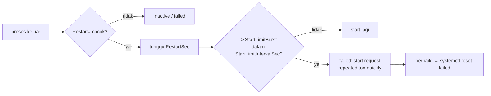
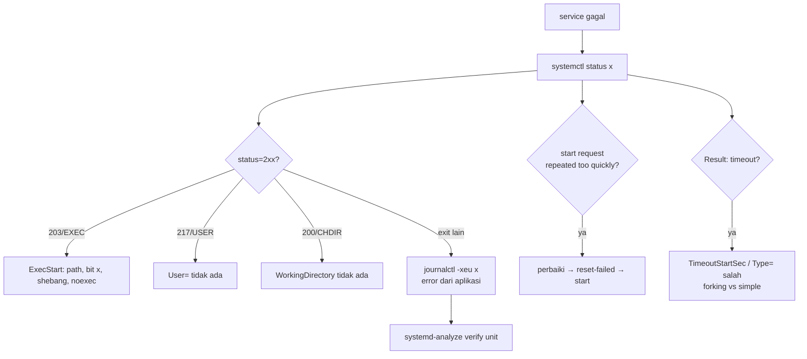

# Service & systemd

Hampir semua distro server modern (Ubuntu, Debian, RHEL, Fedora, SUSE) memakai **systemd** sebagai PID 1.
systemd menyalakan service saat boot, menjaganya tetap hidup, mengumpulkan log, menjalankan job terjadwal, dan
membatasi apa yang boleh dilakukan service. Modul ini membahas `systemctl`, unit file, drop-in, journal,
timer, hardening, dan cara membaca kegagalan service.

> [!NOTE]
> Semua perilaku di modul ini diuji ulang di Ubuntu 24.04 dengan systemd 255 yang berjalan sebagai PID 1 di
> container Docker `--privileged`. Distro lain dengan versi systemd berbeda bisa punya default atau fitur yang
> sedikit lain. Cek `systemctl --version`. Alpine memakai OpenRC, bukan systemd.

## 1. Unit dan lokasinya

systemd mengelola **unit**. Jenis yang paling sering dipakai:

| Jenis | Contoh | Fungsi |
|---|---|---|
| `.service` | `nginx.service` | Proses/daemon |
| `.timer` | `logrotate.timer` | Jadwal yang memicu service |
| `.socket` | `docker.socket` | Socket activation |
| `.target` | `multi-user.target` | Kelompok unit (pengganti runlevel) |
| `.mount` | `srv.mount` | Mount point |

| Lokasi | Pemilik | Prioritas |
|---|---|---|
| `/etc/systemd/system/` | **Admin** (kamu) | Tertinggi |
| `/run/systemd/system/` | Runtime | Menengah |
| `/usr/lib/systemd/system/` | Paket | Terendah — jangan diedit |

## 2. `systemctl` sehari-hari

```bash
systemctl status nginx
systemctl start|stop|restart nginx
systemctl reload nginx              # baca ulang config aplikasi (ExecReload)
systemctl enable --now nginx        # boot + sekarang
systemctl disable --now nginx
systemctl is-active nginx; systemctl is-enabled nginx
systemctl mask cups                 # tidak bisa di-start sama sekali
systemctl --failed
systemctl daemon-reload             # setelah mengubah FILE UNIT
```

> [!WARNING]
> Ada dua pasang perintah yang sering tertukar:
> - `enable` ≠ `start`. Di lab, setelah `disable`, service tetap `active` sampai di-stop.
> - `reload` ≠ `daemon-reload`. `reload` untuk config aplikasi, `daemon-reload` untuk file unit.
>
> Lupa `daemon-reload` memunculkan peringatan `changed on disk`, dan systemd tetap memakai unit versi lama.

## 3. Anatomi unit service

```ini
[Unit]
Description=Demo app
After=network.target postgresql.service   # urutan
Wants=postgresql.service                  # dependency lunak

[Service]
Type=exec
User=app
Group=app
WorkingDirectory=/srv/app
EnvironmentFile=/etc/app.env
ExecStart=/usr/local/bin/app --port 8080
Restart=on-failure
RestartSec=2
TimeoutStopSec=60

[Install]
WantedBy=multi-user.target
```

| Directive | Catatan dari lab |
|---|---|
| `Type=simple` (default) | `start` sukses **segera setelah fork** — binary yang tidak ada tetap `rc=0` |
| `Type=exec` | `start` gagal bila exec gagal (`rc=1`) — lebih jujur untuk skrip deploy |
| `Type=oneshot` | Untuk job yang selesai (dipakai timer); boleh banyak `ExecStart` |
| `Type=notify` | Aplikasi memberi tahu "siap" lewat sd_notify |
| `User=` | Lingkungan service minimal: `PATH=/usr/local/sbin:/usr/local/bin:/usr/sbin:/usr/bin`, **tanpa** `.bashrc` |
| `ExecStart=` | Path relatif diterima systemd 255 (dicari di PATH tetap), tapi path absolut tetap lebih jelas |
| `%` | Specifier. Di lab, `date +%F` membuat unit **ditolak** (`Failed to resolve unit specifiers`); tulis `%%F` |
| `Restart=on-failure` | Lab: `kill -9` → restart; exit 0 → tidak |

## 4. Drop-in: mengubah unit milik paket

```bash
systemctl edit nginx        # → /etc/systemd/system/nginx.service.d/override.conf
systemctl cat nginx         # lihat unit + semua drop-in yang berlaku
systemd-delta --type=extended
```

```ini
# override.conf
[Service]
ExecStart=
ExecStart=/usr/sbin/nginx -g 'daemon on; master_process on;' -c /etc/nginx/custom.conf
LimitNOFILE=65535
```

Setting yang berupa daftar (`ExecStart`, `Environment`, `ReadWritePaths`, ...) **ditambahkan** oleh drop-in.
Baris kosong `ExecStart=` mengosongkannya dulu. Di lab, tanpa baris itu: `Service has more than one ExecStart=
setting ... Refusing.`

## 5. Journal

```bash
journalctl -u nginx -f                # follow
journalctl -u nginx --since -1h       # atau "1 hour ago", "2026-11-20 09:00"
journalctl -u nginx -n 100 --no-pager
journalctl -p err -b                  # error sejak boot ini; -b -1 = boot sebelumnya
journalctl -k                         # pesan kernel (OOM killer, disk error)
journalctl -xeu nginx                 # akhir log + penjelasan (saran dari systemctl sendiri)
journalctl -u app -o json -n 1        # untuk dikirim ke pipeline log
journalctl --disk-usage; journalctl --vacuum-size=500M
```

> [!TIP]
> Di Ubuntu, journal persisten disimpan di `/var/log/journal`. Kalau direktori itu tidak ada (sering di image
> minimal), log hilang setiap reboot dan `-b -1` kosong. Batasi ukurannya lewat `SystemMaxUse=` di
> `/etc/systemd/journald.conf`.

## 6. Restart, start limit, dan stop



| Properti | Default (lab) | Arti |
|---|---|---|
| `StartLimitBurst` / `StartLimitIntervalSec` | 5 / 10s | Lebih dari 5 start dalam 10 detik → berhenti mencoba |
| `TimeoutStartSec` / `TimeoutStopSec` | 1min 30s | Batas waktu start / stop |
| `KillSignal` | 15 (SIGTERM) | Sinyal pertama saat stop |
| `KillMode` | `control-group` | Semua proses di cgroup ikut dihentikan |

Di lab:
- Service dengan `Restart=always` yang crash berulang berhenti setelah `NRestarts=5`.
- Service yang mengabaikan SIGTERM di-SIGKILL setelah `TimeoutStopSec`.
- Semua anak `sleep` ikut hilang saat stop, karena `KillMode=control-group`.

## 7. Timer: pengganti cron

```ini
# /etc/systemd/system/report.service
[Service]
Type=oneshot
User=app
ExecStart=/usr/bin/php /srv/app/artisan report:generate

# /etc/systemd/system/report.timer
[Timer]
OnCalendar=Mon..Fri *-*-* 02:00:00
Persistent=true             # jalankan yang terlewat saat server mati
RandomizedDelaySec=5m       # hindari semua server jalan bersamaan

[Install]
WantedBy=timers.target
```

```bash
systemctl enable --now report.timer
systemctl list-timers
systemd-analyze calendar 'Mon..Fri *-*-* 02:00:00'
systemctl start report.service      # uji jalankan sekarang
```

| Cron | systemd `OnCalendar` |
|---|---|
| `0 2 * * 1-5` | `Mon..Fri *-*-* 02:00:00` |
| `*/15 * * * *` | `*:0/15` |
| `@daily` | `daily` (= `*-*-* 00:00:00`) |

Keunggulan timer: log masuk journal (`journalctl -u report`), tidak tumpang tindih (service oneshot yang masih
jalan tidak di-start ulang), bisa memakai semua sandboxing systemd, dan ada `Persistent=`.

## 8. Hardening dan secret

```ini
[Service]
User=app
NoNewPrivileges=yes
ProtectSystem=strict
ReadWritePaths=/srv/app/storage
ProtectHome=yes
PrivateTmp=yes
```

```bash
systemd-analyze security app     # lab: 9.2 UNSAFE → 8.3 EXPOSED setelah 5 directive di atas
```

Di lab, dengan `ProtectSystem=strict` + `ReadWritePaths=/srv/app`, service bisa menulis ke `/srv/app`, tetapi
`touch /etc/x` dan `touch /usr/local/x` gagal: `Read-only file system`. Aplikasi yang terkompromi tidak bisa
mengubah binary atau config sistem.

> [!DANGER]
> Jangan taruh secret di `Environment=`. Di lab, user tanpa hak apa pun (`nobody`) membaca
> `Environment=... DB_PASSWORD=inline` hanya dengan `systemctl show -p Environment app`, karena properti unit
> terbuka lewat D-Bus. Nilai dari `EnvironmentFile=` (file mode 600) tidak tampil di properti itu. Dokumentasi
> systemd sendiri menyatakan environment variable tidak cocok untuk secret dan menyarankan `LoadCredential=`.
> Sumber: [systemd.exec(5) — Environment=](https://www.freedesktop.org/software/systemd/man/latest/systemd.exec.html#Environment=),
> [systemd Credentials](https://systemd.io/CREDENTIALS/)

## 9. Troubleshooting service yang gagal



| Kode | Arti (diuji di lab) |
|---|---|
| `200/CHDIR` | `WorkingDirectory=` tidak ada |
| `203/EXEC` | `ExecStart=` tidak bisa di-exec |
| `216/GROUP` | `Group=` tidak ada |
| `217/USER` | `User=` tidak ada |
| `status=9/KILL` + `Result: timeout` | Tidak berhenti dalam `TimeoutStopSec` |

> [!INSIGHT]
> systemd hanya memperingatkan key yang tidak dikenal, lalu tetap menjalankan unit. Di lab, typo `Restar=always`
> menghasilkan satu baris `Unknown key name 'Restar' ... ignoring` di journal, dan service berjalan **tanpa**
> restart otomatis. Masalahnya baru ketahuan saat service crash di production. Jalankan
> `systemd-analyze verify` di pipeline CI untuk setiap unit file.
> Sumber: [systemd-analyze(1)](https://www.freedesktop.org/software/systemd/man/latest/systemd-analyze.html)

## 10. Ringkasan kebiasaan aman

| Kebiasaan | Kenapa |
|---|---|
| Unit sendiri di `/etc/systemd/system`, override lewat `systemctl edit` | File paket bisa ditimpa saat upgrade |
| `daemon-reload` setelah mengubah unit | Kalau lupa, unit lama yang dipakai |
| `Type=exec` (atau `notify`) daripada `simple` | `systemctl start` melaporkan kegagalan |
| `systemd-analyze verify` di CI | Typo directive diabaikan diam-diam |
| `Restart=on-failure` + `RestartSec` | Pulih dari crash tanpa loop yang terlalu cepat |
| `TimeoutStopSec` ≥ durasi job terpanjang | Graceful shutdown tidak dipotong SIGKILL |
| `User=` non-root + `ProtectSystem=strict` + `ReadWritePaths` | Membatasi dampak bila service dibobol |
| Secret di `LoadCredential`/`EnvironmentFile` 600, bukan `Environment=` | `systemctl show` terbuka untuk semua user |
