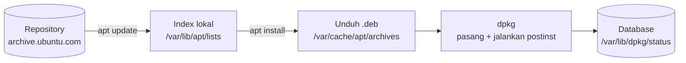
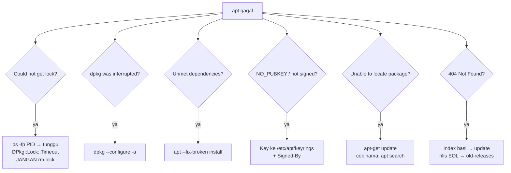

# Package Management (apt & dpkg)

Software di server Ubuntu/Debian dipasang, diperbarui, dan di-patch lewat **paket**. Untuk DevOps, paket
menyentuh banyak hal sekaligus: image Docker yang ramping, provisioning yang tidak macet, patch keamanan
yang benar-benar efektif, dan repository pihak ketiga yang tidak membuka celah supply chain. Modul ini
fokus pada apt/dpkg (Ubuntu 24.04), dengan tabel padanan dnf/rpm di akhir.

> [!NOTE]
> Semua output dan perilaku diuji ulang di container `ubuntu:24.04` (apt 2.8.4, dpkg 1.22.6) dan `rockylinux:9`.
> Image Docker Ubuntu adalah versi *minimal*: index apt kosong, dan man page/dokumentasi sengaja tidak
> dipasang. Server penuh berperilaku sedikit berbeda di dua hal itu.

## 1. Lapisan: dpkg vs apt



| Tool | Tugas | Mengurus dependency? |
|---|---|---|
| `dpkg` | Memasang/menghapus **file .deb** dan menyimpan database paket | Tidak — hanya mengecek |
| `apt-get`, `apt-cache` | Mengambil dari repository, menyelesaikan dependency, memanggil dpkg | Ya — stabil untuk skrip |
| `apt` | Antarmuka yang sama untuk manusia (progress bar, warna) | Ya — CLI tidak dijamin stabil |

## 2. Operasi harian

```bash
apt update                         # perbarui index (bukan paket!)
apt list --upgradable
apt upgrade                        # update paket, tidak menghapus apa pun
apt full-upgrade                   # boleh menambah/menghapus paket (kernel, rilis)
apt install -y nginx
apt install ./app.deb              # .deb lokal + dependency (./ wajib)
apt remove nginx                   # status rc: config di /etc tetap ada
apt purge nginx                    # termasuk config
apt autoremove                     # dependency yang sudah tidak dipakai
apt-get clean                      # kosongkan /var/cache/apt/archives
```

| Status `dpkg -l` | Arti |
|---|---|
| `ii` | Terpasang normal |
| `rc` | Sudah di-remove, file config masih ada |
| `iU` | Di-unpack tapi belum dikonfigurasi (dependency kurang) |
| `iF` | Konfigurasi gagal/terputus |
| `hi` | Terpasang dan di-hold |

## 3. Menelusuri paket

| Pertanyaan | Perintah | Contoh hasil di lab |
|---|---|---|
| File ini milik paket apa? | `dpkg -S /usr/bin/curl` | `curl: /usr/bin/curl` |
| Paket ini memasang file apa? | `dpkg -L curl` | `/usr/bin/curl`, ... |
| Versi berapa yang terpasang? | `dpkg -s curl` | `Version: 8.5.0-2ubuntu10.16` |
| Versi mana yang akan dipasang, dari repo mana? | `apt-cache policy curl` | `Candidate: ... 500 noble-updates/main` |
| Versi apa saja yang tersedia? | `apt list -a curl` / `apt-cache madison curl` | `8.5.0-2ubuntu10.16`, `8.5.0-2ubuntu10` |
| Siapa yang bergantung padanya? | `apt-cache rdepends --installed libssl3t64` | `libkrb5-3`, `openssl` |
| File-file paket berubah? | `dpkg -V openssh-server` | `??5?????? c /etc/ssh/ssh_config` |
| Siapa yang memasang apa, kapan? | `/var/log/apt/history.log` | `Commandline: apt-get install ...` |

> [!WARNING]
> Ubuntu 24.04 memakai *usrmerge*: `/bin` adalah symlink ke `/usr/bin`, tetapi database dpkg mencatat path aslinya.
> Di lab, `dpkg -S /bin/ls` → `no path found matching pattern`, sedangkan `dpkg -S /usr/bin/ls` → `coreutils`.
> Kalau `dpkg -S` gagal, coba `dpkg -S "$(readlink -f /bin/ls)"`.

## 4. Versi, hold, dan pinning

```bash
apt-cache madison nginx                   # versi yang tersedia
apt-get install nginx=1.24.0-2ubuntu7     # versi persis
apt-mark hold postgresql-16               # jangan ikut upgrade
apt-mark showhold
apt-mark unhold postgresql-16
apt-get upgrade -s                        # simulasi: lihat "kept back"
```

Hold cocok untuk komponen yang upgrade-nya harus terjadwal (database, driver, Kubernetes `kubelet`/`kubeadm`).
Tetapi setiap hold adalah utang patch: catat alasannya, dan periksa `apt-mark showhold` saat audit.

## 5. Repository pihak ketiga dengan aman

Cara modern (sesuai dokumentasi Docker untuk Ubuntu): key disimpan per repository dan direferensikan lewat
`Signed-By`.

```bash
sudo install -m 0755 -d /etc/apt/keyrings
sudo curl -fsSL https://download.docker.com/linux/ubuntu/gpg -o /etc/apt/keyrings/docker.asc
```

```text
# /etc/apt/sources.list.d/docker.sources
Types: deb
URIs: https://download.docker.com/linux/ubuntu
Suites: noble
Components: stable
Signed-By: /etc/apt/keyrings/docker.asc
```

Di lab:
- Tanpa key: `NO_PUBKEY 7EA0A9C3F273FCD8`, lalu `E: The repository ... is not signed`.
- Dengan `Signed-By`: index terunduh dan `docker-ce` muncul sebagai kandidat.

> [!DANGER]
> Jangan "memperbaiki" `NO_PUBKEY` dengan `[trusted=yes]` atau `AllowUnauthenticated`. Itu mematikan verifikasi
> tanda tangan: siapa pun yang bisa memanipulasi jalur jaringan atau mirror bisa menyuntikkan paket yang
> dijalankan sebagai root. Hindari juga `apt-key add`. Key yang dimasukkan ke keyring global dipercaya untuk
> **semua** repository, sehingga pemilik key itu bisa menandatangani paket pengganti `openssl` dari repo Ubuntu.
> Di lab, `apt-key` sendiri sudah memperingatkan: `Warning: apt-key is deprecated`.
> Sumber: [Debian Wiki — UseThirdParty](https://wiki.debian.org/DebianRepository/UseThirdParty)

## 6. apt di Dockerfile

```dockerfile
FROM ubuntu:24.04
ARG DEBIAN_FRONTEND=noninteractive
RUN apt-get update \
 && apt-get install -y --no-install-recommends ca-certificates curl git python3 \
 && rm -rf /var/lib/apt/lists/*
```

| Aturan | Alasan (hasil lab) |
|---|---|
| `update` dan `install` di RUN yang sama | Layer `update` yang terpisah di-cache, sehingga install berikutnya memakai index basi |
| `--no-install-recommends` | `git`: 47 → 24 paket |
| `rm -rf /var/lib/apt/lists/*` di RUN yang sama | Index 53 MB; menghapusnya di RUN lain tidak mengecilkan image |
| `ca-certificates` eksplisit | Ikut hilang saat Recommends dimatikan, padahal dibutuhkan untuk HTTPS |
| `ARG DEBIAN_FRONTEND` | Hanya berlaku saat build, tidak terbawa ke container |
| `apt-get`, bukan `apt` | Output `apt` tidak stabil untuk skrip |

Hasil gabungannya di lab: image **400 MB → 292 MB**.

## 7. Patch keamanan yang benar-benar efektif

```bash
apt-get update
apt list --upgradable
apt-get install -y --only-upgrade libssl3t64 openssl   # terarah
lsof -n | grep DEL | grep libssl                        # proses yang masih memakai versi lama
systemctl restart nginx
```

> [!INSIGHT]
> Meng-upgrade library tidak memperbaiki proses yang sudah berjalan: proses itu tetap memetakan file lama yang
> sudah dihapus. Di lab, setelah `libssl3t64` naik dari `3.0.13-0ubuntu3` ke `3.0.13-0ubuntu3.16`, proses
> `openssl` yang berjalan masih memakai `/usr/lib/x86_64-linux-gnu/libssl.so.3 (deleted)`, dan `lsof` menandainya
> `DEL`. Patch baru berlaku setelah service di-restart. Ubuntu Server menyertakan `needrestart` untuk mendeteksi hal ini.
> Sumber: [Ubuntu Server — Package management](https://documentation.ubuntu.com/server/how-to/software/package-management/)

Untuk patch otomatis, Ubuntu memakai `unattended-upgrades`. Di lab, setelah paket itu dipasang,
`/etc/apt/apt.conf.d/20auto-upgrades` berisi `Update-Package-Lists "1"` dan `Unattended-Upgrade "1"`. Dalam
konfigurasinya, `50unattended-upgrades` mengaktifkan origin `${distro_codename}` dan
`${distro_codename}-security`. Konsekuensinya: tak lama setelah boot, apt mungkin sedang dipakai (bagian 8).

## 8. Troubleshooting



| Pesan (direproduksi di lab) | Penyebab | Tindakan |
|---|---|---|
| `Could not get lock /var/lib/dpkg/lock-frontend. It is held by process 2408 (dpkg)` | dpkg/apt lain sedang berjalan | Tunggu; cek prosesnya |
| `dpkg was interrupted, you must manually run 'dpkg --configure -a'` | dpkg terbunuh di tengah jalan | `dpkg --configure -a` |
| `dependency problems - leaving unconfigured` | `dpkg -i` tanpa dependency | `apt --fix-broken install` |
| `Unable to locate package curl` | Index kosong/basi | `apt-get update` |
| `NO_PUBKEY ...` / `is not signed` | Key repo belum dipasang | `Signed-By` + keyring |

## 9. Padanan di keluarga RHEL (dnf/rpm)

| Tujuan | Debian/Ubuntu | RHEL/Rocky/Fedora |
|---|---|---|
| Install | `apt-get install -y nginx` | `dnf install -y nginx` |
| Hapus | `apt purge nginx` | `dnf remove nginx` |
| Cek update | `apt list --upgradable` | `dnf check-update` (exit 100 bila ada) |
| File milik paket apa | `dpkg -S /usr/bin/curl` | `rpm -qf /usr/bin/curl` / `dnf provides` |
| Isi paket | `dpkg -L curl` | `rpm -ql curl` |
| Tahan versi | `apt-mark hold` | `dnf versionlock add` (plugin) |
| Riwayat | `/var/log/apt/history.log` | `dnf history` |

Di Rocky 9 (lab), `rpm -qf /usr/bin/curl` menghasilkan `curl-minimal-7.76.1-43.el9.x86_64`. Nama paket tidak selalu sama dengan nama perintahnya.

## 10. Ringkasan kebiasaan aman

| Kebiasaan | Kenapa |
|---|---|
| `apt-get`/`apt-cache` di skrip | CLI `apt` tidak stabil |
| `update` + `install` + `rm lists` dalam satu RUN | Index tidak basi, image ramping |
| Key per repo + `Signed-By`; tidak pernah `trusted=yes` | Membatasi kepercayaan, mencegah paket palsu |
| Tidak menghapus lock / `kill -9` apt | Database dpkg bisa rusak |
| `dpkg --configure -a` → `apt --fix-broken install` | Urutan pemulihan standar |
| Restart service setelah upgrade library | Proses lama tetap memakai versi rentan |
| Audit `apt-mark showhold` | Hold yang terlupakan = patch yang tertinggal |
