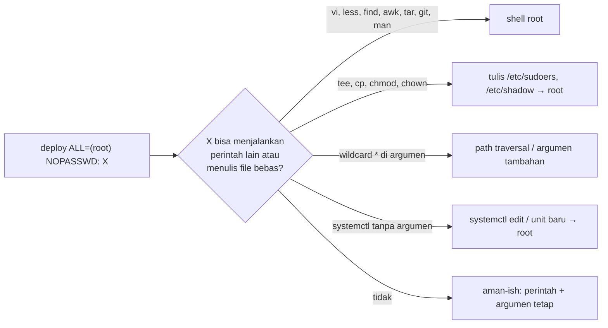

# User, Group & sudo

Setiap proses berjalan sebagai **user**, dan kernel mengecek akses berdasarkan **UID** dan **GID**, bukan nama.
Untuk DevOps/DevSecOps, area ini menentukan banyak hal sekaligus: user sistem untuk service, akses tim ke
server, offboarding yang benar-benar memutus akses, dan aturan sudo yang tidak diam-diam memberi root ke
semua orang. Modul ini melanjutkan modul Permission & Ownership.

> [!NOTE]
> Semua perilaku diuji ulang di container `ubuntu:24.04` (shadow 4.13, sudo 1.9.15p5, OpenSSH 9.6p1, PAM yescrypt).
> Di RHEL/Rocky, grup admin bernama `wheel`, perintah `adduser` adalah alias `useradd`, dan sshd tidak memakai
> patch Debian. Di lingkungan dengan LDAP/SSSD, pakai `getent` alih-alih membaca file di `/etc`.

## 1. Database akun

```text
/etc/passwd   bob:x:1002:1002::/home/bob:/bin/bash        (644, terbaca semua)
/etc/shadow   bob:$y$j9T...:20777:0:99999:7:::            (640 root:shadow)
/etc/group    sudo:x:27:ubuntu,bob                         (644)
```

| `/etc/passwd` | Isi |
|---|---|
| 1 nama · 2 `x` · 3 UID · 4 GID utama | `bob:x:1002:1002` |
| 5 GECOS · 6 home · 7 shell | `::/home/bob:/bin/bash` |

| Rentang UID (Ubuntu, `login.defs`) | Untuk |
|---|---|
| `0` | root |
| `1`–`999` | User sistem (service, paket) |
| `1000`–`60000` | User manusia |
| `65534` | `nobody` |

Awalan hash di `/etc/shadow`: `$y$` yescrypt (default Ubuntu 24.04), `$6$` SHA-512, `!` = terkunci,
`*` = tidak pernah punya password.

## 2. Membuat dan mengubah user

```bash
useradd -m -s /bin/bash -G sudo bob             # manusia: home + shell + grup
useradd -r -s /usr/sbin/nologin -d /srv/app -M app   # service: tanpa login, UID < 1000
adduser --system --group svc                     # versi Debian/Ubuntu (default nologin)
usermod -aG docker bob                           # tambah grup (APPEND!)
gpasswd -d bob docker                            # keluarkan dari satu grup
usermod -s /usr/sbin/nologin bob                 # ganti shell
passwd bob                                       # set password
userdel -r carol                                 # hapus + home
```

> [!DANGER]
> `usermod -G grup user` tanpa `-a` **mengganti** seluruh daftar grup tambahan. Di lab, bob yang tadinya
> `sudo docker` menjadi hanya `devs`, dan akses sudo-nya hilang. Kalau terjadi pada akunmu sendiri di server
> tanpa password root, satu-satunya jalan adalah console/recovery. Selalu `-aG`, atau pakai
> `gpasswd -a`/`adduser user grup`.

## 3. Menonaktifkan akun dengan benar

| Langkah | Memblokir | Hasil di lab |
|---|---|---|
| `passwd -l` / `usermod -L` | Login **password** | SSH key **tetap bisa** (UsePAM yes) |
| `usermod -s /usr/sbin/nologin` | Shell interaktif | `This account is currently not available` |
| `chage -E 0` | **Semua** login (akun kedaluwarsa) | SSH key ditolak |
| Hapus `~/.ssh/authorized_keys` | Login key | — |
| `gpasswd -d user sudo/docker`, hapus `sudoers.d` | Hak istimewa | — |
| `loginctl terminate-user` / `pkill -u` | Sesi berjalan | — |

> [!INSIGHT]
> `passwd -l` hanya menambahkan `!` di depan hash password. Di lab, setelah `passwd -l alice`, perintah
> `ssh -i key alice@host` tetap berhasil (`LOGIN-OK as alice`), karena autentikasi public key tidak memakai hash itu
> dan Ubuntu menjalankan sshd dengan `UsePAM yes`. Dengan `UsePAM no`, sshd sendiri menolak akun yang terkunci
> (`Permission denied`). Yang andal di keduanya: `chage -E 0` (akun kedaluwarsa).
> Sumber: [sshd_config(5) — UsePAM](https://man.openbsd.org/sshd_config#UsePAM),
> [chage(1)](https://man7.org/linux/man-pages/man1/chage.1.html)

## 4. `su` dan `sudo`

| Perintah | Hasil |
|---|---|
| `sudo cmd` | `cmd` sebagai root, dengan password **kamu** |
| `sudo -u www-data cmd` | Sebagai user lain |
| `sudo -i` | Login shell root (env root, `cd /root`) |
| `sudo -s` | Shell root, tetap di direktori saat ini |
| `su - bob` | Login shell bob, dengan password **bob** |
| `sudo -l` | Apa yang boleh kamu jalankan |
| `sudoedit file` | Edit file root dengan editor sebagai **kamu** (aman dari shell escape) |

```bash
echo maintenance | sudo tee /etc/motd.d/99-note >/dev/null   # bukan: sudo echo ... > file
sudo -u www-data php artisan cache:clear                      # bukan: sudo php artisan ...
```

`Defaults env_reset` dan `secure_path` (default Ubuntu) membuang environment dan mengganti `PATH`. Di lab,
`FOO` yang di-export hilang di bawah sudo.

## 5. Menulis aturan sudoers

```text
# user  host=(runas)        tag:        perintah (path absolut + argumen)
deploy  ALL=(root)          NOPASSWD:   /usr/bin/systemctl restart nginx
deploy  ALL=(www-data)      NOPASSWD:   /usr/bin/php /srv/app/artisan migrate --force
%ops    ALL=(ALL:ALL)       ALL
```

```bash
visudo -cf /tmp/deploy.sudoers                         # validasi dulu
install -m 440 -o root -g root /tmp/deploy.sudoers /etc/sudoers.d/deploy
sudo -l -U deploy
```

| Aturan | Kenapa (hasil lab) |
|---|---|
| Path absolut | `systemctl ...` ditolak visudo: `expected a fully-qualified path name` |
| Tulis argumennya | `/usr/bin/systemctl` tanpa argumen = boleh `systemctl` apa pun |
| Nama file tanpa `.` dan tanpa akhiran `~` | `deploy.conf` **diabaikan** tanpa error |
| Bukan world-writable (konvensi 0440) | Mode 666 → `is world writable`, aturan tidak dipakai |
| Selalu `visudo -c` | Satu syntax error bisa mematikan sudo untuk semua orang |

## 6. Aturan sudo yang diam-diam memberi root



> [!DANGER]
> Di lab, kedua aturan "sempit" ini menghasilkan `uid=0(root)`:
> - `NOPASSWD: /usr/bin/vi` → `sudo vi -c ':!id'`
> - `NOPASSWD: /usr/bin/find` → `sudo find /etc/hostname -exec id \;`
>
> Aturan `NOPASSWD: /usr/bin/cat /var/log/*` juga bisa dipakai membaca `/etc/shadow` lewat
> `sudo cat /var/log/../../etc/shadow`, karena `*` di sudoers cocok dengan apa pun, termasuk `/` dan `..`.
> Periksa setiap binary di aturan sudo terhadap GTFOBins. Pakai `sudoedit` untuk mengedit file, dan tag `NOEXEC:`
> sebagai lapisan tambahan (lab: `find: 'id': Permission denied`).
> Sumber: [GTFOBins](https://gtfobins.github.io/), [sudoers(5) — Wildcards](https://www.sudo.ws/docs/man/sudoers.man/)

## 7. UID hygiene: file tanpa pemilik dan UID yang dipakai ulang

```bash
userdel carol                     # home & file lain tetap ada
ls -l /srv/data/carol.txt         # -rw-r--r-- 1 1003 1005 ... (UID angka)
find / -xdev -nouser              # cari sebelum UID dipakai lagi
chown -R --from=1003 fin:finance /srv/data
```

> [!INSIGHT]
> `useradd` memberi UID = UID terbesar yang sedang dipakai + 1. Menghapus user dengan UID tertinggi membuat UID itu
> langsung dipakai user berikutnya. Di lab, `carol` (1003) dihapus, lalu `dave` dibuat dan mendapat `uid=1003`. File
> carol di `/srv/data` kini tampil `dave dave`, dan `find -nouser` tidak lagi menemukannya. Kernel hanya mengenal
> angka. Hal yang sama terjadi pada bind mount Docker: file milik UID 1000 di container tampil sebagai siapa pun
> yang ber-UID 1000 di host.
> Sumber: [useradd(8)](https://man7.org/linux/man-pages/man8/useradd.8.html),
> [userdel(8)](https://man7.org/linux/man-pages/man8/userdel.8.html)

## 8. Ringkasan kebiasaan aman

| Kebiasaan | Kenapa |
|---|---|
| Service berjalan sebagai user sistem `nologin` | Kompromi service ≠ shell login |
| `usermod -aG`, bukan `-G` | `-G` menghapus grup lain |
| Offboarding: `chage -E 0` + cabut key + cabut sudo/docker + putus sesi | `passwd -l` tidak memblokir SSH key |
| Inventaris file (`find -user`) sebelum `userdel` | UID dipakai ulang → user baru memiliki file lama |
| sudoers: path absolut + argumen, tanpa wildcard, tanpa binary GTFOBins | Aturan "sempit" bisa jadi root penuh |
| File di `sudoers.d` tanpa titik, mode 0440, divalidasi `visudo -cf` | Diabaikan diam-diam atau mematikan sudo |
| `sudo -u www-data` untuk perintah aplikasi | File milik root membuat aplikasi error |
| Anggap grup `docker` = root | Bisa mount `/` host ke container |
