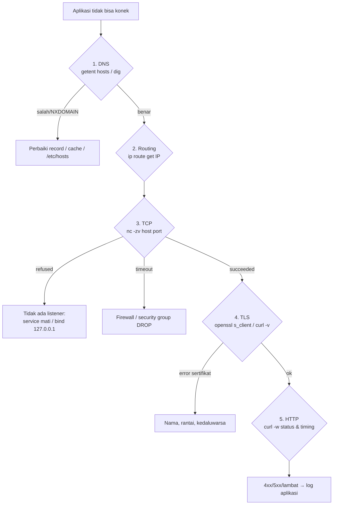

# Networking Dasar (ip, ss, DNS, curl, firewall)

"Aplikasi tidak bisa konek" adalah tiket paling umum yang diterima tim DevOps. Penyebabnya bisa ada di mana saja:
DNS yang menjawab IP lama, service yang hanya listen di localhost, firewall yang membuang paket, sertifikat yang
salah, atau aplikasi yang lambat. Modul ini membahas alat untuk memeriksa setiap lapisan itu satu per satu, dari
dalam server Linux.

> [!NOTE]
> Semua output diuji ulang di container `ubuntu:24.04` (`--privileged`, agar nftables/ufw/tcpdump bisa dipakai) pada
> jaringan bridge Docker Desktop. IP lab: `172.17.0.2/16`, gateway `172.17.0.1`. Nama dan IP seperti
> `db.internal`, `203.0.113.x`, dan `198.51.100.x` di soal adalah contoh (rentang dokumentasi RFC 5737).

## 1. Model berlapis



## 2. IP dan routing

```bash
ip -br a                  # ringkas: interface, status, IP
ip r                      # tabel routing (default via ...)
ip route get 1.1.1.1      # rute yang BENAR-BENAR dipakai
ip link                   # status link (UP/DOWN), MTU
ip neigh                  # tabel ARP (IP ↔ MAC di LAN)
```

```text
lo               UNKNOWN        127.0.0.1/8 ::1/128
eth0@if78        UP             172.17.0.2/16
default via 172.17.0.1 dev eth0
1.1.1.1 via 172.17.0.1 dev eth0 src 172.17.0.2
```

## 3. Port dan koneksi: `ss`

```bash
ss -tlnp                       # TCP listening + proses
ss -ulnp                       # UDP
ss -tn state established
ss -tlnp 'sport = :8001'
ss -s                          # ringkasan
```

| Local Address | Bisa dijangkau dari |
|---|---|
| `127.0.0.1:8000` | Host itu saja |
| `0.0.0.0:8001` / `*:8001` | Semua interface IPv4 |
| `[::]:80` | Semua interface IPv6 (sering juga IPv4) |
| `10.0.4.20:5432` | Hanya lewat IP itu |

Di lab, satu host dengan dua server Python: `curl 127.0.0.1:8000` → 200, `curl 172.17.0.2:8000` →
`Couldn't connect to server`, `curl 172.17.0.2:8001` → 200.

## 4. DNS

```bash
dig +short example.com
dig +noall +answer example.com          # dengan TTL: example.com. 89 IN A 104.20.23.154
dig +short @1.1.1.1 example.com AAAA
dig +short MX gmail.com
dig +short -x 1.1.1.1                   # reverse
dig nosuch.invalid | grep status        # NXDOMAIN
getent hosts api.internal               # seperti aplikasi (nsswitch)
resolvectl status                       # Ubuntu + systemd-resolved: upstream DNS sebenarnya
```

> [!INSIGHT]
> `dig`, `host`, dan `nslookup` **tidak** membaca `/etc/hosts`; mereka bicara langsung ke DNS server. Aplikasi
> (curl, PHP, Java) memakai resolver sistem yang mengikuti `/etc/nsswitch.conf` (`hosts: files dns`). Di lab, dengan
> `10.9.9.9 api.internal` di `/etc/hosts`: `getent hosts` → `10.9.9.9`, `dig +short` → kosong, dan `curl` mencoba
> konek ke `10.9.9.9`. Kalau "dig benar tapi aplikasi salah", hampir selalu ada entri tertinggal di `/etc/hosts`.
> Sumber: [nsswitch.conf(5)](https://man7.org/linux/man-pages/man5/nsswitch.conf.5.html)

**TTL** adalah lama (detik) sebuah jawaban boleh di-cache. Saat migrasi, record lama tetap dipakai resolver
sampai TTL-nya habis. Turunkan TTL **sebelum** pindah.

## 5. Refused vs timeout

| Gejala | Arti | Di lab |
|---|---|---|
| `succeeded` | TCP handshake berhasil | port 8001 |
| `Connection refused` (cepat) | Paket sampai, dibalas RST: tidak ada listener, atau firewall `reject` | port 9001, 0 ms |
| `timed out` | Tidak ada balasan: firewall `drop`, security group, route salah | port 9000 + `nft ... drop`, 3 detik |
| `No route to host` | Routing/ARP gagal, atau ICMP unreachable | — |

```bash
nc -zv -w 3 host 5432
curl -sS --connect-timeout 3 http://host:9000/
```

curl 8.5 menulis refused sebagai `Failed to connect ... after 0 ms: Couldn't connect to server`, dan timeout
sebagai `Connection timed out after 3002 milliseconds`.

## 6. HTTP dan TLS dari terminal

```bash
curl -sI https://example.com/
curl -s -o /dev/null -w '%{http_code}\n' https://example.com/
curl -s -o /dev/null -w 'dns=%{time_namelookup} connect=%{time_connect} tls=%{time_appconnect} ttfb=%{time_starttransfer} total=%{time_total}\n' https://example.com/
curl --resolve shop.example.com:443:203.0.113.10 https://shop.example.com/   # uji server baru
curl -H 'Host: shop.example.com' http://127.0.0.1/                           # vhost lewat HTTP
curl --cacert /etc/ssl/internal-ca.pem https://api.internal/                 # CA internal
echo | openssl s_client -connect example.com:443 -servername example.com 2>/dev/null \
  | openssl x509 -noout -subject -issuer -enddate
```

Hasil di lab:
- `dns=0.002 connect=0.076 tls=0.244 ttfb=0.345 total=0.345`
- Server Python yang mencetak header Host: `host=127.0.0.1:8002`, dan dengan `-H 'Host: shop.example.com'` →
  `host=shop.example.com`

> [!DANGER]
> `curl -k` / `--insecure` mematikan **seluruh** verifikasi sertifikat, sehingga siapa pun di jalur jaringan bisa
> menyamar sebagai servermu. Di lab, `-k` menerima sertifikat self-signed tanpa protes. Untuk CA internal, pakai
> `--cacert`, atau pasang CA ke trust store sistem (`update-ca-certificates`). Jangan pernah membiarkan `-k` ada di
> skrip deploy atau healthcheck production.
> Sumber: [curl — --insecure](https://curl.se/docs/manpage.html#-k)

## 7. Firewall: ufw dan nftables

```bash
sudo ufw default deny incoming
sudo ufw default allow outgoing
sudo ufw limit 22/tcp                         # SSH dulu!
sudo ufw allow 80/tcp
sudo ufw allow 443/tcp
sudo ufw allow from 10.0.0.0/8 to any port 5432 proto tcp
sudo ufw enable
sudo ufw status verbose
sudo ufw status numbered && sudo ufw delete 2
sudo nft list ruleset                          # aturan sebenarnya di kernel
```

ufw adalah frontend: di lab, setelah beberapa rule ufw, `nft list ruleset` menghasilkan 320 baris aturan.
nftables adalah pengganti modern iptables. Rule ad-hoc untuk menguji DROP di lab:

```bash
nft add table inet lab
nft add chain inet lab input '{ type filter hook input priority 0; }'
nft add rule inet lab input tcp dport 9000 drop
nft delete table inet lab
```

> [!WARNING]
> **Docker vs ufw.** Port yang di-publish dengan `docker run -p 8080:80` diproses aturan NAT/forward milik Docker
> sebelum chain yang diatur ufw, sehingga port itu terbuka walaupun ufw `deny incoming`. Ini tercatat di
> dokumentasi Docker (bagian "Docker and ufw"), tidak kami uji di lab. Publish ke `127.0.0.1:PORT:PORT` untuk service
> internal, dan taruh reverse proxy di depan untuk yang publik.
> Sumber: [Docker Docs — Packet filtering and firewalls](https://docs.docker.com/engine/network/packet-filtering-firewalls/)

## 8. Melihat paket: tcpdump

```bash
sudo tcpdump -i any -nn -c 20 tcp port 443
sudo tcpdump -i eth0 -nn host 10.0.4.20 and port 5432
sudo tcpdump -i any -nn -w /tmp/cap.pcap port 80    # buka dengan Wireshark
```

```text
IP 127.0.0.1.50648 > 127.0.0.1.8001: Flags [S], ...       ← SYN
IP 127.0.0.1.8001 > 127.0.0.1.50648: Flags [S.], ...      ← SYN-ACK
IP 127.0.0.1.50648 > 127.0.0.1.8001: Flags [.], ack 1 ... ← ACK
```

SYN tanpa SYN-ACK = paket hilang/di-drop. `[R]` = ditolak (refused).

## 9. Ringkasan kebiasaan aman

| Kebiasaan | Kenapa |
|---|---|
| Diagnosis berlapis: DNS → route → TCP → TLS → HTTP | Langsung tahu lapisan yang rusak |
| `getent hosts`, bukan hanya `dig` | Aplikasi juga membaca `/etc/hosts` |
| Bedakan refused vs timeout | Tidak ada listener vs firewall |
| Database/Redis listen di localhost/IP privat + firewall per sumber | Dua lapis pertahanan |
| `ufw allow 22` sebelum `ufw enable`, uji dari sesi kedua | Tidak mengunci diri sendiri |
| `--resolve` untuk menguji migrasi, turunkan TTL sebelum pindah | Migrasi tanpa downtime yang membingungkan |
| `--cacert`, bukan `-k` | Verifikasi TLS tetap hidup |
| Publish port Docker ke `127.0.0.1` bila tidak publik | Docker melewati ufw |
