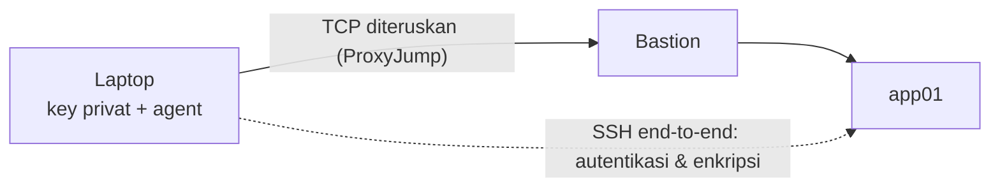

# SSH & Hardening

SSH adalah pintu masuk utama ke server Linux, dan karena itu juga pintu yang paling sering dicoba penyerang. Modul
ini membahas penggunaan SSH sehari-hari yang aman (key, config, bastion, tunnel, transfer file), cara mengeraskan
sshd dengan konfigurasi yang benar-benar berlaku, dan cara merespons ketika ada yang berhasil masuk. Modul ini
juga menutup board Linux: banyak kebiasaan dari modul sebelumnya bertemu di sini.

> [!NOTE]
> Semua perilaku diuji di Ubuntu 24.04 dengan OpenSSH 9.6p1. Lab memakai dua sshd (port 22 sebagai bastion dan
> 2222 sebagai target) untuk ProxyJump, dua container terpisah untuk fail2ban, dan image systemd untuk ssh.socket.
> IP `203.0.113.x`, `bastion.example.com`, dan `db01` di soal adalah contoh.

## 1. Key SSH

```bash
ssh-keygen -t ed25519 -C "dev@laptop"        # beri passphrase
ssh-copy-id ops@10.0.0.5                     # pasang ke authorized_keys server
ssh-keygen -lf ~/.ssh/id_ed25519.pub         # fingerprint: 256 SHA256:... dev@laptop (ED25519)
eval "$(ssh-agent -s)" && ssh-add ~/.ssh/id_ed25519
```

| File | Sisi | Mode |
|---|---|---|
| `~/.ssh/id_ed25519` | Klien — **rahasia** | 600 |
| `~/.ssh/id_ed25519.pub` | Klien — boleh dibagikan | 644 |
| `~/.ssh/known_hosts` | Klien — host key server yang dipercaya | 644 |
| `~/.ssh/config` | Klien — alias & opsi | 600 |
| `~/.ssh/authorized_keys` | Server — key yang boleh login | 600 |

## 2. `~/.ssh/config`, bastion, dan agent

```text
Host bastion
    HostName bastion.example.com
    User ops
    IdentityFile ~/.ssh/id_ed25519
    IdentitiesOnly yes
    ForwardAgent no

Host app01
    HostName 10.0.4.11
    User deploy
    ProxyJump bastion
```

```bash
ssh app01                    # lab: "via-jump", log target: Accepted publickey ... from bastion
ssh -G app01 | grep -E '^(hostname|port|user|proxyjump) '
ssh -J ops@bastion.example.com deploy@10.0.4.11     # tanpa config
```



> [!DANGER]
> **Agent forwarding (`ssh -A`)** membuka socket agent-mu di server tujuan. Root di server itu (atau penyerang yang
> menjadi root) bisa memakai agent-mu untuk login ke server lain atas namamu selama sesimu terbuka. ProxyJump
> memberi hasil yang sama (login ke host di belakang bastion) tanpa membawa agent ke mana pun. Set
> `ForwardAgent no` sebagai default, dan `AllowAgentForwarding no` di bastion.
> Sumber: [ssh_config(5) — ForwardAgent](https://man.openbsd.org/ssh_config#ForwardAgent)

## 3. Host key dan `known_hosts`

Saat pertama konek, ssh menyimpan host key server. Bila key itu berubah, ssh menolak dengan peringatan besar. Di lab:

```text
@    WARNING: REMOTE HOST IDENTIFICATION HAS CHANGED!     @
Offending ECDSA key in /home/dev/.ssh/known_hosts:3
Host key verification failed.
```

Penyebabnya bisa server yang di-reinstall atau ada yang menyamar (MITM). Prosedurnya:
1. Cocokkan fingerprint dari jalur lain (konsol cloud, orang di lokasi): `ssh-keygen -lf /etc/ssh/ssh_host_ed25519_key.pub`.
2. Baru setelah cocok, jalankan `ssh-keygen -R host`.

Jangan memakai `StrictHostKeyChecking=no` atau `UserKnownHostsFile=/dev/null` sebagai kebiasaan. Untuk
otomatisasi, pakai `accept-new` (hanya menerima host yang belum dikenal) atau distribusikan `known_hosts`.

## 4. Tunnel

| Opsi | Arah | Contoh |
|---|---|---|
| `-L 5433:127.0.0.1:5432` | Port **lokal** → tujuan dari sudut pandang server | Akses DB yang listen di localhost server |
| `-R 9000:127.0.0.1:3000` | Port **di server** → tujuan di sisi klien | Tunjukkan app lokal ke server |
| `-D 1080` | SOCKS proxy dinamis | Browsing lewat server |
| `-N` / `-f` | Tanpa shell / ke background | Tunnel saja |

Di lab: `ssh -fN -L 9000:127.0.0.1:8000 bastion`, lalu `curl localhost:9000` → `200` ke service yang hanya listen di
`127.0.0.1:8000` milik server.

## 5. Transfer file

```bash
scp file.gz ops@10.0.0.5:/tmp/              # scp: port pakai -P besar
rsync -az --delete --dry-run -v site/ deploy@10.0.0.5:/var/www/site/   # lihat dulu
rsync -az --delete site/ deploy@10.0.0.5:/var/www/site/
```

Di lab:
- `rsync site/` mengirim **isi** direktori, sedangkan `rsync site` membuat `/tujuan/site/`.
- File yang dihapus di sumber tetap ada di tujuan, sampai rsync dijalankan dengan `--delete`.
- `--dry-run -v` mencetak `deleting old.txt` sebelum benar-benar menghapus.

## 6. Hardening sshd

```text
# /etc/ssh/sshd_config.d/10-hardening.conf
PasswordAuthentication no
KbdInteractiveAuthentication no
PermitRootLogin no
AllowUsers ops deploy
MaxAuthTries 3
X11Forwarding no
AllowAgentForwarding no          # opsional, untuk bastion
```

```bash
sudo sshd -t                                    # syntax
sudo sshd -T | grep -E '^(passwordauthentication|permitrootlogin|allowusers|maxauthtries) '
sudo systemctl reload ssh                       # uji dari terminal BARU
```

| Directive | Hasil lab setelah diterapkan |
|---|---|
| `PasswordAuthentication no` | Login password → `Permission denied (publickey)` |
| `PermitRootLogin no` | root dengan key valid → ditolak |
| `AllowUsers ops` | `dev` dengan key valid → `not listed in AllowUsers` |
| `MaxAuthTries 3` | Batas percobaan per koneksi |

> [!WARNING]
> Dua jebakan khas Ubuntu 24.04, keduanya direproduksi di lab:
> 1. **Drop-in menang.** `Include /etc/ssh/sshd_config.d/*.conf` ada di awal `sshd_config`, dan sshd memakai nilai
>    **pertama**. `50-cloud-init.conf` berisi `PasswordAuthentication yes` akan mengalahkan `no` di file utama. Selalu
>    cek dengan `sshd -T`.
> 2. **Socket activation.** Port dipegang `ssh.socket`. Setelah mengganti `Port`, `systemctl restart ssh` saja tetap
>    listen di `:22`. Perlu `systemctl daemon-reload && systemctl restart ssh.socket`. Buka port baru di firewall dulu.
> Sumber: [Ubuntu Discourse — socket-based activation](https://discourse.ubuntu.com/t/sshd-now-uses-socket-based-activation-ubuntu-22-10-and-later/30189)

## 7. Membatasi key per kegunaan

```text
# ~/.ssh/authorized_keys
ssh-ed25519 AAAA... dev@laptop
from="10.0.4.0/24",restrict,command="/usr/local/bin/backup-receive" ssh-ed25519 AAAA... backup@ci
restrict,port-forwarding,permitopen="127.0.0.1:5432" ssh-ed25519 AAAA... dbtunnel@analyst
```

Di lab:
- `restrict,command="/usr/bin/uptime"` membuat `ssh host "cat /etc/shadow"` hanya mencetak `uptime`, dan port
  forward ditolak (`refused local port forward`).
- `from="10.9.9.0/24"` dari alamat lain → `Permission denied`.

Key untuk mesin (CI, backup, monitoring) sebaiknya **selalu** dibatasi seperti ini.

## 8. Brute force: fail2ban dan log

```ini
# /etc/fail2ban/jail.local
[sshd]
enabled  = true
maxretry = 3
findtime = 10m
bantime  = 1h
ignoreip = 127.0.0.1/8 10.0.0.0/8
```

```bash
sudo fail2ban-client status sshd
sudo fail2ban-client set sshd unbanip 203.0.113.7
journalctl -u ssh --since today | grep 'Failed password' | grep -oE 'from [0-9.]+' | sort | uniq -c | sort -rn
last -i | head; sudo lastb | head
```

> [!INSIGHT]
> Di lab, fail2ban **tidak** mem-ban apa pun saat serangan datang dari IP server itu sendiri (`ignoreself`, default
> true). Ketika diuji dari container lain, setelah 3 password salah: `Banned IP list: 172.18.0.3`, dan percobaan
> berikutnya, **termasuk dengan password yang benar**, langsung `Connection refused`. fail2ban mengurangi kebisingan dan
> memperlambat brute force, tetapi bukan pengganti `PasswordAuthentication no`. Dengan password mati, brute force
> password tidak punya peluang sama sekali.
> Sumber: [fail2ban jail.conf](https://github.com/fail2ban/fail2ban/blob/master/config/jail.conf)

## 9. Checklist hardening server Linux (rangkuman board)

| Area | Minimal | Modul |
|---|---|---|
| Akses | Key-only, tanpa root login, `AllowUsers/Groups`, MFA/bastion bila perlu | SSH & Hardening |
| Akun | User per orang, offboarding `chage -E 0`, sudo least-privilege | User, Group & sudo |
| Patch | `unattended-upgrades`, restart service setelah upgrade library | Package Management |
| Jaringan | Service internal listen di localhost/privat, ufw default deny, hati-hati Docker `-p` | Networking Dasar |
| Service | User non-root, sandbox systemd, secret bukan di `Environment=` | Service & systemd |
| File | Tanpa 777, secret 600/640, audit SUID & world-writable | Permission & Ownership |
| Deteksi | Log terpusat, fail2ban, alert login password yang berhasil | SSH & Hardening |
| Otomasi | Skrip `set -euo pipefail`, shellcheck, tanpa secret di argumen | Bash Scripting, Process |

Tool audit seperti **Lynis** atau CIS Benchmark untuk Ubuntu 24.04 bisa memeriksa ratusan item di atas secara
otomatis. Hasilnya adalah daftar tugas, bukan skor yang harus 100.

## 10. Ringkasan kebiasaan aman

| Kebiasaan | Kenapa |
|---|---|
| Ed25519 + passphrase + agent; satu key per orang/perangkat | Mudah dicabut, aman bila laptop hilang |
| ProxyJump, bukan `-A` | Agent tidak terekspos di server lain |
| Verifikasi fingerprint sebelum `ssh-keygen -R` | Peringatan host key bisa berarti MITM |
| Hardening di drop-in `10-*.conf` + `sshd -t` + `sshd -T` | Drop-in lain bisa menimpa; config rusak = terkunci |
| Uji dari terminal baru sebelum menutup sesi | Rollback masih mungkin |
| `restrict,command=,from=` untuk key mesin | Key bocor berdampak minimal |
| Password login mati + fail2ban + alert `Accepted password` | Brute force jadi tidak relevan |
| Respons insiden: amankan log, `chage -E 0`, cek key & cron, rotasi secret | `passwd -l` tidak memblokir key |
