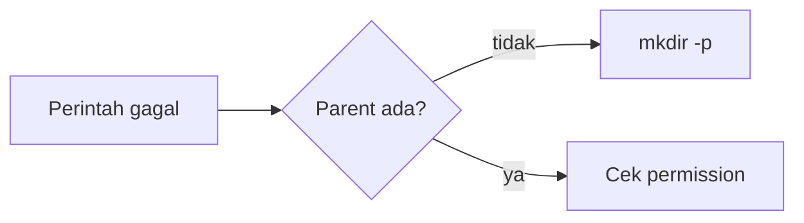

---
# ============================================================================
# TEMPLATE MODUL devops-dojo — format v1
# Satu file = satu modul. Ganti SEMUA isi contoh di bawah dengan topikmu.
# Baris yang diawali '#' adalah komentar YAML dan boleh dihapus.
#
# Aturan penting (file ditolak kalau dilanggar):
# - Semua jawaban berupa STRING. Tulis '0644', bukan 0644.
# - Pakai kutip tunggal untuk command dan regex; kutip tunggal di dalamnya ditulis dua kali: 'echo ''hai'''.
# - Regex = PCRE, beri jangkar ^...$, dicocokkan ke jawaban yang sudah dinormalisasi
#   (prompt "$ " dan awalan "sudo " dibuang, spasi dirapikan, kutip shell dibuang).
# - Setiap `answers` dan `tests.pass` HARUS dinilai benar; setiap `tests.fail` HARUS dinilai salah.
#   Isi tests.fail dengan kesalahan yang realistis, supaya regex tidak terlalu longgar.
# - Scenario (tier C) wajib punya minimal satu `tests.pass`.
# ============================================================================
format: 1
id: __BOARD__-contoh-modul          # slug unik: huruf kecil, angka, strip. Jangan diganti setelah diimpor.
title: Contoh Modul                 # judul modul
summary: Ringkasan satu kalimat yang tampil di daftar modul.
order: 1                            # urutan modul di board (1, 2, 3, ...)
version: 1                          # naikkan setiap kali isi file diubah
status: draft                       # biarkan draft; tandai terverifikasi di aplikasi setelah dicek
updated: '2026-11-20'               # tanggal, tulis sebagai string
tested_on:                          # di mana command diuji (kosongkan [] kalau belum)
  - Ubuntu 24.04 LTS
quiz:                               # jumlah soal per sesi kuis
  A: 10
  B: 8
  C: 2
objectives:                         # tujuan belajar; id dipakai di field `objective` soal
  - id: buat-direktori
    text: Membuat direktori bertingkat dengan `mkdir`
  - id: troubleshoot
    text: Mendiagnosis masalah langkah demi langkah
sources:                            # sumber utama: dokumentasi resmi / man page / standar
  - title: mkdir(1) — Linux manual page
    url: https://man7.org/linux/man-pages/man1/mkdir.1.html
questions:
  # --- Tier A: recall syntax & konsep dasar -----------------------------------
  - id: a01
    tier: A
    type: command                   # jawab dengan mengetik perintah
    objective: buat-direktori
    prompt: Buat direktori `/srv/app/logs` sekaligus semua parent-nya yang belum ada.
    answers: ['mkdir -p /srv/app/logs']          # jawaban pertama = yang ditampilkan sebagai kunci
    patterns: ['^mkdir (-p|--parents) /srv/app/logs/?$']
    tests:
      pass: ['mkdir --parents /srv/app/logs', 'sudo mkdir -p /srv/app/logs/']
      fail: ['mkdir /srv/app/logs', 'mkdir -r /srv/app/logs']
    explanation: '`-p` membuat parent yang belum ada dan tidak error kalau direktori sudah ada.'
    source: https://man7.org/linux/man-pages/man1/mkdir.1.html

  - id: a02
    tier: A
    type: text                      # isian singkat, tidak peka huruf besar/kecil
    objective: buat-direktori
    prompt: Opsi panjang (long option) dari `mkdir -p` adalah?
    answers: ['--parents']
    tests:
      fail: ['-p', '--recursive']
    source: https://man7.org/linux/man-pages/man1/mkdir.1.html

  # --- Tier B: kombinasi opsi, audit, debugging --------------------------------
  - id: b01
    tier: B
    type: command
    objective: buat-direktori
    prompt: Buat `/srv/app/cache` (beserta parent-nya) dengan mode `750` dalam satu perintah.
    answers: ['mkdir -p -m 750 /srv/app/cache']
    patterns: ['^mkdir (-p -m ?0?750|-m ?0?750 -p|-pm ?0?750|--parents --mode=0?750|--mode=0?750 --parents) /srv/app/cache/?$']
    tests:
      pass: ['mkdir -m 750 -p /srv/app/cache', 'mkdir -pm 750 /srv/app/cache']
      fail: ['mkdir -p /srv/app/cache', 'mkdir -m 755 -p /srv/app/cache']
    explanation: '`-m` hanya berlaku untuk direktori terakhir; parent yang ikut dibuat memakai mode default (umask).'
    source: https://man7.org/linux/man-pages/man1/mkdir.1.html

  # --- Tier C: studi kasus multi-langkah ---------------------------------------
  - id: c01
    tier: C
    type: scenario                  # jawaban multi-baris, dinilai dengan checklist regex
    objective: troubleshoot
    prompt: |
      Deploy gagal dengan error di bawah. Tulis langkah diagnosis dan perbaikannya,
      satu perintah per baris.
    context: |
      $ ./deploy.sh
      mkdir: cannot create directory '/srv/app/releases/42': No such file or directory
    checklist:
      - id: diagnose
        label: Mengecek apakah parent directory ada
        patterns: ['ls\s+(-\S+\s+)*/srv/app', 'namei\s+']
      - id: fix
        label: Membuat direktori beserta parent-nya
        required: true              # wajib ada supaya lulus
        patterns: ['mkdir\s+(-\S*p\S*|--parents)\b']
      - id: no-777
        label: Tidak memberi permission 777
        forbid: true                # anti-pattern: kalau terdeteksi, otomatis gagal
        patterns: ['chmod\s+(-\S+\s+)*0?777\b']
    solution: |
      ```bash
      ls -ld /srv/app            # parent belum ada
      mkdir -p /srv/app/releases/42
      ```
    tests:
      pass: ["ls -ld /srv/app\nmkdir -p /srv/app/releases/42"]
      fail: ['mkdir /srv/app/releases/42', "mkdir -p /srv/app/releases/42\nchmod -R 777 /srv/app"]
    source: https://man7.org/linux/man-pages/man1/mkdir.1.html
---

# Contoh Modul

Paragraf pembuka: apa yang dipelajari dan kenapa penting di pekerjaan DevOps.

## Konsep

Jelaskan konsep dengan bahasa sederhana. Tabel GFM boleh dipakai:

| Opsi | Arti |
|---|---|
| `-p` | buat parent yang belum ada |
| `-m MODE` | set mode direktori yang dibuat |

```bash
mkdir -p /srv/app/logs
```



## Troubleshooting

Langkah diagnosis yang benar, dari yang paling murah dicek.

> [!TIP]
> Tips praktis.

> [!WARNING]
> Kesalahan umum dan akibatnya.

> [!INSIGHT]
> Pengalaman lapangan WAJIB punya sumber yang bisa diperiksa (postmortem, thread, blog engineering).
> Sumber: [judul sumber](https://man7.org/linux/man-pages/man1/mkdir.1.html)
